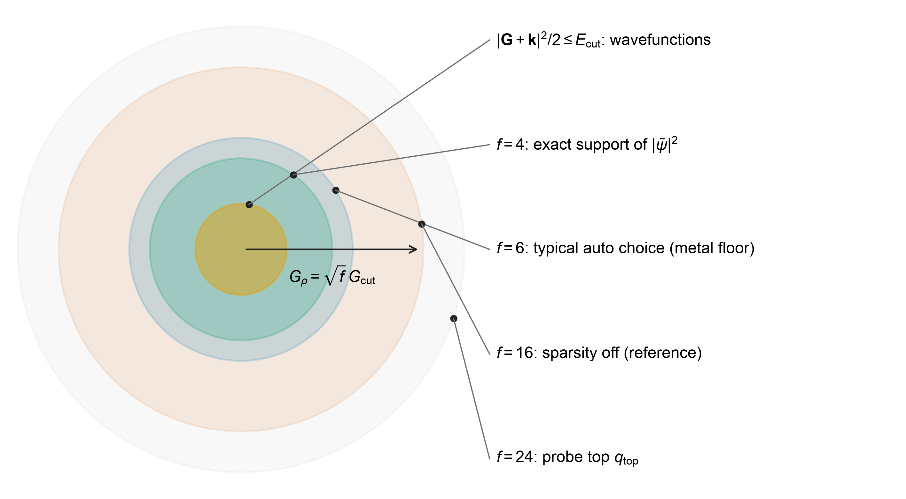
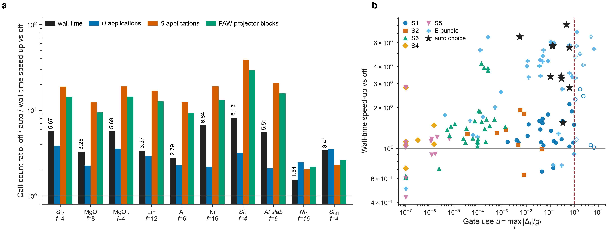
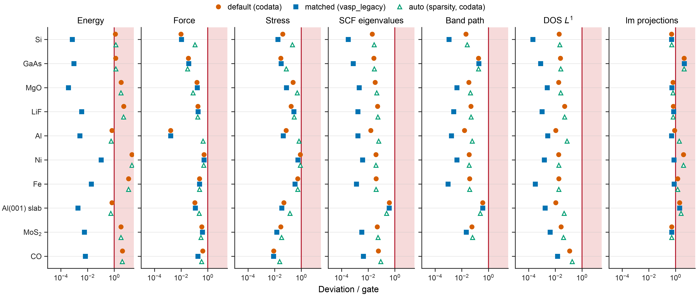
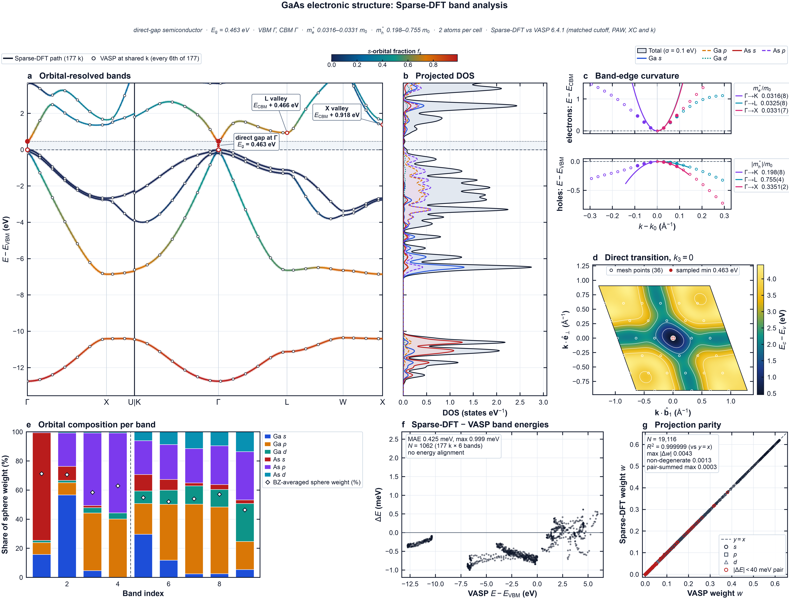

**English** · [简体中文](README.zh-CN.md) · [Theory](docs/THEORY.md) · [Sparsification](docs/SPARSIFICATION.md) · [Accuracy](docs/ACCURACY.md) · [Performance](docs/PERFORMANCE.md) · [User guide](docs/USER_GUIDE.md)

# Sparse-DFT

Sparse-DFT implements the **Sparse Density Function method** for plane-wave projector augmented-wave (PAW) calculations with the PBE functional. The method removes the Fourier support and solver work that a given system does not need. It estimates the omitted part before each run and certifies after it that the converged answer still meets the same tests.

Around the method, Sparse-DFT provides a C++20 core, a Python command line and API, a PyQt6 interface, and OpenMP, MPI, Apple Metal and CUDA back-ends. It computes total energies, forces, stress, relaxations, band structures, densities of states (DOS) and lm-resolved orbital projections, for spin-unpolarised and collinear-spin systems, with optional DFT+U.

## The idea

A plane-wave PAW calculation keeps densities on a Fourier sphere $\tfrac12|\mathbf G|^2\le E_\rho$. The smooth density needs only $E_\rho = 4E_\mathrm{cut}$, but the localised compensation and partial-core charges have long spectral tails. Sparse-DFT's exact reference therefore uses $E_\rho = 16E_\mathrm{cut}$. Most of the ring between $4E_\mathrm{cut}$ and $16E_\mathrm{cut}$ carries very little charge, and how little depends on the PAW datasets.

Before the SCF, a spectrum probe integrates the compensation form factors $g_{s,L}(q)$ of every dataset beyond each candidate sphere, weighted by the free-atom multipoles $w_{s,L}$:

$$T(f) = \sum_s\sum_L w_{s,L}^2\int_{q(fE_\mathrm{cut})}^{q(24E_\mathrm{cut})}|g_{s,L}(q)|^2\,q^2\,dq .$$

Auto mode picks the smallest density factor $f = E_\rho/E_\mathrm{cut}$ whose tail meets a calibrated budget, and applies rules for the XC grid and the eigensolver. The number of density modes falls as $(f/16)^{3/2}$, that is to 1/8 at $f = 4$. Components that only change how the eigensolver searches are accepted only if every eigenpair still passes the FP64 residual test $\|\tilde Hx-\varepsilon\tilde Sx\|\le10^{-12}$ Ha on the original operators.



*Reciprocal-space supports drawn to scale (schematic geometry drawn by code). $E_\mathrm{cut}$, wavefunction cutoff; $f$, density support factor; $q_\mathrm{top}$, upper end of the spectrum probe. Details: [SPARSIFICATION.md](docs/SPARSIFICATION.md).*

## Results at a glance

All numbers are measured, on an Apple M5 Max shared with other jobs; conditions and sources are in the linked pages.

- **Sparsity auto saves work and keeps the result.** On six fit and four hold-out systems, auto passes the same gates as the exact discretisation ($f = 16$) with 2.1–3.9 times fewer Hamiltonian operator calls and wall-time ratios of 1.54–8.13. Si$_{64}$: 1778 → 522 s. Every eigenpair still passes the FP64 certificate. [SPARSIFICATION.md](docs/SPARSIFICATION.md#5-what-auto-saves)
- **Accuracy against VASP 6.4.1 under matched settings** on ten systems (Si, GaAs, MgO, LiF, Al, Ni, Fe, an Al(001) slab, MoS$_2$, CO): same PAW datasets, cutoff, k mesh and bands, with `--atomic-units vasp_legacy`. Every SCF check passes: energy within $1.05\times10^{-4}$ eV/atom, forces within $5.3\times10^{-4}$ eV/Å, stress within $5.5\times10^{-3}$ GPa. Band paths agree within 1.9 meV (gate 5 meV) and the DOS within a normalised $L^1$ difference of $1.5\times10^{-4}$ (gate 1 %). The lm projections fail on two systems, GaAs and the Al slab; the GaAs cause is still open. [ACCURACY.md](docs/ACCURACY.md)
- **Optimised eigensolver, unchanged result.** Converged Si$_8$ at 8 threads takes 23.5 s against 48.3 s for the baseline build, with the energy unchanged to $2.8\times10^{-12}$ eV. The Si$_{64}$ eigensolver replay takes 49.2 s against 323.5 s. [PERFORMANCE.md](docs/PERFORMANCE.md)

| | |
|---|---|
|  |  |
| *Wall-time and operator-call ratios of auto.* | *Deviation from VASP over its gate, three tiers.* |

## Quick start

```bash
# 1. build and install (CPU + OpenMP; --backend metal on macOS)
python3 scripts/install.py
source .install/env.sh

# 2. convert your own licensed POTCAR set once (never redistribute the result)
sparse-dft paw-convert /path/to/potpaw_PBE.54 --out ~/paw/potpaw_PBE.54-json
export PAW=~/paw/potpaw_PBE.54-json

# 3. first SCF with sparsity
sparse-dft suggest examples/Si.POSCAR --paw-root $PAW --argv
OMP_NUM_THREADS=8 sparse-dft scf examples/Si.POSCAR --paw-root $PAW --out si_scf \
    --scf-grid 8 8 8 --sparsity auto

# 4. bands and DOS from the converged SCF
sparse-dft make-band-path --auto examples/Si.POSCAR --out si_path.json
sparse-dft bands examples/Si.POSCAR --paw-root $PAW --path si_path.json --out si_bands \
    --scf-grid 8 8 8 --scf-checkpoint si_scf/scf.json
sparse-dft dos examples/Si.POSCAR --paw-root $PAW --out si_dos --scf-grid 8 8 8 \
    --scf-checkpoint si_scf/scf.json --dos-grid 16 16 16

# 5. figures and the GUI
sparse-dft plot auto si_scf si_bands si_dos --out figures/
sparse-dft-gui
```

Step 4 needs the `symmetry` extra and the GUI the `gui` extra (`pip install ".[gui]"`). The [user guide](docs/USER_GUIDE.md) covers every command and option.



*GaAs electronic-structure atlas drawn by `sparse-dft plot` from Sparse-DFT results, with VASP 6.4.1 bands as the reference. `docs/assets/electronic/atlas.provenance.json` lists the SHA-256 of every input and the plotted values. More atlases: [user guide §10](docs/USER_GUIDE.md#10-figures).*

## PAW datasets: two sources

Sparse-DFT ships no PAW datasets. `--paw-root` accepts data from two sources, and the terms of each source stay with the files ([docs/LEGAL.md §5](docs/LEGAL.md#5-paw-datasets-and-your-data)).

- **VASP PAW datasets (POTCAR).** Download them from the VASP Portal under your own VASP licence. Convert them once on your machine with `sparse-dft paw-convert SRC --out DIR`, where `SRC` is a potpaw directory or a `.tar`, `.tgz` or `.tar.xz` archive, and pass `--paw-root DIR`. The converter keeps each POTCAR text exactly as supplied, with its SHA-256, and adds a metadata index. POTCAR files are proprietary to VASP Software GmbH. Keep the archive private: do not share, upload or bundle it. Check that your own licence agreement covers your use; Sparse-DFT cannot check this. All accuracy results in this release use these datasets (PBE.54).
- **PAW datasets in UPF v2 format** (`pseudo_type="PAW"`). Download or generate them freely, for example with pslibrary and the Quantum ESPRESSO atomic code `ld1.x`, or from libraries that publish PAW UPF files. Quantum ESPRESSO and pslibrary are distributed under the GNU GPL, version 2 or (at your option) any later version. Neither project gives generated or downloaded UPF files a separate licence. Each library sets its own terms and citation requests, so check the file header and the library page, and cite the dataset authors. Pass a `.upf` file, or a directory with one PAW UPF file per element, as `--paw-root`. Sparse-DFT reads UPF as data and runs or links no Quantum ESPRESSO code. Only scalar-relativistic PBE PAW files are accepted; norm-conserving and ultrasoft files are rejected. UPF datasets have not been part of the accuracy comparison.

## Documentation

| page | content |
|---|---|
| [docs/USER_GUIDE.md](docs/USER_GUIDE.md) | install, PAW conversion, every command, GUI, API, environment variables, troubleshooting |
| [docs/THEORY.md](docs/THEORY.md) | equations of PAW, PBE, SCF, eigensolver, forces, stress, relaxation, bands, DOS and projections, each mapped to its source file |
| [docs/SPARSIFICATION.md](docs/SPARSIFICATION.md) | the seven components, the spectrum probe, auto rules and their calibration, savings, the ledger |
| [docs/ACCURACY.md](docs/ACCURACY.md) | comparison with VASP 6.4.1 on ten systems, relaxations, DOS, band paths, projections, open failures |
| [docs/PERFORMANCE.md](docs/PERFORMANCE.md) | OpenMP, MPI, Metal and eigensolver timings |
| [benchmarks/README.md](benchmarks/README.md) | the derived data behind every number and figure, and how to regenerate them |

## Repository layout

```text
src/                 C++20 core: plane waves, PAW, PBE, SCF, eigensolvers, back-ends, native programs
sparse_dft/          Python package: CLI, API, structures, PAW archive, sparsity, analysis, plotting
sparse_dft_gui/      PyQt6 interface
tests/               Python tests; tests/native/ holds the native test programs run by ctest
scripts/             install.py and the element-table generator
schemas/             JSON schema of the input file
data/                empty slots for PAW data and GUI fonts; nothing is shipped
benchmarks/          derived data, the scripts that produced it and the documentation figures
docs/                documentation; docs/assets/ holds the figures
examples/            Si in POSCAR, CIF and XYZ
third_party/eigen3/  Eigen 3.4 headers (MPL-2.0), unmodified
packaging/           PyInstaller specification and bundle layout for the GUI
CMakeLists.txt       native build (CMake 3.20+, FFTW3 required)
```

## Status and limitations

- Version 1.0.0. Every result carries `total_energy_valid: false`: Sparse-DFT has been compared with VASP under matched conditions, not validated against experiment.
- Supported: PBE; PAW datasets as POTCAR (PBE.54, used in every comparison) or as PAW UPF v2 (scalar-relativistic PBE, not yet compared); spin-unpolarised and collinear spin; Dudarev DFT+U; Fermi–Dirac smearing.
- Not supported: other exchange-correlation functionals, non-collinear magnetism and spin–orbit coupling.
- The sparsity rules were fitted on systems of up to 64 atoms. Larger cells, molecules and charged systems have not been swept.
- MPI gives no single-node speed-up over OpenMP. The CUDA back-end has not been run on NVIDIA hardware. Only macOS on Apple silicon has been measured.
- The default `codata` constants shift absolute total energies against VASP by 0.7–21 meV/atom on the test set; use `--atomic-units vasp_legacy` to compare absolute energies.

<!-- license-block:start -->
## License and attribution

Sparse-DFT is released under the [Apache License 2.0](LICENSE).

- **Copyright:** 2026 Yufeng Zhan.
- **Third-party components:** they keep their own terms; see [NOTICE.md](NOTICE.md).
- **Legal scope and disclaimer:** [docs/LEGAL.md](docs/LEGAL.md).
- **Source-independence audit** against VASP and Quantum ESPRESSO: [docs/PROVENANCE.md](docs/PROVENANCE.md).

**What this package does not contain.** It contains no VASP source and no Quantum ESPRESSO source. It also contains no PAW/POTCAR or other pseudopotential data. Users build their own PAW archive from files they are licensed to use (`sparse-dft paw-convert`).

**Independence.** Sparse-DFT is independent of VASP Software GmbH, the Quantum ESPRESSO Foundation, Apple and NVIDIA, and none of them endorses it. VASP appears only as an external reference program in the accuracy comparisons.

**Citation.** Cite the exact release and archive checksum, as given in [CITATION.cff](CITATION.cff).
<!-- license-block:end -->

## Acknowledgements

The structure of this documentation follows the open projects [MetalVASP](https://github.com/FonaTech/MetalVASP) and [E3-miu-GNN](https://github.com/FonaTech/E3-miu-GNN); no code was taken from them. Sparse-DFT builds on FFTW, Eigen, spglib, SeeK-path, NumPy, SciPy, Matplotlib and PyQt6, each under its own licence (see [NOTICE.md](NOTICE.md)).
