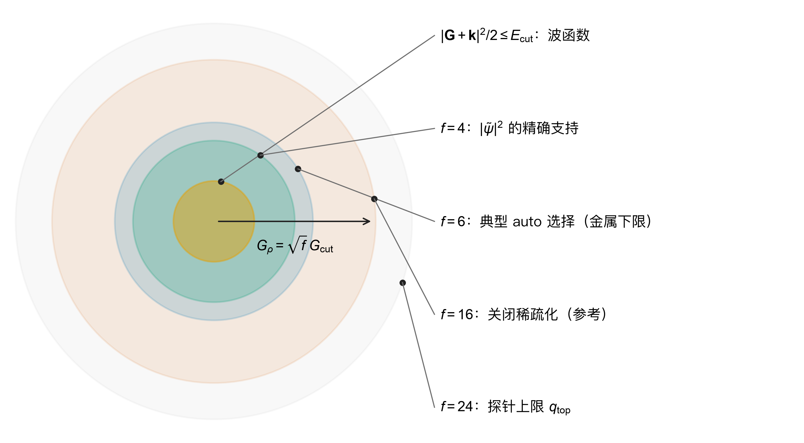
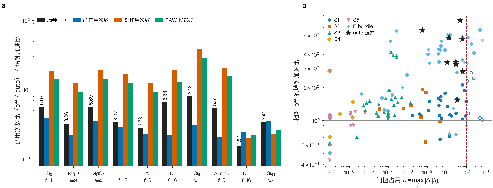
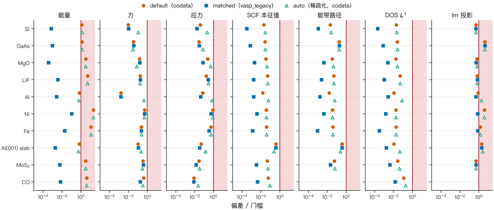
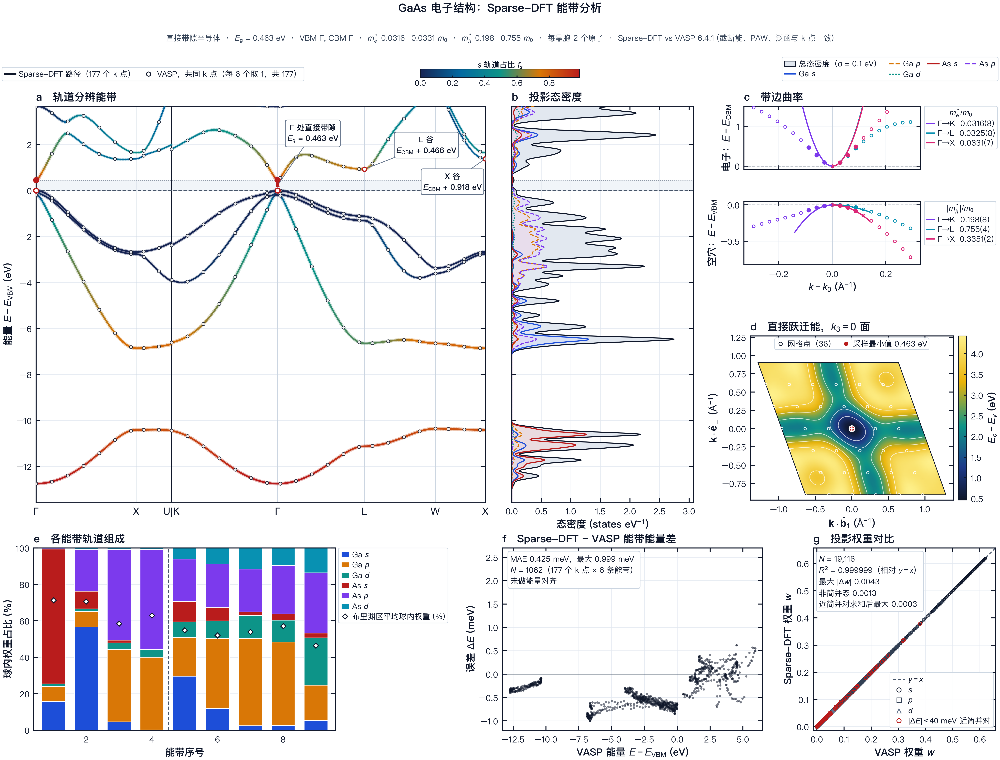

[English](README.md) · **简体中文** · [理论](docs/THEORY.zh-CN.md) · [稀疏化](docs/SPARSIFICATION.zh-CN.md) · [精度](docs/ACCURACY.zh-CN.md) · [性能](docs/PERFORMANCE.zh-CN.md) · [用户指南](docs/USER_GUIDE.zh-CN.md)

# Sparse-DFT

Sparse-DFT 为采用 PBE 泛函的平面波投影缀加波（projector augmented-wave，PAW）计算实现了 **Sparse Density Function 方法**。该方法去掉给定体系不需要的傅里叶支撑和求解器工作量。它在每次计算前估计被略去的部分，并在计算后认证收敛结果仍通过同一组检验。

围绕该方法，Sparse-DFT 提供 C++20 核心、Python 命令行与 API、PyQt6 图形界面，以及 OpenMP、MPI、Apple Metal 和 CUDA 后端。它计算总能、力、应力、结构弛豫、能带、态密度（density of states，DOS）和 lm 分辨的轨道投影，支持非自旋与共线自旋体系，可选 DFT+U。

## 基本思想

平面波 PAW 计算把密度放在傅里叶球 $\tfrac12|\mathbf G|^2\le E_\rho$ 上。光滑密度只需 $E_\rho = 4E_\mathrm{cut}$，但局域的补偿电荷和部分芯电荷有很长的谱尾。因此 Sparse-DFT 的精确参考取 $E_\rho = 16E_\mathrm{cut}$。$4E_\mathrm{cut}$ 到 $16E_\mathrm{cut}$ 之间的大部分壳层只携带极少电荷，具体多少取决于 PAW 数据集。

SCF 开始前，谱探针对每个数据集的补偿形状因子 $g_{s,L}(q)$ 在各候选球之外积分，并以自由原子多极矩 $w_{s,L}$ 加权：

$$T(f) = \sum_s\sum_L w_{s,L}^2\int_{q(fE_\mathrm{cut})}^{q(24E_\mathrm{cut})}|g_{s,L}(q)|^2\,q^2\,dq .$$

auto 模式选取尾部满足标定预算的最小密度因子 $f = E_\rho/E_\mathrm{cut}$，并按规则设定 XC 网格和本征求解器。密度模式数按 $(f/16)^{3/2}$ 下降，$f = 4$ 时降到 1/8。只改变本征求解器搜索方式的组件，只有在每个本征对仍在原始算符上通过 FP64 残差检验 $\|\tilde Hx-\varepsilon\tilde Sx\|\le10^{-12}$ Ha 时才被接受。



*按比例绘制的倒空间支撑（示意几何，由代码绘制）。$E_\mathrm{cut}$，波函数截断能；$f$，密度支撑因子；$q_\mathrm{top}$，谱探针上限。详见 [SPARSIFICATION.zh-CN.md](docs/SPARSIFICATION.zh-CN.md)。*

## 结果一览

以下数字均为实测，在与其他任务共享的 Apple M5 Max 上获得；条件与来源见各链接页面。

- **稀疏化 auto 节省工作量，结果不变。** 在六个拟合体系和四个留出体系上，auto 通过与精确离散化（$f = 16$）相同的门限，哈密顿算符调用次数减少到 1/2.1–1/3.9，墙钟时间比为 1.54–8.13。Si$_{64}$：1778 → 522 s。每个本征对仍通过 FP64 证书。[SPARSIFICATION.zh-CN.md](docs/SPARSIFICATION.zh-CN.md#5-auto-节省了什么)
- **在匹配设置下与 VASP 6.4.1 对比的精度**，十个体系（Si、GaAs、MgO、LiF、Al、Ni、Fe、Al(001) 表面板、MoS$_2$、CO）：相同 PAW 数据集、截断能、k 网格和能带数，使用 `--atomic-units vasp_legacy`。所有 SCF 检验通过：能量差不超过 $1.05\times10^{-4}$ eV/atom，力不超过 $5.3\times10^{-4}$ eV/Å，应力不超过 $5.5\times10^{-3}$ GPa。能带路径相差不超过 1.9 meV（门限 5 meV），DOS 的归一化 $L^1$ 差不超过 $1.5\times10^{-4}$（门限 1 %）。lm 投影在 GaAs 和 Al 表面板两个体系上未通过；GaAs 的原因尚未查明。[ACCURACY.zh-CN.md](docs/ACCURACY.zh-CN.md)
- **优化的本征求解器，结果不变。** 收敛的 Si$_8$ 在 8 线程下用时 23.5 s，基线构建为 48.3 s，能量变化不超过 $2.8\times10^{-12}$ eV。Si$_{64}$ 本征求解回放用时 49.2 s，对照为 323.5 s。[PERFORMANCE.zh-CN.md](docs/PERFORMANCE.zh-CN.md)

| | |
|---|---|
|  |  |
| *auto 的墙钟时间比与算符调用比。* | *与 VASP 的偏差除以门限，三个档位。* |

## 快速上手

```bash
# 1. 编译并安装（CPU + OpenMP；macOS 上可用 --backend metal）
python3 scripts/install.py
source .install/env.sh

# 2. 把你有授权的 POTCAR 集转换一次（转换结果不得再分发）
sparse-dft paw-convert /path/to/potpaw_PBE.54 --out ~/paw/potpaw_PBE.54-json
export PAW=~/paw/potpaw_PBE.54-json

# 3. 第一次带稀疏化的 SCF
sparse-dft suggest examples/Si.POSCAR --paw-root $PAW --argv
OMP_NUM_THREADS=8 sparse-dft scf examples/Si.POSCAR --paw-root $PAW --out si_scf \
    --scf-grid 8 8 8 --sparsity auto

# 4. 由收敛的 SCF 计算能带和 DOS
sparse-dft make-band-path --auto examples/Si.POSCAR --out si_path.json
sparse-dft bands examples/Si.POSCAR --paw-root $PAW --path si_path.json --out si_bands \
    --scf-grid 8 8 8 --scf-checkpoint si_scf/scf.json
sparse-dft dos examples/Si.POSCAR --paw-root $PAW --out si_dos --scf-grid 8 8 8 \
    --scf-checkpoint si_scf/scf.json --dos-grid 16 16 16

# 5. 作图与图形界面
sparse-dft plot auto si_scf si_bands si_dos --out figures/
sparse-dft-gui
```

第 4 步需要 `symmetry` 附加依赖，图形界面需要 `gui` 附加依赖（`pip install ".[gui]"`）。[用户指南](docs/USER_GUIDE.zh-CN.md)涵盖全部命令和选项。



*由 `sparse-dft plot` 根据 Sparse-DFT 结果绘制的 GaAs 电子结构图集，参考数据为 VASP 6.4.1 能带。`docs/assets/electronic/atlas.provenance.json` 列出每个输入文件的 SHA-256 和绘图数值。更多图集见[用户指南 §10](docs/USER_GUIDE.zh-CN.md#10-作图)。*

## PAW 数据集：两种来源

Sparse-DFT 不附带任何 PAW 数据集。`--paw-root` 接受两种来源的数据，各来源的条款随文件保留（[docs/LEGAL.zh-CN.md §5](docs/LEGAL.zh-CN.md#5-paw-数据集与你的数据)）。

- **VASP PAW 数据集（POTCAR）。** 凭你自己的 VASP 许可证从 VASP Portal 下载。在本机用 `sparse-dft paw-convert SRC --out DIR` 转换一次，其中 `SRC` 为 potpaw 目录或 `.tar`、`.tgz`、`.tar.xz` 归档，然后传入 `--paw-root DIR`。转换器按原样保存每个 POTCAR 文本及其 SHA-256，并添加元数据索引。POTCAR 文件是 VASP Software GmbH 的专有数据。请私下保存该归档：不要分享、上传或与软件打包。请确认你自己的许可协议涵盖你的用途；Sparse-DFT 无法替你检查。本版本的全部精度结果都使用这些数据集（PBE.54）。
- **UPF v2 格式的 PAW 数据集**（`pseudo_type="PAW"`）。可自由下载或生成，例如用 pslibrary 加 Quantum ESPRESSO 原子程序 `ld1.x` 生成，或从发布 PAW UPF 文件的库下载。Quantum ESPRESSO 和 pslibrary 以 GNU GPL 第 2 版或（由你选择）任何更新版本分发。两个项目都没有为生成或下载的 UPF 文件另行规定许可证。各赝势库自行规定条款和引用要求，因此请查看文件头和库的页面，并引用数据集作者。把一个 `.upf` 文件，或每个元素一个 PAW UPF 文件的目录，作为 `--paw-root` 传入。Sparse-DFT 把 UPF 作为数据读取，不运行也不链接任何 Quantum ESPRESSO 代码。只接受标量相对论 PBE PAW 文件；模守恒和超软文件会被拒绝。UPF 数据集尚未纳入精度对比。

## 文档

| 页面 | 内容 |
|---|---|
| [docs/USER_GUIDE.zh-CN.md](docs/USER_GUIDE.zh-CN.md) | 安装、PAW 转换、全部命令、图形界面、API、环境变量、故障排查 |
| [docs/THEORY.zh-CN.md](docs/THEORY.zh-CN.md) | PAW、PBE、SCF、本征求解器、力、应力、弛豫、能带、DOS 与投影的公式，每条对应到源文件 |
| [docs/SPARSIFICATION.zh-CN.md](docs/SPARSIFICATION.zh-CN.md) | 七个组件、谱探针、auto 规则及其标定、节省、账本 |
| [docs/ACCURACY.zh-CN.md](docs/ACCURACY.zh-CN.md) | 十个体系上与 VASP 6.4.1 的对比、弛豫、DOS、能带路径、投影、未通过项 |
| [docs/PERFORMANCE.zh-CN.md](docs/PERFORMANCE.zh-CN.md) | OpenMP、MPI、Metal 与本征求解器计时 |
| [benchmarks/README.md](benchmarks/README.md) | 每个数字和图背后的派生数据及其再生方法 |

## 仓库结构

```text
src/                 C++20 核心：平面波、PAW、PBE、SCF、本征求解器、后端、原生程序
sparse_dft/          Python 包：命令行、API、结构、PAW 归档、稀疏化、分析、作图
sparse_dft_gui/      PyQt6 图形界面
tests/               Python 测试；tests/native/ 为 ctest 运行的原生测试程序
scripts/             install.py 与元素表生成脚本
schemas/             输入文件的 JSON schema
data/                PAW 数据与界面字体的空位；不随包提供任何文件
benchmarks/          派生数据、生成它们的脚本和文档图
docs/                文档；docs/assets/ 存放图
examples/            POSCAR、CIF 和 XYZ 格式的 Si
third_party/eigen3/  Eigen 3.4 头文件（MPL-2.0），未修改
packaging/           图形界面的 PyInstaller 配置与打包布局
CMakeLists.txt       原生构建（CMake 3.20+，需要 FFTW3）
```

## 状态与局限

- 版本 1.0.0。每个结果都带有 `total_energy_valid: false`：Sparse-DFT 已在匹配条件下与 VASP 对比，但未与实验对照验证。
- 支持：PBE；POTCAR 格式（PBE.54，用于全部对比）或 PAW UPF v2 格式（标量相对论 PBE，尚未对比）的 PAW 数据集；非自旋与共线自旋；Dudarev DFT+U；Fermi–Dirac 展宽。
- 不支持：其他交换关联泛函、非共线磁性与自旋–轨道耦合。
- 稀疏化规则在不超过 64 个原子的体系上拟合。更大的晶胞、分子和带电体系尚未扫描。
- MPI 在单节点上相对 OpenMP 没有加速。CUDA 后端尚未在 NVIDIA 硬件上运行。目前只在 Apple 芯片的 macOS 上做过测量。
- 默认的 `codata` 常数使测试集上的绝对总能相对 VASP 偏移 0.7–21 meV/atom；比较绝对能量时请用 `--atomic-units vasp_legacy`。

<!-- license-block:start -->
## 许可与署名

Sparse-DFT 以 [Apache License 2.0](LICENSE) 发布。

- **版权：** 2026 Yufeng Zhan。
- **第三方组件：** 保留各自的条款，见 [NOTICE.md](NOTICE.md)。
- **法律范围与免责声明：** [docs/LEGAL.zh-CN.md](docs/LEGAL.zh-CN.md)。
- **与 VASP、Quantum ESPRESSO 的源代码独立性审计：** [docs/PROVENANCE.zh-CN.md](docs/PROVENANCE.zh-CN.md)。

**本包不包含的内容。** 本包不含 VASP 源代码，也不含 Quantum ESPRESSO 源代码。本包同样不含 PAW/POTCAR 或其他赝势数据。用户需用自己有权使用的文件自建 PAW 归档（`sparse-dft paw-convert`）。

**独立性。** Sparse-DFT 独立于 VASP Software GmbH、Quantum ESPRESSO 基金会、Apple 和 NVIDIA，也未获其中任何一方背书。VASP 仅在精度对照中作为外部参考程序出现。

**引用。** 请按 [CITATION.cff](CITATION.cff) 引用具体版本及压缩包校验值。
<!-- license-block:end -->

## 致谢

本文档的组织方式参考了开源项目 [MetalVASP](https://github.com/FonaTech/MetalVASP) 和 [E3-miu-GNN](https://github.com/FonaTech/E3-miu-GNN)，未取用其中任何代码。Sparse-DFT 依赖 FFTW、Eigen、spglib、SeeK-path、NumPy、SciPy、Matplotlib 和 PyQt6，它们各自遵循自己的许可证（见 [NOTICE.md](NOTICE.md)）。
