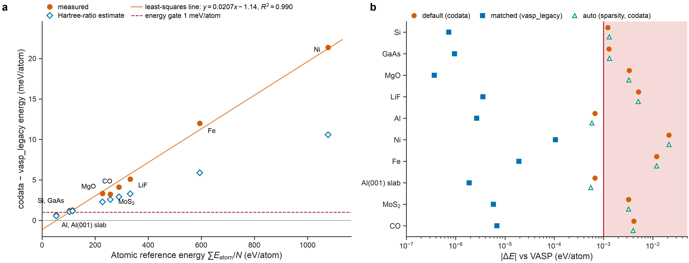
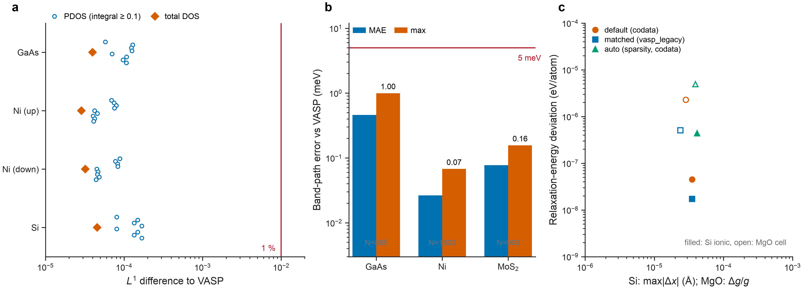

**English** · [简体中文](ACCURACY.zh-CN.md) · [README](../README.md) · [Theory](THEORY.md) · [Sparsification](SPARSIFICATION.md) · [Performance](PERFORMANCE.md) · [User guide](USER_GUIDE.md)

# Accuracy

This report compares Sparse-DFT with VASP 6.4.1 on ten systems under matched conditions. It also covers relaxations, densities of states (DOS), band paths and orbital projections. Every number is measured and is read from `benchmarks/data`, which records the SHA-256 of each source file. The comparison with Sparse-DFT's own exact discretisation, used to calibrate sparsification, is in [SPARSIFICATION.md](SPARSIFICATION.md#4-auto-mode).

**What this shows.** Sparse-DFT agrees with VASP 6.4.1 under matched settings: the same PAW datasets, cutoff, k mesh and band count. **What it does not show.** It does not validate PBE against experiment, the converged accuracy of the chosen cutoff or k mesh, or any system outside this set. Sparse-DFT keeps `total_energy_valid: false` in every result until such material-level validation exists.

## 1. Set-up

*Table 1. Anchor systems (all from `benchmarks/data/anchor_vasp.json`). $E_\mathrm{cut}$, plane-wave cutoff; k mesh, Gamma-centred full mesh; FD, Fermi–Dirac smearing $k_BT$; NBANDS, bands in the SCF.*

| system | kind | atoms | $E_\mathrm{cut}$ (eV) | k mesh | FD (eV) | spin | NBANDS |
|---|---|---|---|---|---|---|---|
| Si | semiconductor | 2 | 320 | 6×6×6 | 0 | 1 | 8 |
| GaAs | semiconductor | 2 | 300 | 6×6×6 | 0 | 1 | 8 |
| MgO | ionic | 2 | 520 | 6×6×6 | 0 | 1 | 8 |
| LiF | ionic | 2 | 520 | 6×6×6 | 0 | 1 | 8 |
| Al | metal | 1 | 315 | 10×10×10 | 0.1 | 1 | 6 |
| Ni | magnetic metal | 1 | 355 | 10×10×10 | 0.1 | 2 | 14 |
| Fe | magnetic metal | 1 | 350 | 10×10×10 | 0.1 | 2 | 14 |
| Al(001) slab | slab metal | 5 | 315 | 8×8×1 | 0.1 | 1 | 16 |
| MoS$_2$ | monolayer | 3 | 340 | 6×6×1 | 0 | 1 | 13 |
| CO | molecule | 2 | 520 | 1×1×1 | 0 | 1 | 9 |

Both codes used:

- the same PBE.54 PAW datasets and the same $E_\mathrm{cut}$, chosen by Sparse-DFT's automatic rule;
- the same Gamma-centred full mesh without symmetry reduction (VASP `ISYM = -1`) and the same SCF band count;
- nominal geometries, not relaxed, with a seeded random displacement of 0.03 Å and a strain of 0.5 % to make forces and stress non-zero.

VASP was converged by its energy criterion; Sparse-DFT by its density and one-centre residuals with the complete PAW closure. In the band-path runs VASP solved $\max(2n, n+8)$ bands, so that every compared band was converged. The comparison window keeps Sparse-DFT's $n$ bands minus the top two and states up to 5 eV above the reference energy.

**Three tiers.** Each system ran three times.

- `default`: factory settings: `codata` constants, automatic cutoff and bands, sparsity off.
- `matched`: `default` plus `--atomic-units vasp_legacy`, the constants VASP uses.
- `auto`: `default` plus `--sparsity auto` (still `codata`).

**Gates.** Energy $10^{-3}$ eV/atom, force $10^{-3}$ eV/Å, stress 0.01 GPa, eigenvalues $5\times10^{-3}$ eV and relative electron count $10^{-8}$ are the Sparse-DFT accuracy targets; the sparsification rules are fitted to the same values ([SPARSIFICATION.md](SPARSIFICATION.md) §4). Three gates were added for this comparison: the magnetic moment (0.01 $\mu_B$), the DOS $L^1$ difference (1 %) and the projection gate ($5\times10^{-4}$ per band in a degenerate group plus $5\times10^{-4}$, the rounding of three-decimal projection output).

## 2. Results against VASP

*Figure 1. Deviation from VASP 6.4.1 divided by its gate, for each system (rows), tier (markers) and quantity (panels); values below $10^{-5}$ are drawn at $10^{-5}$ (measured; `benchmarks/data/anchor_vasp.json`). The red band marks failure (ratio > 1). Energy, total energy per atom; Force and Stress, largest component; SCF eigenvalues and Band path, largest deviation in the comparison window; DOS $L^1$, normalised $L^1$ difference of the Gaussian DOS; lm projections, worst degenerate-group sum. CO has no band path or projection check.*

*Table 2. Matched tier (`--atomic-units vasp_legacy`) against VASP. $\Delta E$, total-energy difference per atom; $\lvert\Delta F\rvert$, $\lvert\Delta\sigma\rvert$, largest force and stress component differences; $\lvert\Delta\varepsilon\rvert$, largest SCF eigenvalue difference in the window; band path, largest band-path difference; DOS $L^1$, normalised $L^1$ difference; proj., worst projection-group difference and status; $\Delta m$, moment difference.*

| system | $\Delta E$ (eV/atom) | $\lvert\Delta F\rvert$ (eV/Å) | $\lvert\Delta\sigma\rvert$ (GPa) | $\lvert\Delta\varepsilon\rvert$ (eV) | band path (eV) | DOS $L^1$ | proj. | $\Delta m$ ($\mu_B$) | SCF status |
|---|---|---|---|---|---|---|---|---|---|
| Si | −7.22e-7 | 1.1e-5 | 1.7e-4 | 1.6e-6 | 5.6e-6 | 2.1e-6 | 5.0e-4 pass | — | PASS |
| GaAs | +9.49e-7 | 3.7e-5 | 3.0e-4 | 3.7e-6 | 9.6e-4 | 7.9e-6 | 4.5e-3 **fail** | — | PASS |
| MgO | −3.68e-7 | 1.6e-4 | 7.7e-4 | 1.0e-5 | 2.2e-5 | 2.4e-5 | 5.4e-4 pass | — | PASS |
| LiF | +3.55e-6 | 1.8e-4 | 2.7e-3 | 8.3e-6 | 1.2e-5 | 1.0e-5 | 7.2e-4 pass | — | PASS |
| Al | −2.67e-6 | 1.7e-6 | 4.4e-4 | 8.3e-6 | 8.3e-6 | 2.7e-5 | 5.0e-4 pass | — | PASS |
| Ni | −1.05e-4 | 5.3e-4 | 5.5e-3 | 1.9e-5 | 2.2e-5 | 1.5e-5 | 7.7e-4 pass | −2.7e-5 | PASS |
| Fe | −1.91e-5 | 2.4e-4 | 3.3e-3 | 6.4e-6 | 4.6e-6 | 3.2e-6 | 7.9e-4 pass | −1.5e-5 | PASS |
| Al(001) slab | −1.88e-6 | 1.2e-4 | 3.5e-4 | 1.9e-3 | 1.9e-3 | 1.7e-5 | 2.0e-3 **fail** | — | PASS |
| MoS$_2$ | −5.83e-6 | 4.0e-4 | 1.5e-4 | 1.7e-5 | 1.1e-4 | 4.1e-5 | 5.1e-4 pass | — | PASS |
| CO | −6.86e-6 | 1.8e-4 | 8.2e-5 | 2.2e-5 | — | 1.5e-4 | — | — | PASS |

The status column counts the SCF checks: energy, forces, stress, eigenvalues, electron count, DOS and moment. Band-path and projection checks are listed separately.

In the matched tier every SCF check passes on all ten systems. The largest energy difference is $1.05\times10^{-4}$ eV/atom (Ni), a tenth of the gate. Forces stay within $5.3\times10^{-4}$ eV/Å and stress within $5.5\times10^{-3}$ GPa. The relative electron count agrees within $1.2\times10^{-12}$ in every run of every tier. Band paths pass on all nine periodic systems. Two systems fail the projection check (§5).

In the `default` and `auto` tiers forces, stress, eigenvalues, DOS and moments also pass on every system. Only the absolute energy fails, on eight of ten systems, because of the unit constants (§3). The `auto` tier differs from `default` by at most 0.12 meV/atom in energy (Al slab) and its stress stays within $8.3\times10^{-3}$ GPa of VASP (Ni).

## 3. codata versus vasp_legacy

The factory default uses CODATA 2018 constants; VASP 6.4.1 uses older ones (THEORY §2). The only measurable consequence in this set is a shift of the absolute total energy. On identical inputs the shift per atom is

*Table 3. Total energy with `codata` minus total energy with `vasp_legacy`, same input (measured; `benchmarks/data/codata_bias.json`). $E^\mathrm{ref}/N$, atomic reference energy of the datasets per atom.*

| system | Si | GaAs | MgO | LiF | Al | Ni | Fe | Al slab | MoS$_2$ | CO |
|---|---|---|---|---|---|---|---|---|---|---|
| shift (meV/atom) | +1.23 | +1.29 | +3.32 | +5.10 | +0.674 | +21.4 | +12.0 | +0.674 | +3.23 | +4.12 |
| $E^\mathrm{ref}/N$ (eV/atom) | 103.1 | 114.5 | 227.7 | 332.5 | 53.5 | 1077.7 | 594.3 | 53.5 | 257.1 | 289.8 |

*Figure 2. (a) Energy shift between the `codata` and `vasp_legacy` constants against the atomic reference energy per atom (measured), with a least-squares line, and the estimate from the Hartree-constant ratio alone (open diamonds). (b) Absolute energy difference to VASP for the three tiers (measured). The red line and band mark the 1 meV/atom gate.*

The shift grows linearly with the atomic reference energy: a least-squares fit gives a slope of 0.0207 meV per eV with $R^2 = 0.990$ over the ten systems. It exceeds the 1 meV/atom gate on every system except Al and the Al slab. The ratio of the two Hartree constants alone, $-9.77\times10^{-6}$ times $E-\sum E^\mathrm{ref}$, reproduces the sign and the trend. It accounts for only 49–90 % of the measured shift, so other terms that depend on the constants also contribute. Their split has not been measured.

Forces, stress, eigenvalues, DOS and moments pass in both conventions. Energy differences between structures of the same composition, such as relaxation energies, also pass (§4), because the shift nearly cancels. Use `--atomic-units vasp_legacy` whenever absolute energies are compared with VASP. The default stays `codata`.

## 4. Relaxations

*Table 4. Relaxations started from the anchor geometry (measured). Si: ionic relaxation at fixed cell; MgO: cell relaxation at fixed fractional coordinates. $\max\lvert\Delta x\rvert$, largest difference of the final positions; $\Delta g/g$, relative difference of the final metric tensor; $\Delta E_\mathrm{relax}$, difference of the relaxation energy per atom.*

| case | tier | steps | $\max\lvert\Delta x\rvert$ (Å) | $\Delta g/g$ | $\Delta E_\mathrm{relax}$ (eV/atom) | status |
|---|---|---|---|---|---|---|
| Si ionic | default | 3 | 3.5e-5 | 0 | −4.5e-8 | energy fails (codata) |
| Si ionic | matched | 3 | 3.5e-5 | 0 | −1.7e-8 | PASS |
| Si ionic | auto | 3 | 4.2e-5 | 0 | +4.4e-7 | energy fails (codata) |
| MgO cell | default | 5 | 5.8e-16 | 2.9e-5 | −2.3e-6 | energy fails (codata) |
| MgO cell | matched | 5 | 3.3e-16 | 2.4e-5 | −5.1e-7 | PASS |
| MgO cell | auto | 5 | 1.4e-15 | 3.9e-5 | −4.9e-6 | energy fails (codata) |

The relaxation gates are 0.002 Å in position, $2\times10^{-4}$ in the relative metric and $10^{-3}$ eV/atom in energy. All final structures agree with VASP far inside these gates. The VASP relaxation energies are −5.66 meV (Si) and −4.73 meV (MgO) per cell. The `default` and `auto` tiers fail only the absolute final energy, by the shift of §3.

## 5. Band paths, DOS and projections

*Figure 3. (a) Normalised $L^1$ difference to VASP of the total DOS (diamonds) and of every projected DOS (PDOS) column with an integral of at least 0.1 state (circles), matched tier, Gaussian $\sigma$ = 0.1 eV, same full mesh (measured). (b) Mean absolute error (MAE) and largest difference of the band path against VASP, no energy alignment; $N$, number of (k, band) samples (measured). (c) Relaxations: position or metric deviation against relaxation-energy deviation for the three tiers (measured).*

**Band paths.** The band suite compares every (k, band) sample in the window without shifting either code (`benchmarks/data/bands_vasp.json`). Alignment would hide errors, and VASP recomputes its Fermi level from the path eigenvalues. GaAs has an MAE of 0.46 meV and a maximum of 1.00 meV over 885 samples; Ni 0.027 and 0.068 meV over 1803 samples; MoS$_2$ 0.077 and 0.157 meV over 963 samples. The PBE gaps agree within 0.22 meV for GaAs (0.4628 against 0.4626 eV) and 0.03 meV for MoS$_2$ (1.5860 against 1.586 eV, VASP printed to three decimals).

**DOS.** `sparse-dft dos` ran on the same full mesh as the VASP SCF, and the VASP DOS was rebuilt from its eigenvalues and projections with the same broadening (`benchmarks/data/dos_vasp.json`). The total DOS $L^1$ difference is $4.5\times10^{-5}$ (Si), $4.0\times10^{-5}$ (GaAs), $2.9\times10^{-5}$ (Ni, up) and $3.2\times10^{-5}$ (Ni, down). Over the PDOS columns with an integral of at least 0.1 state the largest difference is $1.7\times10^{-4}$. The small As d columns of GaAs (integral about 0.01) reach $7.5\times10^{-3}$, still below the gate of $10^{-2}$.

**Projections.** The projection check compares lm-resolved sphere weights (THEORY §13) with VASP's `LORBIT = 11` output, summed over groups of bands degenerate within 2 meV. In the matched tier it passes on seven of nine periodic systems.

## 6. Open failures

Each failure below is reported with its cause where known. No gate was relaxed to make a system pass.

| system and tier | check | value / gate | where (0-based k and band index) | cause |
|---|---|---|---|---|
| GaAs, all tiers | projection | $4.5\times10^{-3}$ / $10^{-3}$ (matched) | k 70, band 5, next band 18.9 meV higher | open |
| Al(001) slab, all tiers | projection | $2.0\times10^{-3}$ / $10^{-3}$ (matched) | k 115, band 13, previous band 17.3 meV lower | near-degenerate pair |
| Ni, Fe; default and auto | projection | $3.9\times10^{-3}$, $1.5\times10^{-3}$ / $10^{-3}$ | Ni k 13 band 11, 38.6 meV gap; Fe k 39 band 11, 31.1 meV gap | Ni: near-degenerate pair; Fe: open; both pass in matched |
| Al, auto | projection | $1.9\times10^{-3}$ / $10^{-3}$ | k 28, band 3, 7.2 meV gap | near-degenerate pair |
| eight systems; default and auto | energy | up to 21 meV/atom / 1 meV/atom | — | codata constants (§3) |

All projection failures sit next to a band 7–39 meV away. Inside such a pair the two single-band weights depend on the mixing angle of the two states, which an off-diagonal perturbation $\delta V$ changes by about $\delta V/\Delta\varepsilon$; the pair sum does not depend on it. Merging close pairs makes the check pass for Al (pairs within 10 meV), the Al slab (20 meV matched, 50 meV auto) and Ni (100 meV). It does not for GaAs or for Fe in the default and auto tiers, even at 100 meV. Three observations exclude incomplete convergence as the cause (measured; `benchmarks/data/anchor_vasp.json`, `projection_checks`). Tightening the VASP energy criterion from $10^{-9}$ to $10^{-12}$ leaves every printed GaAs projection of bands 1–12 unchanged at all 177 k points. The largest Sparse-DFT NSCF residual on the nine band paths is $1.0\times10^{-12}$ Ha. The report keeps the strict per-group gate; the field `projection_merge_window_to_pass_ev` in the data only records how wide a merge window would make the check pass. The GaAs failure persists in the matched tier, is not removed by pair merging, and its cause is not yet known.

For Ni and Fe the failing states shift by about −0.5 meV in the default tier and the failure disappears in the matched tier. This is consistent with the codata shift, but the causal link has not been tested separately.

## 7. Anchor meshes are not converged meshes

The anchor k meshes were chosen to make both codes solve the same problem, not to converge any property. `sparse-dft suggest` and the GUI recommend meshes from a k spacing and are usually denser, for example 8×8×8 for GaAs (anchor 6×6×6) and 16×16×16 for Ni (anchor 10×10×10). For MoS$_2$ they add 0.05 eV of Fermi–Dirac smearing, because a gap cannot be predicted from the composition. The anchor shows that Sparse-DFT and VASP agree on the same mesh; converging the cutoff, mesh and smearing remains the user's task.

## 8. Reproducing these numbers

The anchor workspace is created by `benchmarks/scripts/vasp_anchor.py` and compared by `benchmarks/scripts/anchor_report.py`; DOS comparisons use `benchmarks/scripts/compare_vasp_dos.py`. Running them needs a licensed VASP installation and the matching PAW datasets, neither of which is distributed. The numbers in `benchmarks/data` were extracted from that workspace, and `benchmarks/plot_docs.py` draws the figures from `benchmarks/data` alone; see [benchmarks/README.md](../benchmarks/README.md).

The anchor runs were made on 2026-10-15 with a pre-release build of this code; [benchmarks/README.md](../benchmarks/README.md) records the provenance of every number.
