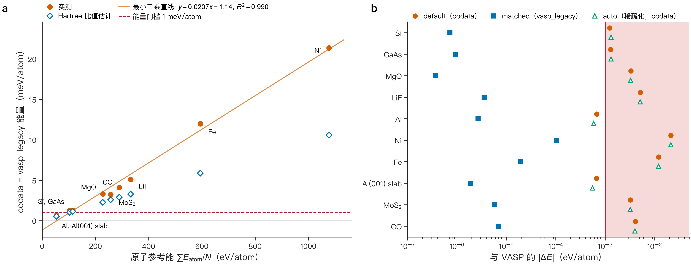
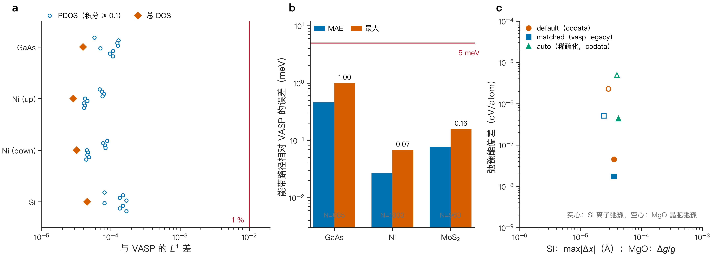

[English](ACCURACY.md) · **简体中文** · [README](../README.zh-CN.md) · [理论](THEORY.zh-CN.md) · [稀疏化](SPARSIFICATION.zh-CN.md) · [性能](PERFORMANCE.zh-CN.md) · [用户指南](USER_GUIDE.zh-CN.md)

# 精度

本报告在匹配条件下把 Sparse-DFT 与 VASP 6.4.1 在十个体系上对比。内容还包括弛豫、态密度（density of states，DOS）、能带路径和轨道投影。所有数字均为实测，读自 `benchmarks/data`，其中记录了每个源文件的 SHA-256。用于标定稀疏化的、与 Sparse-DFT 自身精确离散化的对比见 [SPARSIFICATION.zh-CN.md](SPARSIFICATION.zh-CN.md#4-auto-模式)。

**本报告说明了什么。** 在匹配设置下，即相同的 PAW 数据集、截断能、k 网格和能带数，Sparse-DFT 与 VASP 6.4.1 一致。**本报告没有说明什么。** 它没有用实验验证 PBE，没有验证所选截断能或 k 网格的收敛精度，也不涉及本集合之外的任何体系。在此类材料层面的验证完成之前，Sparse-DFT 在每个结果中都保持 `total_energy_valid: false`。

## 1. 设置

*表 1. 锚定体系（均取自 `benchmarks/data/anchor_vasp.json`）。$E_\mathrm{cut}$，平面波截断能；k 网格，以 Gamma 为中心的完整网格；FD，Fermi–Dirac 展宽 $k_BT$；NBANDS，SCF 中的能带数。*

| 体系 | 类型 | 原子数 | $E_\mathrm{cut}$ (eV) | k 网格 | FD (eV) | 自旋 | NBANDS |
|---|---|---|---|---|---|---|---|
| Si | 半导体 | 2 | 320 | 6×6×6 | 0 | 1 | 8 |
| GaAs | 半导体 | 2 | 300 | 6×6×6 | 0 | 1 | 8 |
| MgO | 离子晶体 | 2 | 520 | 6×6×6 | 0 | 1 | 8 |
| LiF | 离子晶体 | 2 | 520 | 6×6×6 | 0 | 1 | 8 |
| Al | 金属 | 1 | 315 | 10×10×10 | 0.1 | 1 | 6 |
| Ni | 磁性金属 | 1 | 355 | 10×10×10 | 0.1 | 2 | 14 |
| Fe | 磁性金属 | 1 | 350 | 10×10×10 | 0.1 | 2 | 14 |
| Al(001) 表面板 | 金属表面板 | 5 | 315 | 8×8×1 | 0.1 | 1 | 16 |
| MoS$_2$ | 单层 | 3 | 340 | 6×6×1 | 0 | 1 | 13 |
| CO | 分子 | 2 | 520 | 1×1×1 | 0 | 1 | 9 |

两个程序使用：

- 相同的 PBE.54 PAW 数据集和相同的 $E_\mathrm{cut}$，由 Sparse-DFT 的自动规则选定；
- 相同的、不做对称约化的 Gamma 中心完整网格（VASP `ISYM = -1`），以及相同的 SCF 能带数；
- 未弛豫的名义几何，加入带种子的 0.03 Å 随机位移和 0.5 % 应变，使力和应力不为零。

VASP 按其能量判据收敛；Sparse-DFT 按其密度残差和单中心残差收敛，并使用完整的 PAW 闭合。在能带路径计算中，VASP 求解 $\max(2n, n+8)$ 条能带，使每条参与比较的能带都已收敛。比较窗口保留 Sparse-DFT 的 $n$ 条能带去掉最上面两条，以及参考能量以上 5 eV 以内的态。

**三个档位。** 每个体系计算三次。

- `default`：出厂设置：`codata` 常数、自动截断能和能带数、稀疏化关闭。
- `matched`：`default` 加 `--atomic-units vasp_legacy`，即 VASP 使用的常数。
- `auto`：`default` 加 `--sparsity auto`（仍为 `codata`）。

**门限。** 能量 $10^{-3}$ eV/atom、力 $10^{-3}$ eV/Å、应力 0.01 GPa、本征值 $5\times10^{-3}$ eV 和相对电子数 $10^{-8}$ 是 Sparse-DFT 的精度目标，稀疏化规则也按同一组数值拟合（[SPARSIFICATION.zh-CN.md](SPARSIFICATION.zh-CN.md) §4）。本次对比另加三项门限：磁矩（0.01 $\mu_B$）、DOS $L^1$ 差（1 %）和投影门限（简并组内每条能带 $5\times10^{-4}$，加上三位小数投影输出的舍入 $5\times10^{-4}$）。

## 2. 与 VASP 的对比结果

*图 1. 相对 VASP 6.4.1 的偏差除以其门限，按体系（行）、档位（标记）和物理量（分图）给出；低于 $10^{-5}$ 的值按 $10^{-5}$ 绘制（实测；`benchmarks/data/anchor_vasp.json`）。红色带表示未通过（比值 > 1）。能量，每原子总能；力和应力，最大分量；SCF 本征值和能带路径，比较窗口内的最大偏差；DOS $L^1$，高斯 DOS 的归一化 $L^1$ 差；lm 投影，最差的简并组之和。CO 没有能带路径和投影检验。*

*表 2. matched 档位（`--atomic-units vasp_legacy`）相对 VASP 的结果。$\Delta E$，每原子总能差；$\lvert\Delta F\rvert$、$\lvert\Delta\sigma\rvert$，力和应力分量的最大差；$\lvert\Delta\varepsilon\rvert$，窗口内 SCF 本征值的最大差；能带路径，能带路径的最大差；DOS $L^1$，归一化 $L^1$ 差；投影，最差投影组之差及状态；$\Delta m$，磁矩差。*

| 体系 | $\Delta E$ (eV/atom) | $\lvert\Delta F\rvert$ (eV/Å) | $\lvert\Delta\sigma\rvert$ (GPa) | $\lvert\Delta\varepsilon\rvert$ (eV) | 能带路径 (eV) | DOS $L^1$ | 投影 | $\Delta m$ ($\mu_B$) | SCF 状态 |
|---|---|---|---|---|---|---|---|---|---|
| Si | −7.22e-7 | 1.1e-5 | 1.7e-4 | 1.6e-6 | 5.6e-6 | 2.1e-6 | 5.0e-4 通过 | — | PASS |
| GaAs | +9.49e-7 | 3.7e-5 | 3.0e-4 | 3.7e-6 | 9.6e-4 | 7.9e-6 | 4.5e-3 **未通过** | — | PASS |
| MgO | −3.68e-7 | 1.6e-4 | 7.7e-4 | 1.0e-5 | 2.2e-5 | 2.4e-5 | 5.4e-4 通过 | — | PASS |
| LiF | +3.55e-6 | 1.8e-4 | 2.7e-3 | 8.3e-6 | 1.2e-5 | 1.0e-5 | 7.2e-4 通过 | — | PASS |
| Al | −2.67e-6 | 1.7e-6 | 4.4e-4 | 8.3e-6 | 8.3e-6 | 2.7e-5 | 5.0e-4 通过 | — | PASS |
| Ni | −1.05e-4 | 5.3e-4 | 5.5e-3 | 1.9e-5 | 2.2e-5 | 1.5e-5 | 7.7e-4 通过 | −2.7e-5 | PASS |
| Fe | −1.91e-5 | 2.4e-4 | 3.3e-3 | 6.4e-6 | 4.6e-6 | 3.2e-6 | 7.9e-4 通过 | −1.5e-5 | PASS |
| Al(001) 表面板 | −1.88e-6 | 1.2e-4 | 3.5e-4 | 1.9e-3 | 1.9e-3 | 1.7e-5 | 2.0e-3 **未通过** | — | PASS |
| MoS$_2$ | −5.83e-6 | 4.0e-4 | 1.5e-4 | 1.7e-5 | 1.1e-4 | 4.1e-5 | 5.1e-4 通过 | — | PASS |
| CO | −6.86e-6 | 1.8e-4 | 8.2e-5 | 2.2e-5 | — | 1.5e-4 | — | — | PASS |

状态列统计 SCF 检验：能量、力、应力、本征值、电子数、DOS 和磁矩。能带路径和投影检验单独列出。

在 matched 档位中，十个体系的所有 SCF 检验都通过。最大能量差为 $1.05\times10^{-4}$ eV/atom（Ni），为门限的十分之一。力在 $5.3\times10^{-4}$ eV/Å 以内，应力在 $5.5\times10^{-3}$ GPa 以内。各档位每次计算的相对电子数都在 $1.2\times10^{-12}$ 以内一致。九个周期性体系的能带路径全部通过。有两个体系未通过投影检验（§5）。

在 `default` 和 `auto` 档位中，力、应力、本征值、DOS 和磁矩在每个体系上也都通过。只有绝对能量在十个体系中的八个上未通过，原因是单位常数（§3）。`auto` 档位与 `default` 的能量差至多 0.12 meV/atom（Al 表面板），其应力与 VASP 相差不超过 $8.3\times10^{-3}$ GPa（Ni）。

## 3. codata 与 vasp_legacy

出厂默认使用 CODATA 2018 常数；VASP 6.4.1 使用更早的常数（理论 §2）。在本集合中唯一可测的后果是绝对总能的偏移。对相同输入，每原子的偏移为

*表 3. 相同输入下用 `codata` 得到的总能减去用 `vasp_legacy` 得到的总能（实测；`benchmarks/data/codata_bias.json`）。$E^\mathrm{ref}/N$，数据集每原子的原子参考能量。*

| 体系 | Si | GaAs | MgO | LiF | Al | Ni | Fe | Al 表面板 | MoS$_2$ | CO |
|---|---|---|---|---|---|---|---|---|---|---|
| 偏移 (meV/atom) | +1.23 | +1.29 | +3.32 | +5.10 | +0.674 | +21.4 | +12.0 | +0.674 | +3.23 | +4.12 |
| $E^\mathrm{ref}/N$ (eV/atom) | 103.1 | 114.5 | 227.7 | 332.5 | 53.5 | 1077.7 | 594.3 | 53.5 | 257.1 | 289.8 |

*图 2. (a) `codata` 与 `vasp_legacy` 常数之间的能量偏移与每原子原子参考能量的关系（实测），附最小二乘直线，以及仅由 Hartree 常数之比得到的估计（空心菱形）。(b) 三个档位相对 VASP 的绝对能量差（实测）。红线和红色带表示 1 meV/atom 门限。*

偏移随原子参考能量线性增长：十个体系的最小二乘拟合给出斜率 0.0207 meV/eV，$R^2 = 0.990$。除 Al 和 Al 表面板外，偏移在每个体系上都超过 1 meV/atom 门限。仅用两个 Hartree 常数之比，即 $-9.77\times10^{-6}$ 乘以 $E-\sum E^\mathrm{ref}$，可复现符号和趋势。它只解释实测偏移的 49–90 %，因此其他依赖常数的项也有贡献。它们各自的份额尚未测量。

力、应力、本征值、DOS 和磁矩在两种约定下都通过。同一成分不同结构之间的能量差，如弛豫能，也能通过（§4），因为偏移几乎相互抵消。凡与 VASP 比较绝对能量时，请使用 `--atomic-units vasp_legacy`。默认仍为 `codata`。

## 4. 弛豫

*表 4. 从锚定几何出发的弛豫（实测）。Si：固定晶胞的离子弛豫；MgO：固定分数坐标的晶胞弛豫。$\max\lvert\Delta x\rvert$，最终位置的最大差；$\Delta g/g$，最终度规张量的相对差；$\Delta E_\mathrm{relax}$，每原子弛豫能之差。*

| 算例 | 档位 | 步数 | $\max\lvert\Delta x\rvert$ (Å) | $\Delta g/g$ | $\Delta E_\mathrm{relax}$ (eV/atom) | 状态 |
|---|---|---|---|---|---|---|
| Si 离子 | default | 3 | 3.5e-5 | 0 | −4.5e-8 | 能量未通过（codata） |
| Si 离子 | matched | 3 | 3.5e-5 | 0 | −1.7e-8 | PASS |
| Si 离子 | auto | 3 | 4.2e-5 | 0 | +4.4e-7 | 能量未通过（codata） |
| MgO 晶胞 | default | 5 | 5.8e-16 | 2.9e-5 | −2.3e-6 | 能量未通过（codata） |
| MgO 晶胞 | matched | 5 | 3.3e-16 | 2.4e-5 | −5.1e-7 | PASS |
| MgO 晶胞 | auto | 5 | 1.4e-15 | 3.9e-5 | −4.9e-6 | 能量未通过（codata） |

弛豫门限为位置 0.002 Å、相对度规 $2\times10^{-4}$、能量 $10^{-3}$ eV/atom。所有最终结构与 VASP 的一致程度都远在门限之内。VASP 的弛豫能为每个晶胞 −5.66 meV（Si）和 −4.73 meV（MgO）。`default` 和 `auto` 档位只在绝对最终能量上未通过，差值即 §3 的偏移。

## 5. 能带路径、DOS 与投影

*图 3. (a) matched 档位下总 DOS（菱形）以及每个积分至少为 0.1 个态的投影 DOS（PDOS）列（圆点）相对 VASP 的归一化 $L^1$ 差，高斯 $\sigma$ = 0.1 eV，相同完整网格（实测）。(b) 能带路径相对 VASP 的平均绝对误差（mean absolute error，MAE）和最大差，不做能量对齐；$N$，(k, 能带) 样本数（实测）。(c) 弛豫：三个档位的位置或度规偏差与弛豫能偏差的关系（实测）。*

**能带路径。** 能带套件在不平移任一程序的情况下比较窗口内的每个 (k, 能带) 样本（`benchmarks/data/bands_vasp.json`）。对齐会掩盖误差，而且 VASP 会从路径本征值重新计算其 Fermi 能级。GaAs 在 885 个样本上 MAE 为 0.46 meV，最大值 1.00 meV；Ni 在 1803 个样本上分别为 0.027 和 0.068 meV；MoS$_2$ 在 963 个样本上分别为 0.077 和 0.157 meV。PBE 带隙在 GaAs 上相差 0.22 meV 以内（0.4628 对 0.4626 eV），在 MoS$_2$ 上相差 0.03 meV 以内（1.5860 对 1.586 eV，VASP 输出三位小数）。

**DOS。** `sparse-dft dos` 在与 VASP SCF 相同的完整网格上运行，VASP 的 DOS 由其本征值和投影以相同展宽重建（`benchmarks/data/dos_vasp.json`）。总 DOS 的 $L^1$ 差为 $4.5\times10^{-5}$（Si）、$4.0\times10^{-5}$（GaAs）、$2.9\times10^{-5}$（Ni，自旋向上）和 $3.2\times10^{-5}$（Ni，自旋向下）。在积分至少为 0.1 个态的 PDOS 列中，最大差为 $1.7\times10^{-4}$。GaAs 中很小的 As d 列（积分约 0.01）达到 $7.5\times10^{-3}$，仍低于 $10^{-2}$ 的门限。

**投影。** 投影检验把 lm 分辨的球内权重（理论 §13）与 VASP 的 `LORBIT = 11` 输出比较，并对 2 meV 以内简并的能带组求和。在 matched 档位中，九个周期性体系有七个通过。

## 6. 未通过项

下面每个未通过项都给出了已知的原因。没有为了让体系通过而放宽任何门限。

| 体系与档位 | 检验 | 数值 / 门限 | 位置（从 0 起计的 k 和能带指标） | 原因 |
|---|---|---|---|---|
| GaAs，所有档位 | 投影 | $4.5\times10^{-3}$ / $10^{-3}$（matched） | k 70，能带 5，下一条能带高 18.9 meV | 未查明 |
| Al(001) 表面板，所有档位 | 投影 | $2.0\times10^{-3}$ / $10^{-3}$（matched） | k 115，能带 13，上一条能带低 17.3 meV | 近简并对 |
| Ni、Fe；default 和 auto | 投影 | $3.9\times10^{-3}$、$1.5\times10^{-3}$ / $10^{-3}$ | Ni k 13 能带 11，间隔 38.6 meV；Fe k 39 能带 11，间隔 31.1 meV | Ni：近简并对；Fe：未查明；二者在 matched 中都通过 |
| Al，auto | 投影 | $1.9\times10^{-3}$ / $10^{-3}$ | k 28，能带 3，间隔 7.2 meV | 近简并对 |
| 八个体系；default 和 auto | 能量 | 最大 21 meV/atom / 1 meV/atom | — | codata 常数（§3） |

所有投影未通过项都紧邻一条相距 7–39 meV 的能带。在这样的能带对中，两个单能带权重取决于两个态的混合角，非对角微扰 $\delta V$ 会使混合角改变约 $\delta V/\Delta\varepsilon$；能带对之和与它无关。合并相近的能带对后，Al（10 meV 以内的对）、Al 表面板（matched 20 meV，auto 50 meV）和 Ni（100 meV）的检验通过。GaAs 以及 default 和 auto 档位中的 Fe 即使在 100 meV 下也不通过。三项观察排除了收敛不完全这一原因（实测；`benchmarks/data/anchor_vasp.json`，`projection_checks`）。把 VASP 能量判据从 $10^{-9}$ 收紧到 $10^{-12}$，GaAs 能带 1–12 在全部 177 个 k 点上的每个输出投影都不变。九条能带路径上 Sparse-DFT 最大的 NSCF 残差为 $1.0\times10^{-12}$ Ha。本报告保留严格的逐组门限；数据中的字段 `projection_merge_window_to_pass_ev` 只记录多宽的合并窗口能使检验通过。GaAs 的未通过在 matched 档位中依然存在，不能通过能带对合并消除，其原因尚不清楚。

对 Ni 和 Fe，未通过的态在 default 档位中偏移约 −0.5 meV，在 matched 档位中未通过项消失。这与 codata 偏移一致，但两者的因果关系尚未单独检验。

## 7. 锚定网格不是收敛网格

锚定 k 网格的选择是为了让两个程序求解同一问题，而不是为了收敛任何性质。`sparse-dft suggest` 和图形界面按 k 间距推荐网格，通常更密，例如 GaAs 为 8×8×8（锚定 6×6×6），Ni 为 16×16×16（锚定 10×10×10）。对 MoS$_2$，它们会加 0.05 eV 的 Fermi–Dirac 展宽，因为无法从成分预测带隙。锚定只说明 Sparse-DFT 与 VASP 在同一网格上一致；截断能、网格和展宽的收敛仍是用户的任务。

## 8. 复现这些数字

锚定工作区由 `benchmarks/scripts/vasp_anchor.py` 创建，由 `benchmarks/scripts/anchor_report.py` 比较；DOS 对比使用 `benchmarks/scripts/compare_vasp_dos.py`。运行它们需要有授权的 VASP 安装和对应的 PAW 数据集，二者都不随包分发。`benchmarks/data` 中的数字由该工作区提取，`benchmarks/plot_docs.py` 仅凭 `benchmarks/data` 绘制所有图；见 [benchmarks/README.md](../benchmarks/README.md)。

锚定计算于 2026-10-15 使用本程序的预发布构建完成；[benchmarks/README.md](../benchmarks/README.md) 记录了每个数字的来源。
