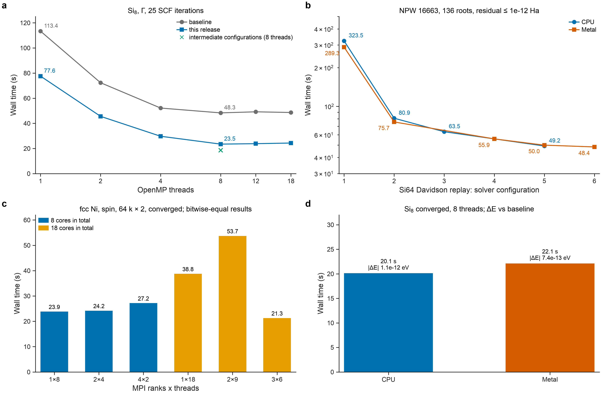

**English** · [简体中文](PERFORMANCE.zh-CN.md) · [README](../README.md) · [Theory](THEORY.md) · [Sparsification](SPARSIFICATION.md) · [Accuracy](ACCURACY.md) · [User guide](USER_GUIDE.md)

# Performance

This page reports measured wall times of the native core with its parallel back-ends. Every number comes from `benchmarks/data/performance.json`, which hashes the timing logs it was read from. The savings from sparsification are reported separately in [SPARSIFICATION.md §5](SPARSIFICATION.md#5-what-auto-saves).

**Machine.** Apple M5 Max (6 performance and 12 efficiency cores), macOS 26. Other jobs were running during the measurements (load average about 4), so each wall time carries noise of the order of 10 %. Times are single measurements unless stated. No measurement in this page used a second machine, Linux, Windows or an NVIDIA GPU.

**Builds.** "This release" is the release code path with its default solver. "Baseline" is a reference build of the same physics with an unoptimised solver (fixed summation order, per-vector CGS2 orthogonalisation, `full` compensation scope). Both are compared on identical inputs. Every comparison reports the change in energy, force and stress, so speed is never traded silently for accuracy.

*Figure 1. (a) Converged Si$_8$ SCF (8-atom diamond cell, Γ point, 25 SCF iterations, forces and stress) against OpenMP threads, baseline and this release; crosses: intermediate solver configurations at 8 threads. (b) Si$_{64}$ Davidson replay (one frozen-operator solve, $N_\mathrm{PW}$ = 16 663, 136 roots, residual ≤ $10^{-12}$ Ha) for six solver configurations (1 = baseline), CPU and Metal. (c) MPI layouts for fcc Ni (spin, 64 k points × 2 spins); results are bitwise identical across layouts. (d) Converged Si$_8$ on the CPU and Metal back-ends with the change in total energy against the baseline. All measured; NPW, number of plane waves.*

## 1. OpenMP

*Table 1. Converged Si$_8$ SCF, wall time (s) against OpenMP threads (measured).*

| threads | 1 | 2 | 4 | 8 | 12 | 18 |
|---|---|---|---|---|---|---|
| baseline | 113.36 | 72.34 | 52.18 | 48.34 | 49.20 | 48.65 |
| this release | 77.58 | 45.59 | 29.74 | 23.48 | 23.83 | 24.35 |

At 8 threads the wall time falls from 48.3 to 23.5 s. Against the baseline the converged energy changes by at most $2.8\times10^{-12}$ eV, the force by $1.7\times10^{-9}$ eV/Å and the stress by $2.2\times10^{-10}$ GPa across all thread counts. Both builds stop scaling beyond 8 threads on this machine. The efficiency cores and the other load are the likely reasons; neither was isolated.

Other systems at 8 threads (this release against the baseline, measured): Si$_2$ 9.98 → 6.90 s, MgO 6.86 → 3.35 s, Ni 31.28 → 16.55 s. The largest changes of the converged results across Si$_2$, MgO, Ni and Si$_8$ are $2.4\times10^{-12}$ eV, $1.5\times10^{-9}$ eV/Å and $5.7\times10^{-9}$ GPa.

`--deterministic` selects a fixed summation order and the baseline solver settings. It costs time: Si$_2$ 9.16 s, MgO 6.19 s, Ni 27.85 s at 8 threads.

## 2. Si$_{64}$ eigensolver replay

The replay program `sdft_solver_replay` re-solves one stored Si$_{64}$ eigenproblem (64-atom diamond supercell, Γ point, 320 eV) from frozen operators. It isolates the Davidson solver from the rest of the SCF. Each run must pass the same FP64 certificate of $10^{-12}$ Ha; all passed in 36 iterations.

*Table 2. Si$_{64}$ replay, solver time (s), 8 threads (measured). Configurations 1–6 are successive solver configurations, from the baseline (1) to the last one measured (5 on CPU, 6 on Metal).*

| configuration | 1 | 2 | 3 | 4 | 5 | 6 |
|---|---|---|---|---|---|---|
| CPU | 323.5 | 80.9 | 63.5 | — | 49.2 | — |
| Metal | 289.3 | 75.7 | — | 55.9 | 50.0 | 48.4 |

The CPU solve takes 49.2 s in configuration 5 and 323.5 s in the baseline configuration. The largest residual stayed between $8.05\times10^{-13}$ and $9.40\times10^{-13}$ Ha in every run.

## 3. MPI

*Table 3. fcc Ni SCF, wall time (s), ranks × threads per rank (measured). All layouts give bitwise identical energies and forces.*

| layout | 1×8 | 2×4 | 4×2 | 1×18 | 2×9 | 3×6 |
|---|---|---|---|---|---|---|
| wall (s) | 23.86 | 24.20 | 27.18 | 38.77 | 53.73 | 21.30 |

On one node MPI does not beat OpenMP with the same number of cores: 1×8 and 2×4 are within 2 %, and 4×2 is 14 % slower. Each rank still repeats the serial density and assembly work. The 18-core layouts vary widely (21–54 s). The slow 1×18 and 2×9 runs spent 148 and 374 s in system time, against at most 2.5 s in the other layouts; the cause was not isolated. Si$_2$ shows the same picture (7.71, 7.59 and 9.18 s for 1×8, 2×4 and 4×2). MPI is intended for runs across nodes and for memory; neither has been measured.

## 4. GPU back-ends

**Metal (macOS).** On converged Si$_8$ at 8 threads the Metal build took 22.11 s and the CPU build 20.13 s. Both agree with the baseline to $1.1\times10^{-12}$ eV. In the replay the two back-ends finish within 2 % (CPU 49.2 s, Metal 50.0 and 48.4 s). The Apple GPU has no FP64 arithmetic, so the certificate and every exact product stay on the CPU; only inexact search work moves to the GPU. Metal is therefore not faster than the CPU on these systems.

**CUDA.** The CUDA back-end has been checked for syntax against stub headers only. It has not been compiled with the CUDA toolkit or run on NVIDIA hardware. No CUDA timing or accuracy is claimed.

## 5. What these numbers do not say

- They are single measurements on one machine under load. Repeat on your own hardware before planning resources.
- Wall times of the sparsification sweep (SPARSIFICATION §5) and these timings were taken with different inputs and should not be combined.
- No result here covers more than 64 atoms, more than one node or an NVIDIA GPU.
