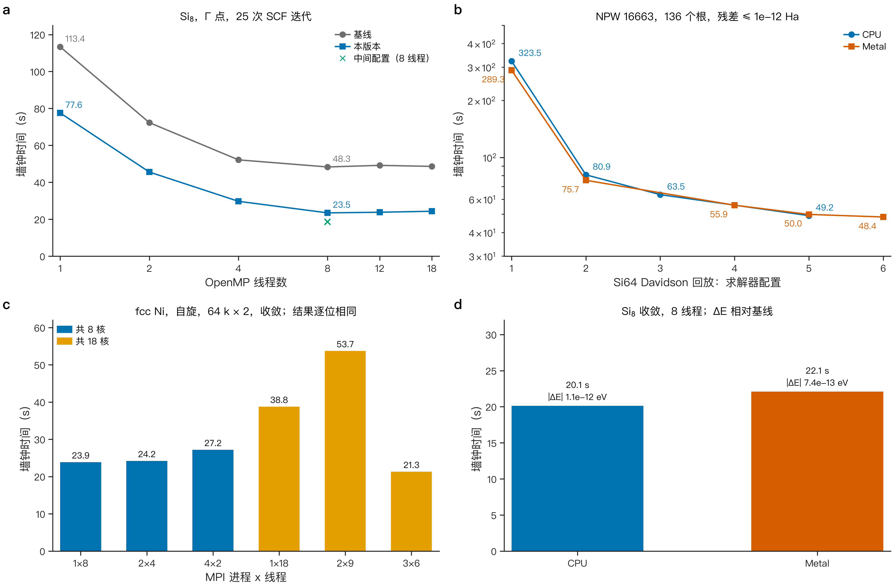

[English](PERFORMANCE.md) · **简体中文** · [README](../README.zh-CN.md) · [理论](THEORY.zh-CN.md) · [稀疏化](SPARSIFICATION.zh-CN.md) · [精度](ACCURACY.zh-CN.md) · [用户指南](USER_GUIDE.zh-CN.md)

# 性能

本页报告原生核心及其并行后端的实测墙钟时间。所有数字都来自 `benchmarks/data/performance.json`，其中记录了所读取计时日志的哈希。稀疏化带来的节省单独见 [SPARSIFICATION.zh-CN.md §5](SPARSIFICATION.zh-CN.md#5-auto-节省了什么)。

**机器。** Apple M5 Max（6 个性能核心和 12 个能效核心），macOS 26。测量期间有其他任务在运行（负载均值约 4），因此每个墙钟时间带有约 10 % 量级的噪声。除另有说明外，时间均为单次测量。本页没有任何测量使用第二台机器、Linux、Windows 或 NVIDIA GPU。

**构建。** "本版本"是发布版代码路径及其默认求解器。"基线"是物理相同、求解器未经优化（固定求和顺序、逐向量 CGS2 正交化、`full` 补偿范围）的参考构建。两者在相同输入上比较。每次比较都报告能量、力和应力的变化，确保速度从不以悄然牺牲精度为代价。

*图 1. (a) 收敛的 Si$_8$ SCF（8 原子金刚石晶胞，Γ 点，25 次 SCF 迭代，含力和应力）随 OpenMP 线程数的变化，基线与本版本；叉号：8 线程下的中间求解器配置。(b) Si$_{64}$ Davidson 回放（一次冻结算符求解，$N_\mathrm{PW}$ = 16 663，136 个根，残差 ≤ $10^{-12}$ Ha）在六种求解器配置下的结果（1 = 基线），CPU 和 Metal。(c) fcc Ni（自旋，64 个 k 点 × 2 个自旋）的 MPI 布局；各布局的结果逐位相同。(d) CPU 和 Metal 后端上收敛的 Si$_8$，以及相对基线的总能变化。均为实测；NPW，平面波数。*

## 1. OpenMP

*表 1. 收敛的 Si$_8$ SCF，墙钟时间 (s) 随 OpenMP 线程数的变化（实测）。*

| 线程数 | 1 | 2 | 4 | 8 | 12 | 18 |
|---|---|---|---|---|---|---|
| 基线 | 113.36 | 72.34 | 52.18 | 48.34 | 49.20 | 48.65 |
| 本版本 | 77.58 | 45.59 | 29.74 | 23.48 | 23.83 | 24.35 |

8 线程下墙钟时间从 48.3 s 降到 23.5 s。在所有线程数下，相对基线，收敛能量的变化至多 $2.8\times10^{-12}$ eV，力至多 $1.7\times10^{-9}$ eV/Å，应力至多 $2.2\times10^{-10}$ GPa。在这台机器上两个构建超过 8 线程后都不再扩展。能效核心和其他负载是可能的原因；二者都未单独隔离。

8 线程下的其他体系（本版本相对基线，实测）：Si$_2$ 9.98 → 6.90 s，MgO 6.86 → 3.35 s，Ni 31.28 → 16.55 s。在 Si$_2$、MgO、Ni 和 Si$_8$ 上，收敛结果的最大变化为 $2.4\times10^{-12}$ eV、$1.5\times10^{-9}$ eV/Å 和 $5.7\times10^{-9}$ GPa。

`--deterministic` 选用固定的求和顺序和基线求解器设置。它会增加用时：8 线程下 Si$_2$ 9.16 s，MgO 6.19 s，Ni 27.85 s。

## 2. Si$_{64}$ 本征求解回放

回放程序 `sdft_solver_replay` 从冻结算符重新求解一个存储的 Si$_{64}$ 本征问题（64 原子金刚石超胞，Γ 点，320 eV）。它把 Davidson 求解器从 SCF 的其余部分中隔离出来。每次计算都必须通过同一个 $10^{-12}$ Ha 的 FP64 证书；全部在 36 次迭代内通过。

*表 2. Si$_{64}$ 回放，求解时间 (s)，8 线程（实测）。配置 1–6 是依次的求解器配置，从基线（1）到最后测量的配置（CPU 为 5，Metal 为 6）。*

| 配置 | 1 | 2 | 3 | 4 | 5 | 6 |
|---|---|---|---|---|---|---|
| CPU | 323.5 | 80.9 | 63.5 | — | 49.2 | — |
| Metal | 289.3 | 75.7 | — | 55.9 | 50.0 | 48.4 |

CPU 求解在配置 5 下用时 49.2 s，在基线配置下用时 323.5 s。每次计算的最大残差都保持在 $8.05\times10^{-13}$ 与 $9.40\times10^{-13}$ Ha 之间。

## 3. MPI

*表 3. fcc Ni SCF，墙钟时间 (s)，进程数 × 每进程线程数（实测）。所有布局给出逐位相同的能量和力。*

| 布局 | 1×8 | 2×4 | 4×2 | 1×18 | 2×9 | 3×6 |
|---|---|---|---|---|---|---|
| 墙钟 (s) | 23.86 | 24.20 | 27.18 | 38.77 | 53.73 | 21.30 |

在单节点上，同样核心数下 MPI 不比 OpenMP 快：1×8 与 2×4 相差 2 % 以内，4×2 慢 14 %。每个进程仍重复串行的密度和组装工作。18 核布局的差异很大（21–54 s）。较慢的 1×18 和 2×9 计算分别花了 148 s 和 374 s 系统时间，其他布局至多 2.5 s；原因未单独隔离。Si$_2$ 呈现同样的情形（1×8、2×4 和 4×2 分别为 7.71、7.59 和 9.18 s）。MPI 面向跨节点计算和内存扩展；二者都尚未测量。

## 4. GPU 后端

**Metal（macOS）。** 在 8 线程的收敛 Si$_8$ 上，Metal 构建用时 22.11 s，CPU 构建用时 20.13 s。两者与基线的差异都在 $1.1\times10^{-12}$ eV 以内。回放中两个后端相差 2 % 以内（CPU 49.2 s，Metal 50.0 s 和 48.4 s）。Apple GPU 没有 FP64 运算，因此证书和所有精确乘积都留在 CPU 上；只有非精确搜索工作移到 GPU。所以在这些体系上 Metal 并不比 CPU 快。

**CUDA。** CUDA 后端只对照桩头文件做过语法检查。它没有用 CUDA 工具链编译过，也没有在 NVIDIA 硬件上运行过。本文不给出任何 CUDA 计时或精度结论。

## 5. 这些数字没有说明什么

- 它们是单台负载机器上的单次测量。规划资源之前请在自己的硬件上重复测量。
- 稀疏化扫描的墙钟时间（稀疏化 §5）与这些计时使用不同的输入，不应合并使用。
- 本页没有任何结果涉及超过 64 个原子、超过一个节点或 NVIDIA GPU。
