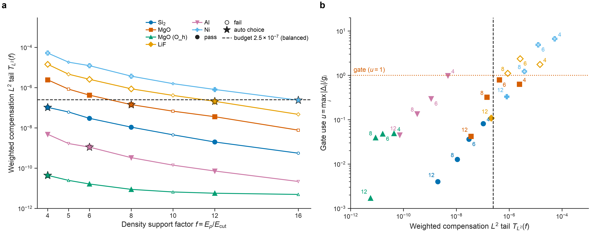
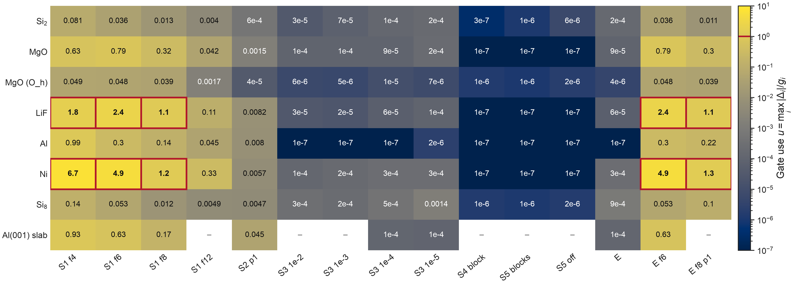

**English** · [简体中文](SPARSIFICATION.zh-CN.md) · [README](../README.md) · [Theory](THEORY.md) · [Accuracy](ACCURACY.md) · [Performance](PERFORMANCE.md) · [User guide](USER_GUIDE.md)

# Sparsification in Sparse-DFT

The Sparse Density Function method of Sparse-DFT removes work that a plane-wave PAW calculation does not need for a given accuracy. It never changes what "converged" means. This document defines each sparsification component, the error it can introduce, and how the code bounds that error. All numbers come from `benchmarks/data`; each is labelled measured or computed and carries its conditions.

## 1. The idea in one page

A plane-wave PAW calculation keeps two kinds of arrays on a Fourier grid. Wavefunctions live inside the sphere $\tfrac12|\mathbf G+\mathbf k|^2 \le E_\mathrm{cut}$. Densities live on a larger sphere $\tfrac12|\mathbf G|^2 \le E_\rho$. The density sphere must be larger for two reasons:

- the smooth density $\tilde n=\sum_{n\mathbf k} f_{n\mathbf k}|\tilde\psi_{n\mathbf k}|^2$ has Fourier support up to $|\mathbf G| = 2G_\mathrm{cut}$, that is $E_\rho = 4E_\mathrm{cut}$;
- the PAW compensation charge $\hat n$ and the partial core $\tilde n_c$ are localised inside the augmentation spheres, so their spectra extend beyond any finite sphere.

The exact reference in Sparse-DFT uses $E_\rho = 16E_\mathrm{cut}$ and a twofold XC quadrature padding ("sparsity off"). Sparsification asks a narrower question: how much of this support, and how much of the iterative solver's work, does a given system need?

Two rules keep the answer safe:

1. **Discretisation components (class A)** change the discrete problem. Their error is estimated before the run from the PAW data, and the choice is recorded in the result.
2. **Search components (class E)** change only how the eigensolver reaches its answer. Every accepted eigenpair still passes the FP64 residual certificate on the original operators, and the SCF still stops at the original density thresholds.


*Figure 1. Reciprocal-space supports, drawn to scale in $|\mathbf G|$ for one cutoff (schematic geometry drawn by code). $E_\mathrm{cut}$, wavefunction cutoff; $E_\rho$, density cutoff; $f = E_\rho/E_\mathrm{cut}$, density support factor; $G_\rho=\sqrt f\,G_\mathrm{cut}$. The ring between $f = 4$ and $f = 16$ holds only the high-frequency tails of the compensation and partial-core charges.*

```mermaid
flowchart LR
  S[structure + PAW] --> P[spectrum probe<br/>tails T(f)]
  S --> F[features<br/>metallic, spin, vacuum, Z]
  P --> A{auto rules}
  F --> A
  A -->|class A| D[density support f<br/>XC padding]
  A -->|class E| E[inexact search, block CGS2,<br/>compensation scope]
  D --> SCF[SCF]
  E --> SCF
  SCF --> C{FP64 certificate<br/>residual ≤ 1e-12 Ha<br/>original density thresholds}
  C -->|pass| R[result + sparsity ledger]
  C -->|fail| SCF
```

*Figure 2. Decision flow of `--sparsity auto`. Class A components are fixed before the SCF; class E components act inside it and are checked by the unchanged FP64 certificate (FP64, IEEE double precision).*

## 2. Components

Each component has its own switch. `--sparsity custom` applies only the components you name. `--sparsity auto` chooses them from the rules in `sparse_dft/sparsity_rules.json`. An explicit component flag always overrides auto.

| ID | Class | What it changes | Control and range | With `--sparsity off` | Error mechanism | How it is bounded |
|---|---|---|---|---|---|---|
| S1 | A | density support $E_\rho = f E_\mathrm{cut}$ for compensation, partial-core and Hartree terms | `--density-cutoff-factor F`, $F\in[4,24]$; `--density-cutoff EV` for an absolute value | $f = 16$ | truncation of $\hat n(\mathbf G)$ and $\tilde n_c(\mathbf G)$ beyond $G_\rho$ | spectrum-probe tail $T(f)$ below a budget (§3) |
| S2 | A | XC quadrature grid: padding $p$ per axis, $N_a = p\max(3, 2m_a+1)$ | `--xc-padding P`, $P\in\{1,2,3,4\}$ | $p = 2$ | aliasing of the non-linear GGA integrand | measured per system class; kept at 2 in vacuum cells (§4) |
| S3 | E | inner eigen tolerance during SCF: $\epsilon_\mathrm{eig} = \mathrm{clamp}(s\,r_\mathrm{out}, \epsilon_\mathrm{fin}, 10^{-4})$ | `--eigen-search-factor S`, $S\in(0, 0.1]$ | inner solves at $\epsilon_\mathrm{fin}$ | more outer iterations if $s$ is too large | final iterations use $\epsilon_\mathrm{fin}\le 10^{-12}$ Ha; certificate |
| S4 | E | orthogonalisation of appended Davidson vectors by block classical Gram–Schmidt, two passes (CGS2) | `--block-ortho 0/1` | block (native default); per-vector with `--deterministic` | loss of $S$-orthogonality | re-orthogonalised against $S$; certificate |
| S5 | E | scope of compensated (error-free) summation in PAW products: `full`, `blocks`, `off` | `--paw-compensation` | `blocks` (native default); `full` with `--deterministic` | rounding in long $B^\dagger X$ contractions | per-atom $D$/$Q$ products stay compensated in `blocks`; certificate |
| S6 | E | real-space projectors during inexact search only | `--projector-space real-search`, `--projector-radius-factor` in $[1,2]$ | reciprocal | projector truncation in the search | FP64 reciprocal projectors at certification |
| S7 | E | FP32 working precision during search | `--search-precision` | fp64 | — | not implemented: `fp32` is refused |

Here $m_a$ is the largest Miller index on axis $a$ in the density support, $r_\mathrm{out}$ the current outer density residual and $\epsilon_\mathrm{fin} = \min(10^{-12}, \max(5\times10^{-14}, \min(\delta_\rho, \delta_\mathrm{1c})/10^4))$ with the density and one-centre acceptance thresholds $\delta_\rho$ and $\delta_\mathrm{1c}$ (`src/scf_inner_accuracy.hpp`). Inexact inner solves stop once both residuals fall within $10^3$ times their thresholds.

The native solver defaults already include block CGS2 (S4) and the `blocks` compensation scope (S5). `--deterministic` (or `SDFT_DETERMINISTIC=1`) selects a fixed summation order, per-vector CGS2 and the `full` scope; §6 gives the measured differences. The `off` references of the sweep in §4 used per-vector CGS2 and the `full` scope.

**Not implemented.** S7 has no FP32 kernel in this build. S6 is available through `--projector-space real-search`, but no auto rule selects it, and its speed has no record in `benchmarks/data`. There is no real-space truncation of the density itself and no adaptive per-atom support.

## 3. The spectrum probe (S1 error estimate)

The probe estimates, before the SCF, how much charge spectrum each candidate factor $f$ would discard. It is implemented in `density_spectrum_probe_json` (`src/scf_core.cpp`) and writes `density_probe.json` (schema `sparse-dft-density-spectrum-probe-1`). It is diagnostic: it never changes the operator.

**Grid.** A density cutoff $E$ in eV corresponds to the wavevector

$$q(E) = \sqrt{2E/E_\mathrm h}\;\big/\;a_0 \quad [\text{Å}^{-1}],$$

with $E_\mathrm h$ the Hartree energy in eV and $a_0$ the Bohr radius in Å of the active unit convention. The probe samples $q_i = (i+\tfrac12)\,\Delta q$ for $i = 0,\dots,N_q-1$ with $N_q = 3072$, $\Delta q = q_\mathrm{top}/N_q$ and $q_\mathrm{top} = q(24\,E_\mathrm{cut})$.

**Form factors.** For each distinct PAW dataset $s$ (deduplicated by content hash):

- $c_s(q)$ is the partial-core charge form factor, read from the dataset's reciprocal-space table;
- $g_{s,L}(q) = \int_0^{r_c} \bar g_{s,L}(r)\,r^2 j_L(qr)\,dr$ is the radial form of the compensation shape of angular momentum $L$, normalised so that $g_{s,0}(0) = 1$ (`paw_compensation_radial_form`, `src/paw_compensation.cpp`);
- $w_{s,L} = \big(\sum_{M=-L}^{L}|\rho_{s,LM}|^2\big)^{1/2}$ is the multipole weight of the free-atom reference occupation: the compensation moments $\rho_{s,LM}$ of [THEORY.md §4](THEORY.md#4-projector-augmented-waves), evaluated for the reference occupation stored in the dataset (`src/paw_augmentation.cpp`). For a spherical free atom only $w_{s,0}$ is non-zero.

**Cumulative spectra.** For any form factor $h(q)$ the probe accumulates two midpoint sums,

$$C^{L^2}_h(Q) = \sum_{q_i < Q} |h(q_i)|^2 q_i^2\,\Delta q, \qquad C^{H}_h(Q) = \sum_{q_i < Q} |h(q_i)|^2\,\Delta q.$$

$C^{L^2}$ approximates the real-space $L^2$ norm of the omitted charge, up to a constant $4\pi$. $C^{H}$ is weighted by $1/q^2$ relative to $C^{L^2}$ and so tracks the Hartree energy of the omitted charge. With $q_f = q(f E_\mathrm{cut})$ the absolute and relative tails are

$$A_h(f) = C_h(q_\mathrm{top}) - C_h(q_f), \qquad R_h(f) = A_h(f)/C_h(q_\mathrm{top}).$$

**Reported metrics.** For each factor $f$ and species $s$, `density_probe.json` reports:

| field | definition |
|---|---|
| `weighted_compensation_l2` | $\sum_L w_{s,L}^2\,A^{L^2}_{g_{s,L}}(f)$ |
| `weighted_compensation_hartree` | $\sum_L w_{s,L}^2\,A^{H}_{g_{s,L}}(f)$ |
| `compensation_l2`, `compensation_hartree` | $\max_L R_{g_{s,L}}(f)$ for the $L^2$ and Hartree weights |
| `compensation_amplitude` | $\max_L \max_{q \ge q_f}|g_{s,L}(q)| / \max_q |g_{s,L}(q)|$ |
| `core_l2`, `core_hartree`, `core_amplitude` | the same relative tails for $c_s(q)$ |
| `absolute_core_l2`, `absolute_core_hartree` | $A^{L^2}_{c_s}(f)$, $A^{H}_{c_s}(f)$ |

The default factors are $\{4,5,6,8,10,12,16\}$. `SDFT_SPARSITY_PROBE_FACTORS` replaces them with 1–32 values in $[1,24)$.

**The two auto metrics.** Auto mode reduces the per-species values to one number per factor:

$$T_{L^2}(f) = \sum_s \sum_L w_{s,L}^2\,A^{L^2}_{g_{s,L}}(f) \qquad (\texttt{weighted\_compensation\_l2}, \text{default}),$$

$$T_{\mathrm{shape}}(f) = \max_s \max\big(\texttt{compensation\_hartree}_s(f),\ \texttt{core\_hartree}_s(f)\big) \qquad (\texttt{shape\_hartree}).$$

$T_{L^2}$ measures how much compensation charge, weighted by its actual size, falls outside the sphere. The sum runs over distinct datasets, not over atoms, so it does not grow with cell size. $T_\mathrm{shape}$ ignores the charge weights and compares shapes only; it needs an explicit `--sparsity-tail-budget`. Neither metric is a rigorous error bound on energies or forces: §4 shows how the budget was calibrated against measured errors, and where the ordering is imperfect.

The monopole weights explain most of the spread between systems (computed, `benchmarks/data/sparsity_probe_tails.json` and the probe files it hashes): $w_0$ is 1.80 for Ni, 0.336 for F, 0.144 for O, 0.077 for Si, 0.0189 for Al, 0.0036 for Mg, 0.0010 for Li and 0.0007 for the hard O_h dataset. A hard dataset with a small compensation charge tolerates $f = 4$; Ni with a large $d$ compensation charge needs $f = 16$.

## 4. Auto mode

### 4.1 Algorithm

`resolve_auto` (`sparse_dft/sparsity.py`) runs once per calculation, after the probe and before the SCF. A relaxation resolves it once on the starting geometry and keeps the choice for every step.

1. **Features.** `metallic` means Fermi–Dirac smearing $k_BT > 0$; `spin` means two collinear channels; `natoms`, `max_zval` and the dataset IDs come from the input. `vacuum_fraction` is the largest empty fraction of a lattice vector, counted only when the empty gap exceeds 5 Å.
2. **Budget.** $\tau = \tau_\mathrm{rules}\times\lambda$, with $\tau_\mathrm{rules} = 2.5\times10^{-7}$ and the level factor $\lambda$ = 0.25 (`conservative`), 1 (`balanced`, default) or $4.25\times10^{-7}/2.5\times10^{-7} = 1.7$ (`aggressive`). `--sparsity-tail-budget` replaces $\tau$ directly.
3. **Candidates.** The factors $\{4,5,6,8,10,12,16\}$, clipped to `--sparsity-min-factor`/`--sparsity-max-factor` or replaced by `--sparsity-candidates`. Rule `S1.metal_min6.v1` raises the lower limit to 6 for metals. A candidate the probe did not report raises an error; it is never treated as a zero tail.
4. **Choice.** The smallest eligible $f$ with $T(f)\le\tau$. If none qualifies, the fallback is $f = 16$ (or the largest eligible factor when the user limited the range), and the ledger records `fallback: true` with a warning.
5. **S2–S7.** For each component the first rule whose `when` conditions match wins. Conditions compare features with `_min`/`_max` suffixes or exact values.

The rules file shipped with this release (`sparsity_rules.json`, status `fitted-v2`) contains:

| rule | condition | value | evidence (measured, against the same-system off run) |
|---|---|---|---|
| S1.weighted_l2.v1 | always | smallest $f$ with $T_{L^2}(f)\le2.5\times10^{-7}$ | §4.2 |
| S1.metal_min6.v1 | metallic | $f\ge6$ | Al: gate use 0.988 at $f = 4$, 0.298 at $f = 6$ (stress-limited) |
| S2.vacuum.v2 | vacuum fraction ≥ 0.3 | $p = 2$ | Al(001) slab with $f = 6$, $p = 1$: force error $1.98\times10^{-3}$ eV/Å, gate $10^{-3}$; $f = 6$, $p = 2$: $3.0\times10^{-4}$ eV/Å |
| S2.insulator.v1 | not metallic | $p = 1$ | $p = 1$ alone: $\lvert\Delta E\rvert\le2.4\times10^{-5}$ meV/atom, $\lvert\Delta\sigma\rvert\le1.8\times10^{-5}$ GPa on Si$_2$, MgO, MgO (O_h), LiF, Si$_8$ |
| S2.metal.v1 | metallic | $p = 1$ | $p = 1$ alone: $\lvert\Delta E\rvert$ = $2.4\times10^{-4}$ (Al) and $7.6\times10^{-4}$ (Ni) meV/atom |
| S3.metal.v1 | metallic, no spin | $s = 10^{-5}$ | Al: 22, 21, 19 and 12 outer iterations for $s = 10^{-2}\dots10^{-5}$, against 10 for the reference |
| S3.default.v1 | otherwise | $s = 10^{-4}$ | fewest $H$ operator calls, or within 7 % of the fewest, among $s = 10^{-2}\dots10^{-5}$ on Si$_2$, MgO (O_h), Ni and Si$_8$ |
| S4.all.v1 | always | block CGS2 | $\lvert\Delta E\rvert\le4.1\times10^{-9}$ meV/atom on 7 systems; 6.8–18× fewer $S$ operator calls |
| S5.blocks.v1 | always | `blocks` | `blocks` and `off`: $\lvert\Delta E\rvert\le5.9\times10^{-9}$ meV/atom, $\lvert\Delta F\rvert\le6.4\times10^{-9}$ eV/Å on 7 systems |

S6 and S7 have no rules. The rules file can be replaced with `--sparsity-rules FILE` (schema `sparse-dft-sparsity-rules-1`).

### 4.2 How the S1 budget was calibrated

The budget comes from a sweep of fixed factors on six fit systems (measured; `benchmarks/data/sparsity_sweep.json`). Each run is compared with the same system at $f = 16$, padding 2. The gates are the Sparse-DFT accuracy targets ([ACCURACY.md](ACCURACY.md) §1): 1 meV/atom in energy, $10^{-3}$ eV/Å in force, 0.01 GPa in stress and 5 meV for the band window. The gate use

$$u = \max\Big(\tfrac{|\Delta E|}{1\ \mathrm{meV/atom}},\ \tfrac{|\Delta F|_\infty}{10^{-3}\ \mathrm{eV/Å}},\ \tfrac{|\Delta\sigma|_\infty}{0.01\ \mathrm{GPa}},\ \tfrac{|\Delta\varepsilon|_\mathrm{window}}{5\ \mathrm{meV}}\Big)$$

summarises a run in one number; a run passes when $u\le1$, it converged and the electron count agrees.



*Figure 3. (a) Weighted compensation $L^2$ tail $T_{L^2}(f)$ from the spectrum probe for the six fit systems (computed). Filled markers: the fixed-factor sweep passed; open markers: it failed; small markers: factor not swept; stars: the factor chosen by the fitted rules. Dashed line: balanced budget $2.5\times10^{-7}$. (b) Measured gate use $u$ against $T_{L^2}$ for every swept factor (labels give $f$). Gate use $u$ is the largest ratio of a deviation to its Table 1 gate.*

Three facts follow from Figure 3.

- Every chosen factor lies on the passing side. The balanced budget selects $f$ = 4 (Si$_2$, MgO (O_h)), 6 (Al, metal floor), 8 (MgO), 12 (LiF) and 16 (Ni). Their gate uses are 0.005–0.65 (Table 4).
- The failures sit at large tails: LiF at $f\le8$ ($T_{L^2}\ge8.77\times10^{-7}$) and Ni at $f\le8$ ($T_{L^2}\ge3.73\times10^{-6}$).
- The ordering is not perfect. MgO passes at $f = 4$ with $T_{L^2} = 2.45\times10^{-6}$, above the smallest failing tail. A single threshold therefore cannot separate passes from failures, and the budget sits below every failing tail with a margin. The rules file states its evidence as "largest passing weighted L2 tail 4.25e-7 (MgO f6)", which ignores the MgO $f = 4$ pass; the `aggressive` level ($\tau = 4.25\times10^{-7}$) inherits that number.



*Figure 4. Gate use $u$ of each single-component variant (columns) on each system (rows) against the same-system off run (measured). Red frames mark failures; "–" marks variants not run. E = the search bundle S3 ($s = 10^{-4}$) + S4 + S5 `blocks`. Values below $10^{-7}$ are drawn at $10^{-7}$. Colour scale: logarithmic gate use.*

Figure 4 separates the two classes. Every class-E variant (S3, S4, S5 and the E bundle, 61 runs) passes with $u < 10^{-3}$. Their largest deviations are $2.1\times10^{-8}$ meV/atom, $1.4\times10^{-6}$ eV/Å and $2.6\times10^{-6}$ GPa, at the level of the SCF convergence threshold. Class-A variants carry all measurable error: S1 fails on LiF and Ni at small $f$. S2 at $p = 1$ stays below $u = 10^{-2}$ in bulk cells and reaches $u = 0.045$ in the slab.

### 4.3 Hold-out tests

Four systems were kept out of the fit (measured): Si$_8$, the Al(001) slab, Si$_{64}$ and Ni$_4$ with the Ni_pv dataset. The slab tests the rules where they are weakest. With $f = 6$ and padding 1 it fails the force gate at $1.98\times10^{-3}$ eV/Å, although each component alone passes ($f = 6$: $3.0\times10^{-4}$ eV/Å; $p = 1$: $4.5\times10^{-5}$ eV/Å). The error comes from the interaction of a reduced density support and a reduced XC grid in vacuum. Rule S2.vacuum.v2 therefore keeps $p = 2$ when the vacuum fraction is at least 0.3; the slab's is 0.60. With the shipped rules the slab passes at $u = 0.63$.

## 5. What auto saves

The savings are reported in two currencies that are kept apart. Operator call counts come from the performance counters of each run and do not depend on machine load. Wall time is a single run on a shared machine (Apple M5 Max, 8 OpenMP threads, other jobs present) and carries run-to-run noise.

*Table 4. `--sparsity auto` against `--sparsity off` on the same system, binary and machine (measured; `benchmarks/data/sparsity_sweep.json`). $f$, density support factor; $p$, XC padding; $s$, S3 search factor; $u$, gate use; $H$, $S$, $P$, ratios of Hamiltonian, overlap and PAW projector-block operator calls (off / auto); "it", SCF iterations auto / off; rules, version of the rules file the run used; every v1 row has vacuum fraction 0, where S2.vacuum.v2 does not apply.*

| system | set | rules | $f$ | $p$ | $s$ | $\lvert\Delta E\rvert$ (meV/atom) | $\lvert\Delta F\rvert$ (eV/Å) | $\lvert\Delta\sigma\rvert$ (GPa) | $u$ | wall off → auto (s) | wall × | $H$ | $S$ | $P$ | it |
|---|---|---|---|---|---|---|---|---|---|---|---|---|---|---|---|
| Si$_2$ | fit | v1 | 4 | 1 | 1e-4 | 0.0745 | 1.2e-4 | 3.4e-4 | 0.122 | 10.12 → 1.78 | 5.67 | 3.9 | 18.9 | 14.4 | 20/20 |
| MgO | fit | v1 | 8 | 1 | 1e-4 | 0.0606 | 5.6e-5 | 3.0e-3 | 0.301 | 6.40 → 1.96 | 3.26 | 2.3 | 12.4 | 9.4 | 15/12 |
| MgO (O_h) | fit | v1 | 4 | 1 | 1e-4 | 0.0346 | 1.3e-4 | 3.0e-4 | 0.131 | 33.71 → 5.93 | 5.69 | 3.6 | 19.1 | 14.4 | 38/34 |
| LiF | fit | v1 | 12 | 1 | 1e-4 | 0.0228 | 6.0e-5 | 1.0e-3 | 0.104 | 6.54 → 1.94 | 3.37 | 2.9 | 16.9 | 12.7 | 15/14 |
| Al | fit | v1 | 6 | 1 | 1e-5 | 0.0832 | 6.8e-11 | 6.5e-3 | 0.645 | 7.54 → 2.70 | 2.79 | 2.3 | 12.5 | 9.2 | 12/10 |
| Ni | fit | v1 | 16 | 1 | 1e-4 | 0.000756 | 2.5e-12 | 5.5e-5 | 0.005 | 73.93 → 11.13 | 6.64 | 2.2 | 19.0 | 13.1 | 22/23 |
| Si$_8$ | hold-out | v1 | 4 | 1 | 1e-4 | 0.0889 | 4.8e-4 | 3.5e-3 | 0.480 | 50.31 → 6.18 | 8.13 | 3.1 | 38.8 | 29.2 | 23/25 |
| Al(001) slab | hold-out | v2 | 6 | 2 | 1e-5 | 0.120 | 3.0e-4 | 7.4e-4 | 0.632 | 692.99 → 125.86 | 5.51 | 2.1 | 20.9 | 15.7 | 102/72 |
| Ni$_4$ (Ni_pv) | hold-out | v2 | 16 | 1 | 1e-4 | 0.000993 | 3.4e-4 | 3.8e-4 | 0.343 | 108.1 → 70.2 | 1.54 | 2.5 | 2.0 | 2.2 | 30/33 |
| Si$_{64}$ | hold-out | v2 | 4 | 1 | 1e-4 | 0.0885 | 2.9e-4 | 1.7e-3 | 0.292 | 1777.7 → 521.7 | 3.41 | 3.5 | 2.3 | 2.6 | 30/36 |


*Figure 5. (a) Wall-time speed-up and operator call-count ratios of `--sparsity auto` against `--sparsity off` per system (measured; italic labels are hold-outs). (b) Gate use against wall-time speed-up for every swept variant (open markers: failed) and for the fitted auto runs (stars). Call ratios count operator invocations; a block call applies the operator to several vectors at once.*

How to read Table 4:

- **Class E removes most operator calls.** The $S$ and projector-block ratios of 9–39 on the small cells come mainly from block CGS2 (S4), which batches the overlap applications. On Si$_{64}$ and Ni$_4$ the reference already ran with fewer, larger blocks, and the ratios fall to 2–2.6.
- **Class A shrinks every density-side array.** At $f = 4$ the density support holds $(4/16)^{3/2} = 1/8$ of the reference modes before FFT rounding. Si$_{64}$ uses 133 219 instead of 1 066 147 density modes (ratio 0.125) and 250 047 instead of 16 387 064 XC points.
- **Wall-time ratios are noisy.** The Ni off reference took 73.9 s, while a sweep run with nearly the same operator call counts (S5 `off`) took 26.0 s on the same machine. The 6.64× for Ni therefore overstates the saving; the call ratios (2.2–19) are the robust measure.
- **Iterations can rise.** Auto took 102 outer iterations on the slab against 72 for the reference; the fewer, cheaper operator calls still gave a 5.5× wall-time ratio.

## 6. Class E leaves the converged result unchanged

The search components alter the path to convergence, not the converged fixed point. Two sets of measurements support this (measured; `benchmarks/data/performance.json`).

- **Default solver against the baseline build.** With block CGS2 and the `blocks` scope, converged Si$_2$, MgO, Ni and Si$_8$ agree with the baseline build (per-vector CGS2, `full` scope) within $|\Delta E|\le2.4\times10^{-12}$ eV, $|\Delta F|\le1.5\times10^{-9}$ eV/Å and $|\Delta\sigma|\le6\times10^{-9}$ GPa (8 threads).
- **Run-to-run noise of the baseline build.** Repeating the baseline build on Si$_2$ gives $|\Delta F|$ up to $1.6\times10^{-8}$ eV/Å and $|\Delta\sigma|$ up to $6.3\times10^{-8}$ GPa, larger than the change caused by the search components.
- **Deterministic mode.** `--deterministic` matched the baseline build bit for bit on Ni ($\Delta E = \Delta F = \Delta\sigma = 0$, two runs). On Si$_2$ and MgO it differed by at most $1.9\times10^{-12}$ eV and $1.4\times10^{-9}$ eV/Å, the same size as the baseline build's own repeat noise.

## 7. The sparsity ledger

Every SCF result carries a `sparsity_ledger` block (schema `sparse-dft-sparsity-ledger-2`), written by `sparsity_ledger` in `sparse_dft/sparsity.py`. It records what was chosen and what the run cost, so a reader can audit a result without rerunning it.

| field | meaning |
|---|---|
| `mode` | `off`, `custom` or `auto` |
| `density_cutoff_factor` | $f = E_\rho/E_\mathrm{cut}$ actually used |
| `density_modes_ratio_vs_16x_estimate` | $(f/16)^{3/2}$, the S1 mode ratio before FFT rounding |
| `density_reciprocal_modes`, `max_xc_grid_points`, `max_fft_grid_points`, `plane_waves`, `iterations` | sizes of this run |
| `components` | every component value that was set |
| `rule_ids` | the rules that produced the choice, e.g. `S1.weighted_l2.v1` |
| `auto.level`, `auto.controls` | the level and the user controls |
| `auto.tail_metric`, `auto.tail_budget`, `auto.tail_budget_source` | metric and budget, and whether the budget came from the rules × level or from the user |
| `auto.tail_at_choice`, `auto.tails_tried` | $T(f)$ at the chosen factor and at every factor tried |
| `auto.fallback`, `auto.warnings` | set when no candidate met the budget |
| `counters` | seconds and calls of the operator, FFT, density, diagonalisation and SCF timers |

Ratios against `off` need a second run; the ledger stores only this run's counts. The GUI shows the probe preview and the rule table before a run starts (see the [user guide](USER_GUIDE.md#11-graphical-interface)).

## 8. Limits

- The fit used ten systems with up to 64 atoms, PBE, collinear spin and the PBE.54 datasets. Other functionals, non-collinear magnetism, surfaces other than one Al slab, molecules and charged cells have not been swept.
- $T_{L^2}$ ranks systems well but not perfectly (§4.2). It is an estimate, not a bound.
- The reference for every sweep comparison is Sparse-DFT with sparsity off, not experiment and not another code. The comparison with VASP is in [ACCURACY.md](ACCURACY.md).
- Wall-time ratios are single measurements on a loaded machine.
- `--sparsity auto` does not choose the wavefunction cutoff, the k mesh or the number of bands. These must still be converged by the user.
