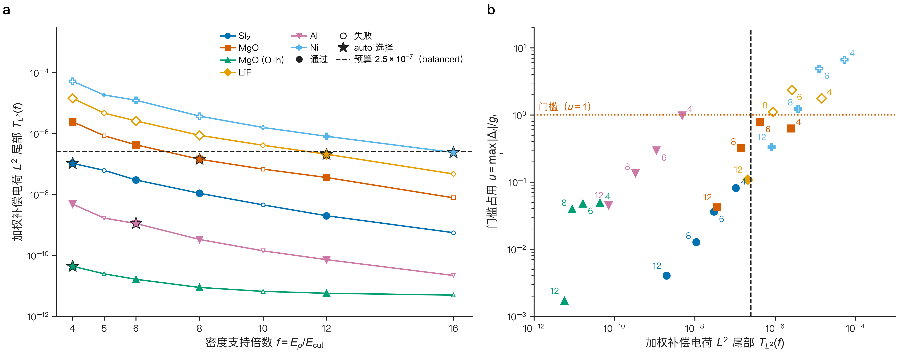
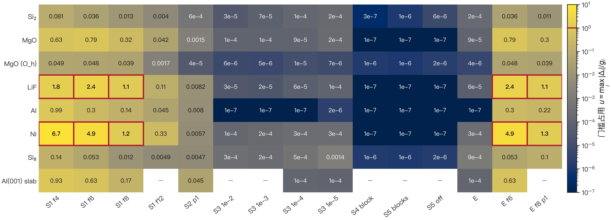

[English](SPARSIFICATION.md) · **简体中文** · [README](../README.zh-CN.md) · [理论](THEORY.zh-CN.md) · [精度](ACCURACY.zh-CN.md) · [性能](PERFORMANCE.zh-CN.md) · [用户指南](USER_GUIDE.zh-CN.md)

# Sparse-DFT 的稀疏化

Sparse-DFT 的 Sparse Density Function 方法去掉平面波 PAW 计算在给定精度下不需要的工作量。它从不改变"收敛"的含义。本文定义每个稀疏化组件、它可能引入的误差，以及代码如何约束该误差。所有数字都来自 `benchmarks/data`；每个数字都标注为实测或计算值，并注明条件。

## 1. 一页讲清基本思想

平面波 PAW 计算在傅里叶网格上保存两类数组。波函数位于球 $\tfrac12|\mathbf G+\mathbf k|^2 \le E_\mathrm{cut}$ 之内。密度位于更大的球 $\tfrac12|\mathbf G|^2 \le E_\rho$ 上。密度球必须更大，原因有两个：

- 光滑密度 $\tilde n=\sum_{n\mathbf k} f_{n\mathbf k}|\tilde\psi_{n\mathbf k}|^2$ 的傅里叶支撑延伸到 $|\mathbf G| = 2G_\mathrm{cut}$，即 $E_\rho = 4E_\mathrm{cut}$；
- PAW 补偿电荷 $\hat n$ 和部分芯电荷 $\tilde n_c$ 局域在缀加球内，因此它们的谱超出任何有限的球。

Sparse-DFT 的精确参考使用 $E_\rho = 16E_\mathrm{cut}$ 和两倍 XC 积分填充（"sparsity off"）。稀疏化回答一个更窄的问题：给定体系究竟需要多少这样的支撑，以及多少迭代求解器的工作量？

两条规则保证答案安全：

1. **离散化组件（A 类）**改变离散问题本身。它们的误差在计算前由 PAW 数据估计，所作选择记录在结果中。
2. **搜索组件（E 类）**只改变本征求解器到达答案的方式。每个被接受的本征对仍须在原始算符上通过 FP64 残差证书，SCF 仍在原始密度阈值处停止。


*图 1. 一个截断能下的倒空间支撑，按 $|\mathbf G|$ 比例绘制（示意几何，由代码绘制）。$E_\mathrm{cut}$，波函数截断能；$E_\rho$，密度截断能；$f = E_\rho/E_\mathrm{cut}$，密度支撑因子；$G_\rho=\sqrt f\,G_\mathrm{cut}$。$f = 4$ 与 $f = 16$ 之间的环只包含补偿电荷和部分芯电荷的高频尾部。*

```mermaid
flowchart LR
  S[结构 + PAW] --> P[谱探针<br/>尾部 T(f)]
  S --> F[特征<br/>金属性、自旋、真空、Z]
  P --> A{auto 规则}
  F --> A
  A -->|A 类| D[密度支撑 f<br/>XC 填充]
  A -->|E 类| E[非精确搜索、块 CGS2、<br/>补偿求和范围]
  D --> SCF[SCF]
  E --> SCF
  SCF --> C{FP64 证书<br/>残差 ≤ 1e-12 Ha<br/>原始密度阈值}
  C -->|通过| R[结果 + 稀疏化账本]
  C -->|未通过| SCF
```

*图 2. `--sparsity auto` 的决策流程。A 类组件在 SCF 之前确定；E 类组件在 SCF 内部起作用，并由不变的 FP64 证书检验（FP64，IEEE 双精度）。*

## 2. 组件

每个组件都有独立开关。`--sparsity custom` 只应用你指定的组件。`--sparsity auto` 按 `sparse_dft/sparsity_rules.json` 中的规则选择组件。显式的组件参数总是覆盖 auto。

| 编号 | 类别 | 改变的内容 | 控制参数与范围 | `--sparsity off` 时 | 误差机制 | 约束方式 |
|---|---|---|---|---|---|---|
| S1 | A | 补偿、部分芯和 Hartree 项的密度支撑 $E_\rho = f E_\mathrm{cut}$ | `--density-cutoff-factor F`，$F\in[4,24]$；绝对值用 `--density-cutoff EV` | $f = 16$ | $\hat n(\mathbf G)$ 和 $\tilde n_c(\mathbf G)$ 在 $G_\rho$ 之外被截断 | 谱探针尾部 $T(f)$ 低于预算（§3） |
| S2 | A | XC 积分网格：每轴填充 $p$，$N_a = p\max(3, 2m_a+1)$ | `--xc-padding P`，$P\in\{1,2,3,4\}$ | $p = 2$ | 非线性 GGA 被积函数的混叠 | 按体系类别实测；真空晶胞中保持为 2（§4） |
| S3 | E | SCF 中的内层本征容差：$\epsilon_\mathrm{eig} = \mathrm{clamp}(s\,r_\mathrm{out}, \epsilon_\mathrm{fin}, 10^{-4})$ | `--eigen-search-factor S`，$S\in(0, 0.1]$ | 内层求解取 $\epsilon_\mathrm{fin}$ | $s$ 过大时外层迭代增多 | 最后几次迭代用 $\epsilon_\mathrm{fin}\le 10^{-12}$ Ha；证书 |
| S4 | E | 追加的 Davidson 向量用块经典 Gram–Schmidt 两遍（CGS2）正交化 | `--block-ortho 0/1` | 块（原生默认）；`--deterministic` 时逐向量 | 失去 $S$ 正交性 | 对 $S$ 重新正交化；证书 |
| S5 | E | PAW 乘积中补偿（无误差）求和的范围：`full`、`blocks`、`off` | `--paw-compensation` | `blocks`（原生默认）；`--deterministic` 时 `full` | 长 $B^\dagger X$ 收缩中的舍入 | `blocks` 下每原子的 $D$/$Q$ 乘积仍为补偿求和；证书 |
| S6 | E | 仅在非精确搜索中使用实空间投影子 | `--projector-space real-search`，`--projector-radius-factor` 取 $[1,2]$ | 倒空间 | 搜索中的投影子截断 | 认证时用 FP64 倒空间投影子 |
| S7 | E | 搜索中使用 FP32 工作精度 | `--search-precision` | fp64 | — | 未实现：`fp32` 会被拒绝 |

其中 $m_a$ 是密度支撑在轴 $a$ 上的最大 Miller 指数，$r_\mathrm{out}$ 是当前外层密度残差，$\epsilon_\mathrm{fin} = \min(10^{-12}, \max(5\times10^{-14}, \min(\delta_\rho, \delta_\mathrm{1c})/10^4))$，$\delta_\rho$ 和 $\delta_\mathrm{1c}$ 为密度和单中心的接受阈值（`src/scf_inner_accuracy.hpp`）。两个残差都落到各自阈值的 $10^3$ 倍以内后，非精确内层求解即停止。

原生求解器默认已包含块 CGS2（S4）和 `blocks` 补偿范围（S5）。`--deterministic`（或 `SDFT_DETERMINISTIC=1`）选用固定的求和顺序、逐向量 CGS2 和 `full` 范围；§6 给出实测差异。§4 扫描中的 `off` 参考使用逐向量 CGS2 和 `full` 范围。

**未实现的部分。** 本构建中 S7 没有 FP32 内核。S6 可通过 `--projector-space real-search` 启用，但没有 auto 规则选择它，`benchmarks/data` 中也没有它的速度记录。本构建不对密度本身做实空间截断，也没有逐原子的自适应支撑。

## 3. 谱探针（S1 误差估计）

探针在 SCF 之前估计每个候选因子 $f$ 会丢弃多少电荷谱。它实现于 `density_spectrum_probe_json`（`src/scf_core.cpp`），输出 `density_probe.json`（schema `sparse-dft-density-spectrum-probe-1`）。它只做诊断，从不改变算符。

**网格。** 以 eV 为单位的密度截断能 $E$ 对应波矢

$$q(E) = \sqrt{2E/E_\mathrm h}\;\big/\;a_0 \quad [\text{Å}^{-1}],$$

其中 $E_\mathrm h$ 为以 eV 计的 Hartree 能量，$a_0$ 为当前单位约定下以 Å 计的 Bohr 半径。探针在 $q_i = (i+\tfrac12)\,\Delta q$ 处采样，$i = 0,\dots,N_q-1$，$N_q = 3072$，$\Delta q = q_\mathrm{top}/N_q$，$q_\mathrm{top} = q(24\,E_\mathrm{cut})$。

**形状因子。** 对每个不同的 PAW 数据集 $s$（按内容哈希去重）：

- $c_s(q)$ 是部分芯电荷形状因子，取自数据集的倒空间表；
- $g_{s,L}(q) = \int_0^{r_c} \bar g_{s,L}(r)\,r^2 j_L(qr)\,dr$ 是角动量 $L$ 的补偿形状的径向形式，归一化使 $g_{s,0}(0) = 1$（`paw_compensation_radial_form`，`src/paw_compensation.cpp`）；
- $w_{s,L} = \big(\sum_{M=-L}^{L}|\rho_{s,LM}|^2\big)^{1/2}$ 是自由原子参考占据的多极权重：即 [THEORY.zh-CN.md §4](THEORY.zh-CN.md#4-投影缀加波) 的补偿矩 $\rho_{s,LM}$，按数据集中存储的参考占据求得（`src/paw_augmentation.cpp`）。对球对称的自由原子，只有 $w_{s,0}$ 非零。

**累积谱。** 对任一形状因子 $h(q)$，探针累积两个中点和：

$$C^{L^2}_h(Q) = \sum_{q_i < Q} |h(q_i)|^2 q_i^2\,\Delta q, \qquad C^{H}_h(Q) = \sum_{q_i < Q} |h(q_i)|^2\,\Delta q.$$

$C^{L^2}$ 在相差常数 $4\pi$ 的意义下近似被略去电荷的实空间 $L^2$ 范数。$C^{H}$ 相对 $C^{L^2}$ 多了 $1/q^2$ 权重，因此反映被略去电荷的 Hartree 能。记 $q_f = q(f E_\mathrm{cut})$，绝对尾部和相对尾部为

$$A_h(f) = C_h(q_\mathrm{top}) - C_h(q_f), \qquad R_h(f) = A_h(f)/C_h(q_\mathrm{top}).$$

**输出的指标。** 对每个因子 $f$ 和物种 $s$，`density_probe.json` 给出：

| 字段 | 定义 |
|---|---|
| `weighted_compensation_l2` | $\sum_L w_{s,L}^2\,A^{L^2}_{g_{s,L}}(f)$ |
| `weighted_compensation_hartree` | $\sum_L w_{s,L}^2\,A^{H}_{g_{s,L}}(f)$ |
| `compensation_l2`、`compensation_hartree` | $L^2$ 权重和 Hartree 权重下的 $\max_L R_{g_{s,L}}(f)$ |
| `compensation_amplitude` | $\max_L \max_{q \ge q_f}|g_{s,L}(q)| / \max_q |g_{s,L}(q)|$ |
| `core_l2`、`core_hartree`、`core_amplitude` | $c_s(q)$ 的相同相对尾部 |
| `absolute_core_l2`、`absolute_core_hartree` | $A^{L^2}_{c_s}(f)$、$A^{H}_{c_s}(f)$ |

默认因子为 $\{4,5,6,8,10,12,16\}$。`SDFT_SPARSITY_PROBE_FACTORS` 可将其替换为 $[1,24)$ 内的 1–32 个值。

**两个 auto 指标。** auto 模式把各物种的值归约为每个因子一个数：

$$T_{L^2}(f) = \sum_s \sum_L w_{s,L}^2\,A^{L^2}_{g_{s,L}}(f) \qquad (\texttt{weighted\_compensation\_l2}, \text{默认}),$$

$$T_{\mathrm{shape}}(f) = \max_s \max\big(\texttt{compensation\_hartree}_s(f),\ \texttt{core\_hartree}_s(f)\big) \qquad (\texttt{shape\_hartree}).$$

$T_{L^2}$ 衡量按实际大小加权后有多少补偿电荷落在球外。求和遍历不同的数据集而不是原子，因此不随晶胞增大而增长。$T_\mathrm{shape}$ 忽略电荷权重，只比较形状；它需要显式给出 `--sparsity-tail-budget`。两个指标都不是能量或力的严格误差界：§4 说明预算如何用实测误差标定，以及排序在哪里不完美。

单极权重解释了体系间的大部分差异（计算值，`benchmarks/data/sparsity_probe_tails.json` 及其哈希的探针文件）：$w_0$ 对 Ni 为 1.80，F 为 0.336，O 为 0.144，Si 为 0.077，Al 为 0.0189，Mg 为 0.0036，Li 为 0.0010，硬 O_h 数据集为 0.0007。补偿电荷小的硬数据集可承受 $f = 4$；$d$ 补偿电荷大的 Ni 需要 $f = 16$。

## 4. auto 模式

### 4.1 算法

`resolve_auto`（`sparse_dft/sparsity.py`）每次计算运行一次，位于探针之后、SCF 之前。弛豫只在初始几何上解析一次，并在每一步沿用该选择。

1. **特征。** `metallic` 指 Fermi–Dirac 展宽 $k_BT > 0$；`spin` 指两个共线通道；`natoms`、`max_zval` 和数据集 ID 来自输入。`vacuum_fraction` 是晶格矢量上最大的空白比例，仅当空隙超过 5 Å 时计入。
2. **预算。** $\tau = \tau_\mathrm{rules}\times\lambda$，其中 $\tau_\mathrm{rules} = 2.5\times10^{-7}$，档位因子 $\lambda$ 为 0.25（`conservative`）、1（`balanced`，默认）或 $4.25\times10^{-7}/2.5\times10^{-7} = 1.7$（`aggressive`）。`--sparsity-tail-budget` 直接替换 $\tau$。
3. **候选。** 因子 $\{4,5,6,8,10,12,16\}$，按 `--sparsity-min-factor`/`--sparsity-max-factor` 裁剪，或由 `--sparsity-candidates` 替换。规则 `S1.metal_min6.v1` 对金属把下限提高到 6。探针未报告的候选会引发错误，绝不会被当作零尾部。
4. **选择。** 取满足 $T(f)\le\tau$ 的最小合格 $f$。若无一合格，则回退到 $f = 16$（用户限定范围时取最大合格因子），账本记录 `fallback: true` 并给出警告。
5. **S2–S7。** 对每个组件，第一条 `when` 条件匹配的规则生效。条件用 `_min`/`_max` 后缀或精确值比较特征。

本版本随附的规则文件（`sparsity_rules.json`，状态 `fitted-v2`）包含：

| 规则 | 条件 | 取值 | 证据（实测，相对同体系 off 计算） |
|---|---|---|---|
| S1.weighted_l2.v1 | 总是 | 满足 $T_{L^2}(f)\le2.5\times10^{-7}$ 的最小 $f$ | §4.2 |
| S1.metal_min6.v1 | 金属 | $f\ge6$ | Al：$f = 4$ 时门限使用率 0.988，$f = 6$ 时 0.298（受应力限制） |
| S2.vacuum.v2 | 真空比例 ≥ 0.3 | $p = 2$ | Al(001) 表面板取 $f = 6$、$p = 1$：力误差 $1.98\times10^{-3}$ eV/Å，门限 $10^{-3}$；$f = 6$，$p = 2$：$3.0\times10^{-4}$ eV/Å |
| S2.insulator.v1 | 非金属 | $p = 1$ | 单独 $p = 1$：在 Si$_2$、MgO、MgO (O_h)、LiF、Si$_8$ 上 $\lvert\Delta E\rvert\le2.4\times10^{-5}$ meV/atom，$\lvert\Delta\sigma\rvert\le1.8\times10^{-5}$ GPa |
| S2.metal.v1 | 金属 | $p = 1$ | 单独 $p = 1$：$\lvert\Delta E\rvert$ = $2.4\times10^{-4}$（Al）和 $7.6\times10^{-4}$（Ni）meV/atom |
| S3.metal.v1 | 金属，无自旋 | $s = 10^{-5}$ | Al：$s = 10^{-2}\dots10^{-5}$ 时外层迭代 22、21、19 和 12 次，参考为 10 次 |
| S3.default.v1 | 其他情况 | $s = 10^{-4}$ | 在 Si$_2$、MgO (O_h)、Ni 和 Si$_8$ 上，$s = 10^{-2}\dots10^{-5}$ 中 $H$ 算符调用最少，或与最少者相差在 7 % 以内 |
| S4.all.v1 | 总是 | 块 CGS2 | 7 个体系上 $\lvert\Delta E\rvert\le4.1\times10^{-9}$ meV/atom；$S$ 算符调用减少到 1/6.8–1/18 |
| S5.blocks.v1 | 总是 | `blocks` | `blocks` 与 `off`：7 个体系上 $\lvert\Delta E\rvert\le5.9\times10^{-9}$ meV/atom，$\lvert\Delta F\rvert\le6.4\times10^{-9}$ eV/Å |

S6 和 S7 没有规则。规则文件可用 `--sparsity-rules FILE` 替换（schema `sparse-dft-sparsity-rules-1`）。

### 4.2 S1 预算如何标定

预算来自六个拟合体系上的固定因子扫描（实测；`benchmarks/data/sparsity_sweep.json`）。每次计算都与同一体系在 $f = 16$、填充 2 下的结果比较。门限取 Sparse-DFT 的精度目标（[ACCURACY.zh-CN.md](ACCURACY.zh-CN.md) §1）：能量 1 meV/atom，力 $10^{-3}$ eV/Å，应力 0.01 GPa，能带窗口 5 meV。门限使用率

$$u = \max\Big(\tfrac{|\Delta E|}{1\ \mathrm{meV/atom}},\ \tfrac{|\Delta F|_\infty}{10^{-3}\ \mathrm{eV/Å}},\ \tfrac{|\Delta\sigma|_\infty}{0.01\ \mathrm{GPa}},\ \tfrac{|\Delta\varepsilon|_\mathrm{window}}{5\ \mathrm{meV}}\Big)$$

用一个数概括一次计算；当 $u\le1$、计算收敛且电子数一致时，该计算通过。



*图 3. (a) 六个拟合体系由谱探针得到的加权补偿 $L^2$ 尾部 $T_{L^2}(f)$（计算值）。实心标记：固定因子扫描通过；空心标记：未通过；小标记：该因子未扫描；星号：拟合规则选中的因子。虚线：balanced 预算 $2.5\times10^{-7}$。(b) 每个扫描因子的实测门限使用率 $u$ 与 $T_{L^2}$ 的关系（标签为 $f$）。门限使用率 $u$ 是各偏差与其表 1 门限之比的最大值。*

由图 3 可得三点。

- 每个被选中的因子都位于通过一侧。balanced 预算选出的 $f$ 为 4（Si$_2$、MgO (O_h)）、6（Al，金属下限）、8（MgO）、12（LiF）和 16（Ni）。它们的门限使用率为 0.005–0.65（表 4）。
- 未通过的计算都处于大尾部：LiF 在 $f\le8$（$T_{L^2}\ge8.77\times10^{-7}$），Ni 在 $f\le8$（$T_{L^2}\ge3.73\times10^{-6}$）。
- 排序并不完美。MgO 在 $f = 4$ 时 $T_{L^2} = 2.45\times10^{-6}$，高于最小的未通过尾部，却仍然通过。因此单一阈值无法把通过与未通过完全分开，预算留有余量地设在所有未通过尾部之下。规则文件把证据写为"largest passing weighted L2 tail 4.25e-7 (MgO f6)"，忽略了 MgO 在 $f = 4$ 的通过；`aggressive` 级别（$\tau = 4.25\times10^{-7}$）沿用了这个数。



*图 4. 每个单组件变体（列）在每个体系（行）上相对同体系 off 计算的门限使用率 $u$（实测）。红框表示未通过；"–"表示未运行的变体。E = 搜索组合 S3（$s = 10^{-4}$）+ S4 + S5 `blocks`。低于 $10^{-7}$ 的值按 $10^{-7}$ 绘制。色标：门限使用率的对数。*

图 4 把两类组件区分开来。所有 E 类变体（S3、S4、S5 和 E 组合，共 61 次计算）都以 $u < 10^{-3}$ 通过。它们的最大偏差为 $2.1\times10^{-8}$ meV/atom、$1.4\times10^{-6}$ eV/Å 和 $2.6\times10^{-6}$ GPa，与 SCF 收敛阈值同一量级。所有可测误差都来自 A 类变体：S1 在小 $f$ 下对 LiF 和 Ni 未通过。S2 取 $p = 1$ 时在体相晶胞中保持在 $u = 10^{-2}$ 以下，在表面板中达到 $u = 0.045$。

### 4.3 留出检验

四个体系未参与拟合（实测）：Si$_8$、Al(001) 表面板、Si$_{64}$，以及使用 Ni_pv 数据集的 Ni$_4$。表面板在规则最薄弱处检验它们。取 $f = 6$ 和填充 1 时，力误差为 $1.98\times10^{-3}$ eV/Å，未通过力门限，尽管每个组件单独都通过（$f = 6$：$3.0\times10^{-4}$ eV/Å；$p = 1$：$4.5\times10^{-5}$ eV/Å）。误差来自真空中缩减的密度支撑与缩减的 XC 网格之间的相互作用。因此规则 S2.vacuum.v2 在真空比例不低于 0.3 时保持 $p = 2$；表面板的真空比例为 0.60。在随附规则下表面板以 $u = 0.63$ 通过。

## 5. auto 节省了什么

节省分两种计量方式报告，二者分开处理。算符调用次数来自每次计算的性能计数器，与机器负载无关。墙钟时间是共享机器上的单次计算（Apple M5 Max，8 个 OpenMP 线程，有其他任务在运行），带有每次计算之间的噪声。

*表 4. 同一体系、同一二进制、同一机器上 `--sparsity auto` 相对 `--sparsity off` 的结果（实测；`benchmarks/data/sparsity_sweep.json`）。$f$，密度支撑因子；$p$，XC 填充；$s$，S3 搜索因子；$u$，门限使用率；$H$、$S$、$P$，哈密顿、交叠和 PAW 投影子块算符调用次数之比（off / auto）；"it"，SCF 迭代次数 auto / off；规则，该计算所用规则文件的版本；所有 v1 行的真空比例均为 0，S2.vacuum.v2 不适用于它们。*

| 体系 | 集合 | 规则 | $f$ | $p$ | $s$ | $\lvert\Delta E\rvert$ (meV/atom) | $\lvert\Delta F\rvert$ (eV/Å) | $\lvert\Delta\sigma\rvert$ (GPa) | $u$ | 墙钟 off → auto (s) | 墙钟 × | $H$ | $S$ | $P$ | it |
|---|---|---|---|---|---|---|---|---|---|---|---|---|---|---|---|
| Si$_2$ | 拟合 | v1 | 4 | 1 | 1e-4 | 0.0745 | 1.2e-4 | 3.4e-4 | 0.122 | 10.12 → 1.78 | 5.67 | 3.9 | 18.9 | 14.4 | 20/20 |
| MgO | 拟合 | v1 | 8 | 1 | 1e-4 | 0.0606 | 5.6e-5 | 3.0e-3 | 0.301 | 6.40 → 1.96 | 3.26 | 2.3 | 12.4 | 9.4 | 15/12 |
| MgO (O_h) | 拟合 | v1 | 4 | 1 | 1e-4 | 0.0346 | 1.3e-4 | 3.0e-4 | 0.131 | 33.71 → 5.93 | 5.69 | 3.6 | 19.1 | 14.4 | 38/34 |
| LiF | 拟合 | v1 | 12 | 1 | 1e-4 | 0.0228 | 6.0e-5 | 1.0e-3 | 0.104 | 6.54 → 1.94 | 3.37 | 2.9 | 16.9 | 12.7 | 15/14 |
| Al | 拟合 | v1 | 6 | 1 | 1e-5 | 0.0832 | 6.8e-11 | 6.5e-3 | 0.645 | 7.54 → 2.70 | 2.79 | 2.3 | 12.5 | 9.2 | 12/10 |
| Ni | 拟合 | v1 | 16 | 1 | 1e-4 | 0.000756 | 2.5e-12 | 5.5e-5 | 0.005 | 73.93 → 11.13 | 6.64 | 2.2 | 19.0 | 13.1 | 22/23 |
| Si$_8$ | 留出 | v1 | 4 | 1 | 1e-4 | 0.0889 | 4.8e-4 | 3.5e-3 | 0.480 | 50.31 → 6.18 | 8.13 | 3.1 | 38.8 | 29.2 | 23/25 |
| Al(001) 表面板 | 留出 | v2 | 6 | 2 | 1e-5 | 0.120 | 3.0e-4 | 7.4e-4 | 0.632 | 692.99 → 125.86 | 5.51 | 2.1 | 20.9 | 15.7 | 102/72 |
| Ni$_4$ (Ni_pv) | 留出 | v2 | 16 | 1 | 1e-4 | 0.000993 | 3.4e-4 | 3.8e-4 | 0.343 | 108.1 → 70.2 | 1.54 | 2.5 | 2.0 | 2.2 | 30/33 |
| Si$_{64}$ | 留出 | v2 | 4 | 1 | 1e-4 | 0.0885 | 2.9e-4 | 1.7e-3 | 0.292 | 1777.7 → 521.7 | 3.41 | 3.5 | 2.3 | 2.6 | 30/36 |


*图 5. (a) 各体系 `--sparsity auto` 相对 `--sparsity off` 的墙钟加速比与算符调用次数之比（实测；斜体标签为留出体系）。(b) 每个扫描变体（空心标记：未通过）和拟合 auto 计算（星号）的门限使用率与墙钟加速比的关系。调用次数之比统计算符调用；一次块调用把算符同时作用于多个向量。*

表 4 的读法：

- **E 类去掉了大部分算符调用。** 小晶胞上 $S$ 和投影子块之比为 9–39，主要来自把交叠作用批量化的块 CGS2（S4）。在 Si$_{64}$ 和 Ni$_4$ 上，参考计算本来就用更少、更大的块，比值降到 2–2.6。
- **A 类缩小了所有密度侧数组。** $f = 4$ 时，FFT 取整之前密度支撑只含参考模式数的 $(4/16)^{3/2} = 1/8$。Si$_{64}$ 用 133 219 个密度模式代替 1 066 147 个（比值 0.125），用 250 047 个 XC 点代替 16 387 064 个。
- **墙钟时间比有噪声。** Ni 的 off 参考用时 73.9 s，而同一机器上算符调用次数几乎相同的扫描计算（S5 `off`）用时 26.0 s。因此 Ni 的 6.64× 高估了节省；调用次数之比（2.2–19）才是稳健的度量。
- **迭代次数可能增加。** 表面板上 auto 用了 102 次外层迭代，参考为 72 次；更少、更便宜的算符调用仍带来 5.5× 的墙钟时间比。

## 6. E 类不改变收敛结果

搜索组件改变的是收敛路径，而不是收敛的不动点。两组测量支持这一点（实测；`benchmarks/data/performance.json`）。

- **默认求解器相对基线构建。** 使用块 CGS2 和 `blocks` 范围时，收敛的 Si$_2$、MgO、Ni 和 Si$_8$ 与基线构建（逐向量 CGS2、`full` 范围）的差异为 $|\Delta E|\le2.4\times10^{-12}$ eV、$|\Delta F|\le1.5\times10^{-9}$ eV/Å 和 $|\Delta\sigma|\le6\times10^{-9}$ GPa（8 线程）。
- **基线构建自身的重复噪声。** 在 Si$_2$ 上重复运行基线构建，$|\Delta F|$ 可达 $1.6\times10^{-8}$ eV/Å，$|\Delta\sigma|$ 可达 $6.3\times10^{-8}$ GPa，大于搜索组件带来的变化。
- **确定性模式。** `--deterministic` 在 Ni 上与基线构建逐位一致（$\Delta E = \Delta F = \Delta\sigma = 0$，两次计算）。在 Si$_2$ 和 MgO 上差异至多为 $1.9\times10^{-12}$ eV 和 $1.4\times10^{-9}$ eV/Å，与基线构建自身的重复噪声同一量级。

## 7. 稀疏化账本

每个 SCF 结果都带有 `sparsity_ledger` 块（schema `sparse-dft-sparsity-ledger-2`），由 `sparse_dft/sparsity.py` 中的 `sparsity_ledger` 写出。它记录所作的选择和本次计算的开销，读者无需重算即可审核结果。

| 字段 | 含义 |
|---|---|
| `mode` | `off`、`custom` 或 `auto` |
| `density_cutoff_factor` | 实际使用的 $f = E_\rho/E_\mathrm{cut}$ |
| `density_modes_ratio_vs_16x_estimate` | $(f/16)^{3/2}$，FFT 取整前的 S1 模式数之比 |
| `density_reciprocal_modes`、`max_xc_grid_points`、`max_fft_grid_points`、`plane_waves`、`iterations` | 本次计算的规模 |
| `components` | 设定的每个组件值 |
| `rule_ids` | 产生该选择的规则，如 `S1.weighted_l2.v1` |
| `auto.level`、`auto.controls` | 级别和用户控制参数 |
| `auto.tail_metric`、`auto.tail_budget`、`auto.tail_budget_source` | 指标与预算，以及预算来自规则 × 级别还是来自用户 |
| `auto.tail_at_choice`、`auto.tails_tried` | 选中因子以及每个尝试过的因子处的 $T(f)$ |
| `auto.fallback`、`auto.warnings` | 没有候选满足预算时设置 |
| `counters` | 算符、FFT、密度、对角化和 SCF 计时器的秒数与调用次数 |

相对 `off` 的比值需要第二次计算；账本只保存本次计算的计数。图形界面在计算开始前显示探针预览和规则表（见[用户指南](USER_GUIDE.zh-CN.md#11-图形界面)）。

## 8. 局限

- 拟合使用了十个不超过 64 个原子的体系、PBE、共线自旋和 PBE.54 数据集。其他泛函、非共线磁性、除一个 Al 表面板之外的表面、分子和带电晶胞都未扫描。
- $T_{L^2}$ 对体系的排序良好但不完美（§4.2）。它是估计，不是上界。
- 每个扫描对比的参考都是关闭稀疏化的 Sparse-DFT，既不是实验，也不是其他程序。与 VASP 的对比见 [ACCURACY.zh-CN.md](ACCURACY.zh-CN.md)。
- 墙钟时间比是负载机器上的单次测量。
- `--sparsity auto` 不选择波函数截断能、k 网格或能带数。这些仍须由用户自行收敛。
