**English** · [简体中文](USER_GUIDE.zh-CN.md) · [README](../README.md) · [Theory](THEORY.md) · [Sparsification](SPARSIFICATION.md) · [Accuracy](ACCURACY.md) · [Performance](PERFORMANCE.md)

# User guide

This guide takes you from a source checkout to band structures, densities of states (DOS), relaxations and figures. Commands are shown for macOS and Linux shells; Windows uses the same commands in PowerShell with `\` paths.

## 1. Requirements

- A C++20 compiler, CMake 3.20 or newer and FFTW3 (headers and library). On macOS, `brew install cmake fftw` provides both.
- Python 3.11 or newer for the command line, the API and the GUI. The numerical core itself needs only the standard library.
- Optional: an OpenMP runtime (`libomp` on macOS), an MPI implementation (Open MPI, MPICH or MS-MPI), Xcode command-line tools for Metal, a CUDA toolkit.
- PAW datasets: your own licensed VASP POTCAR set, or PAW UPF v2 files (§3). Sparse-DFT ships none.

Eigen 3.4 headers are bundled in `third_party/eigen3` and compiled with `EIGEN_MPL2_ONLY`. The 307 headers under `Eigen/src` ship as `Eigen/src.zip`; CMake unpacks a copy into `build/_deps/eigen3` and leaves the source tree unchanged. An unpacked `Eigen/src` directory is used directly when present.

## 2. Install

### 2.1 One command

```bash
python3 scripts/install.py                    # CPU build with OpenMP, venv in .venv, plots extra
python3 scripts/install.py --backend metal    # macOS: Metal back-end
python3 scripts/install.py --backend cuda     # CUDA back-end (not yet tested on hardware)
```

The script configures and builds the native programs in `build-<backend>/`, runs the data-independent native tests, installs into `--prefix` (default `.install/`), creates a virtual environment (`--venv`, default `.venv/`) and installs the Python package with the `plots` extra. It writes `<prefix>/env.sh`; source it to put the programs on `PATH` and set `SDFT_SCF_EXE`:

```bash
source .install/env.sh
sparse-dft doctor
```

Useful options: `--jobs N` (parallel compile, default 2), `--serial` (no OpenMP), `--no-python`, `--no-plots`, `--cmake-arg=-DSDFT_ENABLE_MPI=ON`. `--index-url URL` selects the Python package index (default `https://pypi.org/simple`); pass a regional mirror if PyPI is slow, for example `--index-url https://mirrors.aliyun.com/pypi/simple/`.

### 2.2 Manual build

```bash
cmake -S . -B build -DCMAKE_BUILD_TYPE=Release -DSDFT_ENABLE_OPENMP=ON
cmake --build build --parallel 8
ctest --test-dir build --output-on-failure
python3 -m venv .venv && . .venv/bin/activate
pip install ".[plots]"
```

CMake options: `SDFT_ENABLE_OPENMP` (default ON), `SDFT_ENABLE_MPS` (Metal; default ON, used only on macOS), `SDFT_ENABLE_CUDA` (OFF), `SDFT_ENABLE_MPI` (OFF), `SDFT_USE_SYSTEM_EIGEN` (OFF). The Python package finds `build/sdft_scf` automatically when it runs from the source tree; otherwise set `SDFT_SCF_EXE`.

### 2.3 Optional Python extras

| extra | adds | needed for |
|---|---|---|
| `plots` | numpy, matplotlib | `sparse-dft plot`, `bands-analysis` figures |
| `symmetry` | spglib, seekpath | `make-band-path --auto`, symmetry in `suggest` |
| `bz` | spglib, seekpath, scipy | Brillouin-zone insets |
| `gui` | PyQt6 and the above | `sparse-dft-gui` |
| `all` | everything | — |

Install with `pip install ".[gui]"` and so on. PyQt6 is distributed under the GPL v3 or a commercial licence; see [NOTICE.md](../NOTICE.md) before you redistribute a GUI bundle.

The Python tests (`python -m unittest discover tests`) need an indexed PAW archive (§3). Without `SDFT_PAW_ARCHIVE` the tests that read PAW data fail with a message naming the variable.

## 3. PAW datasets

Sparse-DFT ships no PAW datasets. It reads them from two sources, and the terms of each source stay with the files ([LEGAL.md §5](LEGAL.md#5-paw-datasets-and-your-data) has the full table):

- **VASP PAW datasets (POTCAR).** Download them from the VASP Portal under your own VASP licence and convert them once (§3.1). POTCAR files are proprietary to VASP Software GmbH. The converted archive stays private: do not share, upload or bundle it. Check that your licence agreement covers your use; Sparse-DFT cannot check this. All accuracy results of this release use the PBE.54 set.
- **PAW datasets in UPF v2 format** (`pseudo_type="PAW"`). Download or generate them freely, for example with pslibrary and the Quantum ESPRESSO atomic code `ld1.x`, or from libraries that publish PAW UPF files (§3.2). Quantum ESPRESSO and pslibrary are distributed under the GNU GPL, version 2 or (at your option) any later version; neither project gives generated or downloaded UPF files a separate licence. Each library sets its own terms and citation requests: check the file header and the library page, and cite the dataset authors.

### 3.1 Convert your POTCAR set once

```bash
sparse-dft paw-convert /path/to/potpaw_PBE.54   --out ~/paw/potpaw_PBE.54-json
sparse-dft paw-convert potpaw_PBE.54.tar.gz     --out ~/paw/potpaw_PBE.54-json
sparse-dft paw-convert potpaw_PBE.54.tar.xz     --out ~/paw/potpaw_PBE.54-json --overwrite
```

- **Source.** A potpaw directory, or a `.tar`, `.tar.gz`, `.tgz` or `.tar.xz` archive of one. It holds one sub-directory per dataset (`Si`, `Ga_d`, `Ni_pv`, …) with `POTCAR` and, optionally, `PSCTR`.
- **Output.** `--out` must be a new or empty directory; `--overwrite` allows a non-empty one. The command writes `manifest.json`, `index.json`, `potentials.jsonl.xz` and `auxiliary_files.json`.
- **Content.** POTCAR and PSCTR texts are stored byte for byte with their SHA-256. Nothing is rewritten, and the variant of each dataset (standard, `_pv`, `_sv`, `_h`, `_GW`, …) is recorded in the index.
- **Safety.** Unsafe paths inside an archive are refused, and links are never followed.

The command prints a JSON summary with the output path and the number of records and elements.

**The converted archive is still covered by the POTCAR licence. Keep it private and do not redistribute it.**

### 3.2 PAW UPF files

Pass a single `.upf` file, or a directory with one PAW UPF file per element, as `--paw-root`; no conversion is needed. Sparse-DFT reads UPF as data and runs or links no Quantum ESPRESSO code. Each file is parsed strictly: only UPF version 2 with `pseudo_type="PAW"`, scalar-relativistic and PBE, is accepted. Norm-conserving and ultrasoft files are rejected, and so is a directory with two candidates for one element. UPF datasets have not been part of the accuracy comparison ([ACCURACY.md](ACCURACY.md)).

### 3.3 Point Sparse-DFT at the data

- **Calculations.** Pass `--paw-root DIR` (a converted archive, a UPF file or a UPF directory) to `scf`, `bands`, `dos`, `relax` and `prepare`, and optionally to `suggest`. The command line reads no environment variable for this.
- **GUI.** Import the directory on the *PAW datasets* page. The GUI also lists archives in the per-user data directory and in `SDFT_PAW_ROOT`.
- **Tests.** Set `SDFT_PAW_ARCHIVE=DIR` to a converted POTCAR archive; the Python tests read it from this variable.

```bash
export SDFT_PAW_ARCHIVE=~/paw/potpaw_PBE.54-json
sparse-dft paw-inventory --root "$SDFT_PAW_ARCHIVE"
sparse-dft paw-resolve   --root "$SDFT_PAW_ARCHIVE" --elements Ga As --family standard
```

`paw-inventory` lists the datasets by element and variant. `paw-resolve` shows which dataset each element gets under a selection family.

## 4. A first calculation

Structures are read from POSCAR, CIF or XYZ files; `examples/` contains silicon in all three.

```bash
export PAW=~/paw/potpaw_PBE.54-json
sparse-dft inspect examples/Si.POSCAR                    # lattice, atoms, warnings
sparse-dft suggest examples/Si.POSCAR --paw-root $PAW    # classification and recommended options (JSON)
sparse-dft suggest examples/Si.POSCAR --paw-root $PAW --argv   # the same as a command line
```

`suggest` classifies the structure (semiconductor, metal, magnetic metal, slab, molecule, …) and proposes the cutoff, k mesh, smearing, spin and bands for `--task scf|bands|dos|relax` at `--accuracy low|standard|high|production`. Nothing is run.

Run the SCF:

```bash
OMP_NUM_THREADS=8 sparse-dft scf examples/Si.POSCAR --paw-root $PAW --out si_scf \
    --scf-grid 8 8 8 --sparsity auto
```

The command prints a JSON summary and exits with 0 when the SCF converged and 3 when it did not. `si_scf/` contains:

| file | content |
|---|---|
| `scf_result.json` | energies (`total_energy_ev`, its terms), forces, stress, eigenvalues, Fermi level, moments, provenance, `sparsity_ledger` |
| `scf.json` | the native result the summary is built from |
| `scf.json.iterations.jsonl` | one line per SCF iteration: residuals, energies, eigensolver data |
| `scf.json.performance.json` | timers and call counts |
| `density_probe.json` | spectrum probe (with `--sparsity auto`) |

Main options shared by `scf`, `bands`, `dos` and `relax`:

| option | meaning | default |
|---|---|---|
| `--cutoff EV` | plane-wave cutoff | $\max(300, 1.30\max E_{\max})$ eV at `standard` |
| `--accuracy` | `low`, `standard`, `high`, `production` (cutoff margin and suggestions) | `standard` |
| `--scf-grid NX NY NZ` | full uniform k mesh, no symmetry reduction | Γ only (`--kpoint 0 0 0`) |
| `--mesh-mode` | `gamma` or `monkhorst-pack` [1] | `gamma` |
| `--smearing-ev KT` | Fermi–Dirac $k_BT$; 0 = zero-temperature filling | 0 |
| `--bands N` | bands to solve; 0 = automatic | 0 |
| `--spin-channels 1` or `2`, `--initial-moments M…` | collinear spin and starting moments ($\mu_B$ per atom) | 1 |
| `--hubbard EL:L:UEFF` | Dudarev DFT+U, e.g. `Fe:2:4`; may repeat | none |
| `--mixing A` | density mixing | 0.2 |
| `--density-tolerance`, `--onecenter-density-tolerance` | SCF thresholds | $10^{-6}$, $10^{-6}$ |
| `--max-iterations` | SCF iteration limit | 240 |
| `--density-cutoff EV` | absolute density cutoff | $16E_\mathrm{cut}$ |
| `--atomic-units` | `codata` or `vasp_legacy` (use the latter to compare absolute energies with VASP) | `codata` |
| `--projector-interpolation` | `cubic` or `spline` interpolation of the reciprocal-space projectors | `cubic` |
| `--scf-checkpoint FILE` | reuse a converged `scf.json` | — |

The absolute total energy is reported with `total_energy_valid: false`. Sparse-DFT has been compared with VASP under matched conditions ([ACCURACY.md](ACCURACY.md)) but not validated against experiment.

## 5. Band structures

A band path is a JSON file of fractional k points. Build the standard labelled path from the structure (needs the `symmetry` extra):

```bash
sparse-dft make-band-path --auto examples/Si.POSCAR --out si_path.json --spacing 0.025
sparse-dft bands examples/Si.POSCAR --paw-root $PAW --path si_path.json --out si_bands \
    --scf-grid 8 8 8 --scf-checkpoint si_scf/scf.json
```

`--auto` uses spglib and SeeK-path, reports the space group and the symmetry tolerance used (ladder $10^{-5}$, $10^{-3}$, $10^{-2}$ Å unless `--symprec` is given), and samples the path at `--spacing` Å$^{-1}$ with $2\pi$ included. `--periodic-axes auto` drops segments along vacuum axes of slabs, wires and molecules. If the input is a supercell, `--export-primitive POSCAR` writes the standard primitive cell; use it for the band run. Without `--auto`, `make-band-path VERTICES.json --points-per-segment 81` interpolates your own vertices.

`--scf-checkpoint` reuses a converged SCF; otherwise `bands` converges one first at `--kpoint`/`--scf-grid`. The SCF settings (cutoff, density cutoff, spin, units, projector interpolation) must match the checkpoint. The result `si_bands/bands.json` holds eigenvalues, labels, the Fermi level of the SCF and lm-resolved projections (THEORY §13). The command exits with 3 if the SCF did not converge.

Compare two band sources, for example with a VASP `vasprun.xml` or `EIGENVAL`:

```bash
sparse-dft bands-compare REFERENCE CANDIDATE --align none --max-energy-ev 10 --out compare.json
```

`--align auto|vbm|fermi|none` sets the energy zero (default `auto`). `auto` refers each source to its sampled VBM when both are gapped with the same occupied band count, and otherwise to its own SCF $E_F$; both spin channels share one zero (THEORY §12). With smearing, two codes can place $E_F$ at different points of the same gap, so `fermi` can show a rigid shift for an insulator. Use `none` when both runs share the PAW energy zero, as in the accuracy report.

## 6. Density of states

```bash
sparse-dft dos examples/Si.POSCAR --paw-root $PAW --out si_dos --scf-checkpoint si_scf/scf.json \
    --scf-grid 8 8 8 --dos-grid 16 16 16 --dos-sigma 0.05 --dos-step 0.005
```

`dos` solves the full `--dos-grid` mesh without symmetry reduction and broadens with a Gaussian of width `--dos-sigma` eV (default 0.05). `--dos-step` must not exceed $\sigma/3$. `--dos-emin`/`--dos-emax` set the window in absolute eV; by default it runs from 1 eV below the lowest band to where the highest solved band starts plus $3\sigma$. Raise `--bands` to extend the DOS above $E_F$. `si_dos/dos.json` contains the total, spin-resolved and lm-resolved projected DOS, the integrated electron count and `complete_below_ev`. Converge `--dos-grid` and `--dos-sigma` together.

## 7. Relaxation

```bash
sparse-dft relax POSCAR --paw-root $PAW --out relax_ionic --scf-grid 6 6 6 --max-steps 20
sparse-dft relax POSCAR --paw-root $PAW --out relax_cell  --scf-grid 6 6 6 --cell
```

The default relaxes positions at fixed cell until the largest force is below `--force-tolerance` (0.02 eV/Å). `--cell` relaxes the cell at fixed fractional coordinates until every stress component is below `--stress-tolerance` (default 0.05 GPa, given in eV/Å$^3$). Steps are capped by `--max-displacement` (0.15 Å) or `--max-strain` (0.02). Each accepted step is checkpointed; see THEORY §11 for the optimiser. Stress at a fixed cutoff omits the basis-set (Pulay) term, so converge the cutoff before a cell relaxation.

## 8. Sparsity

Sparsification is off unless you ask for it. [SPARSIFICATION.md](SPARSIFICATION.md) explains every component and the evidence behind the rules.

```bash
sparse-dft scf POSCAR --paw-root $PAW --sparsity auto                                   # balanced level
sparse-dft scf POSCAR --paw-root $PAW --sparsity auto --sparsity-level conservative     # budget × 0.25
sparse-dft scf POSCAR --paw-root $PAW --sparsity auto --sparsity-tail-budget 1e-7       # explicit budget
sparse-dft scf POSCAR --paw-root $PAW --sparsity auto --sparsity-min-factor 8           # never below f = 8
sparse-dft scf POSCAR --paw-root $PAW --sparsity custom --density-cutoff-factor 8 --xc-padding 2
```

| option | meaning |
|---|---|
| `--sparsity off` | exact discretisation: $f = 16$, XC padding 2 (default) |
| `--sparsity auto` | probe-driven choice of every component; explicit component flags override it |
| `--sparsity custom` | only the components you give |
| `--sparsity-level` | `conservative`, `balanced`, `aggressive` (S1 budget × 0.25, 1, 1.7) |
| `--sparsity-tail-budget T` | absolute S1 budget in $(0, 10^{-3}]$, replaces the level |
| `--sparsity-candidates F…` | S1 factors to try, each in $[4, 24)$ |
| `--sparsity-min-factor`, `--sparsity-max-factor` | clip the S1 factor; the maximum also caps the fallback |
| `--sparsity-metric` | `weighted_compensation_l2` (default) or `shape_hartree` (needs a budget) |
| `--sparsity-rules FILE` | alternative rules file |
| `--density-cutoff-factor F` | S1, $F\in[4, 24]$ |
| `--xc-padding P` | S2, $P\in\{1,2,3,4\}$ |
| `--eigen-search-factor S` | S3, $S\in(0, 0.1]$ |
| `--block-ortho 0/1` | S4 |
| `--paw-compensation full/blocks/off` | S5 |
| `--projector-space`, `--projector-radius-factor` | S6 |
| `--search-precision fp64` | S7 (`fp32` is refused in this build) |

The auto options require `--sparsity auto`. A relaxation resolves auto once on the starting geometry. The choice, the rules applied, the tails tried and the run's operator counts are written to `sparsity_ledger` in `scf_result.json`. If you have set one of the environment variables a component controls (for example `SDFT_FFT_OVERSAMPLING`) to a value that disagrees with the profile, the run stops with an error rather than ignoring either.

**Solver controls.** These change only how the eigensolver works; the FP64 certificate is unchanged: `--davidson-subspace-factor` (4–16, default 8), `--search-operator-floor` (default $10^{-6}$), `--ritz-solver auto|qr|divide_conquer|subset`, `--incremental-ritz 0/1`, `--warm-guard-vectors N`, `--fast-density-grid 0/1`, `--scf-acceptance-margin` (0–1, default 1).

## 9. Parallel runs

- **OpenMP.** Set `OMP_NUM_THREADS`. K points are distributed in teams with an inner thread budget.
- **MPI.** Build with `-DSDFT_ENABLE_MPI=ON` and run with `--mpi-ranks N`. `--kgroups` and `--bandgroups` split ranks over k points and Davidson band blocks; `--threads-per-rank` sets OpenMP threads per rank. The launcher comes from `SDFT_MPI_LAUNCHER` (default `mpiexec -n {ranks}`, which must contain `{ranks}`). Results are bitwise identical across rank layouts. On one node MPI is not faster than OpenMP ([PERFORMANCE.md](PERFORMANCE.md#3-mpi)).
- **Metal and CUDA.** Select with `SDFT_COMPUTE_BACKEND=mps` or `cuda` in a build that has the back-end; `sparse-dft backend-info` shows what is available. Certification always runs in FP64 on the CPU.
- **Reproducibility.** `--deterministic` selects a fixed summation order and the baseline solver settings; it is slower ([PERFORMANCE.md](PERFORMANCE.md#1-openmp)).

## 10. Figures

```bash
sparse-dft plot list                                   # every figure kind and the inputs it needs
sparse-dft plot auto si_scf si_bands si_dos --out figures/
sparse-dft plot bands si_bands --gap-arrow --bz-inset --structure examples/Si.POSCAR
sparse-dft plot fatbands si_bands --group element+l --mode width
sparse-dft plot pdos si_dos --group element+l --stacked
sparse-dft plot band_suite si_bands --reference vasprun.xml --dos-reference vasp_scf/vasprun.xml
```

`plot auto` draws every figure the sources support and skips the rest. Each figure is written as PDF and PNG by default (`--formats pdf,svg,png,tiff,eps`), at journal widths (`--width single|onehalf|double` or mm), with `--lang en|zh_CN|zh_TW|ja` and a colour-blind-safe palette. A `.provenance.json` next to every figure records the input files with their SHA-256 and every value drawn. `bands-analysis BANDS [--doscar] [--procar] [--structure]` writes a provenance-tracked analysis report and its plots to `--out` (default `band_analysis/`).

| | |
|---|---|
|  | 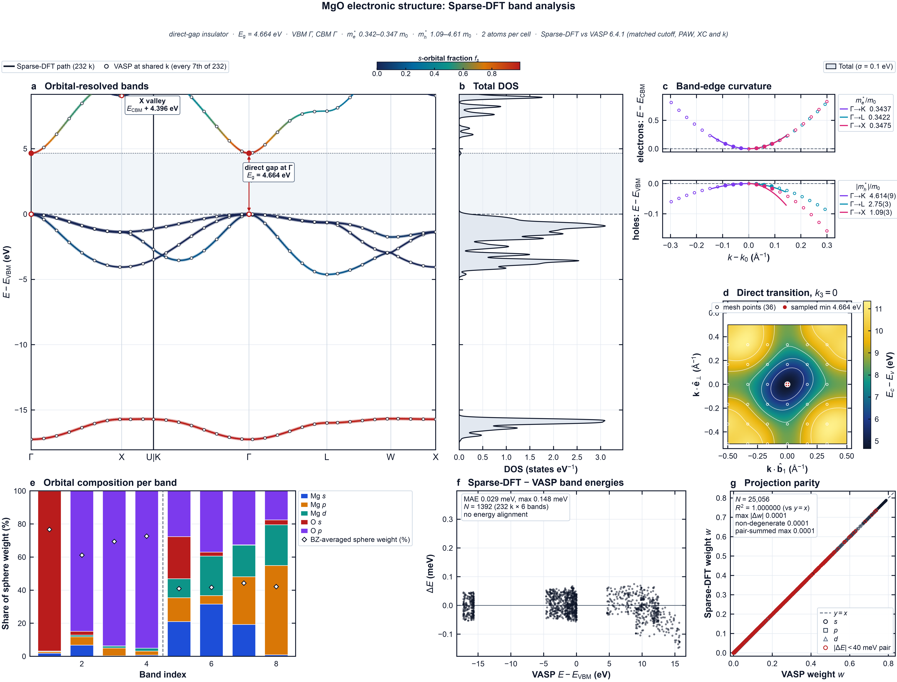 |
| *GaAs* | *MgO* |
| 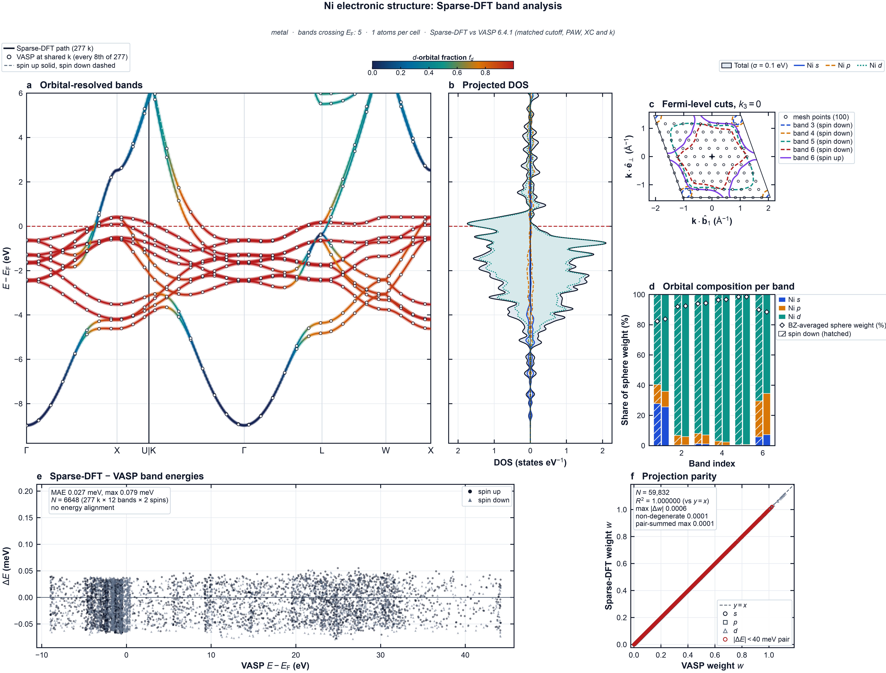 | 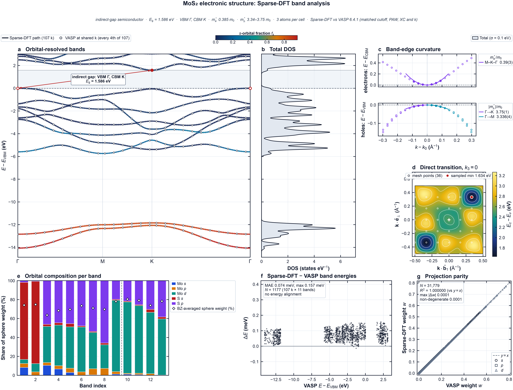 |
| *Ni* | *MoS$_2$* |

*Electronic-structure atlases drawn by `sparse-dft plot` from Sparse-DFT band and DOS results, with VASP 6.4.1 bands of the same anchor system as the reference. `assets/electronic/atlas.provenance.json` lists the SHA-256 of every input, the plotted values and the result of the layout check.*

## 11. Graphical interface

```bash
sparse-dft-gui
```

The GUI (needs the `gui` extra) builds its forms from the same argument parser as the command line, so every option above is available. Each job runs in its own worker process and can be cancelled. Typical use:

1. **Structure.** Load a POSCAR, CIF or XYZ file. The card shows the lattice, the atoms and the classification from `suggest`.

   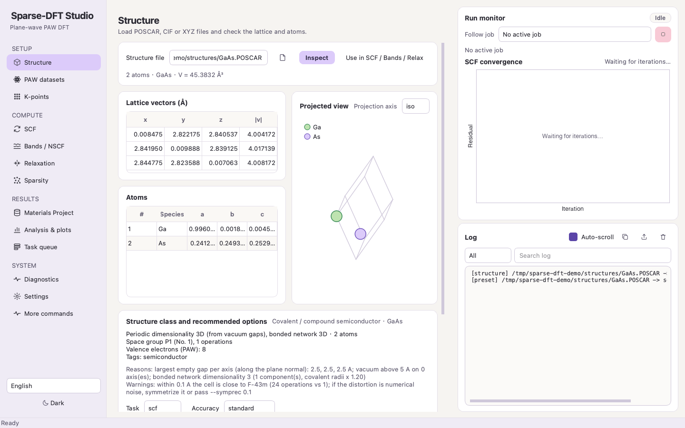

2. **SCF.** Apply the suggested settings, then adjust cutoff, k mesh, smearing and spin.

   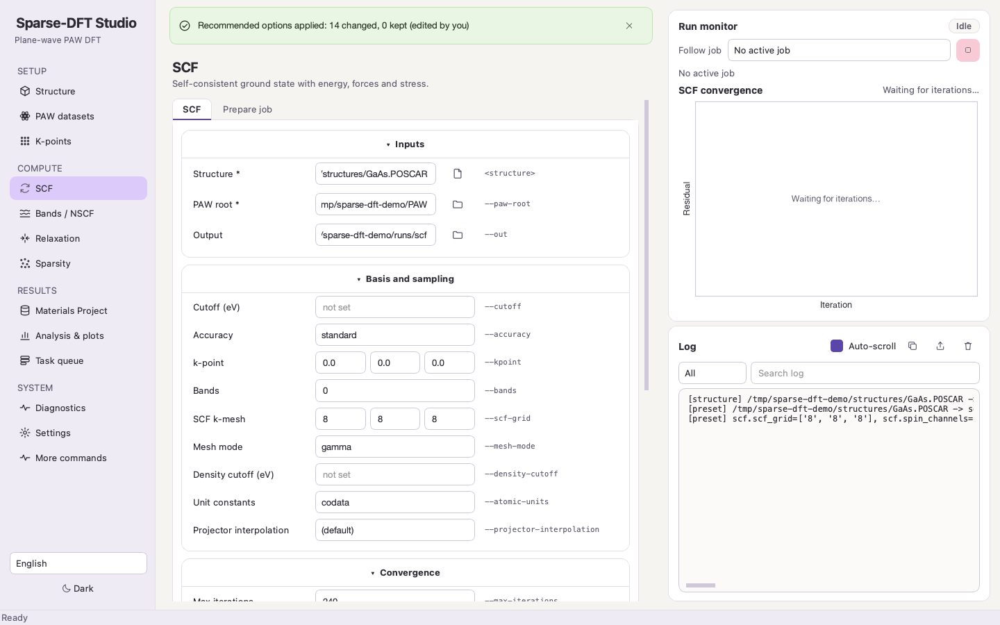

3. **Sparsity.** Choose `off`, `custom` or `auto` and a level. *Preview* runs the spectrum probe only, without an SCF, and lists for each level the S1 factor, padding, tail and the estimated mode ratio $(f/16)^{3/2}$. The page also shows the rule table and the measured sweep table of SPARSIFICATION §5.

   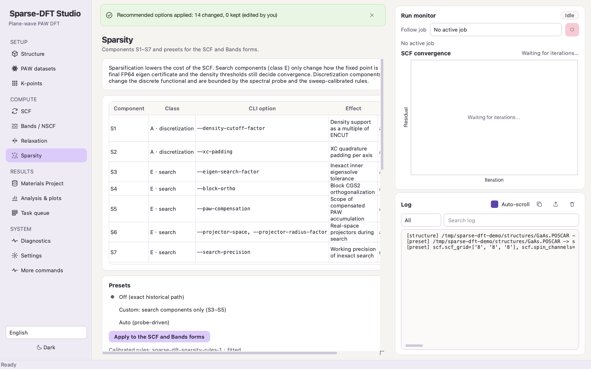

4. **Bands / NSCF.** Generate a path or a DOS mesh and run from the SCF checkpoint.

   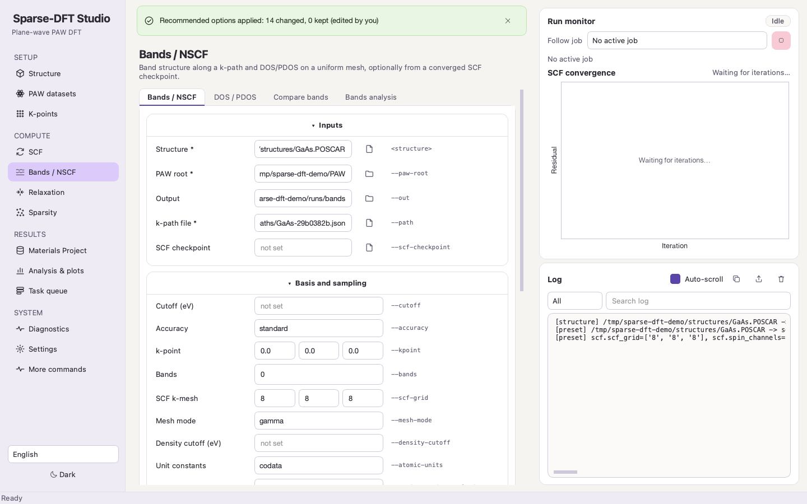

5. **Analysis & plots.** Preview and export figures; panels can be exported separately or combined.

   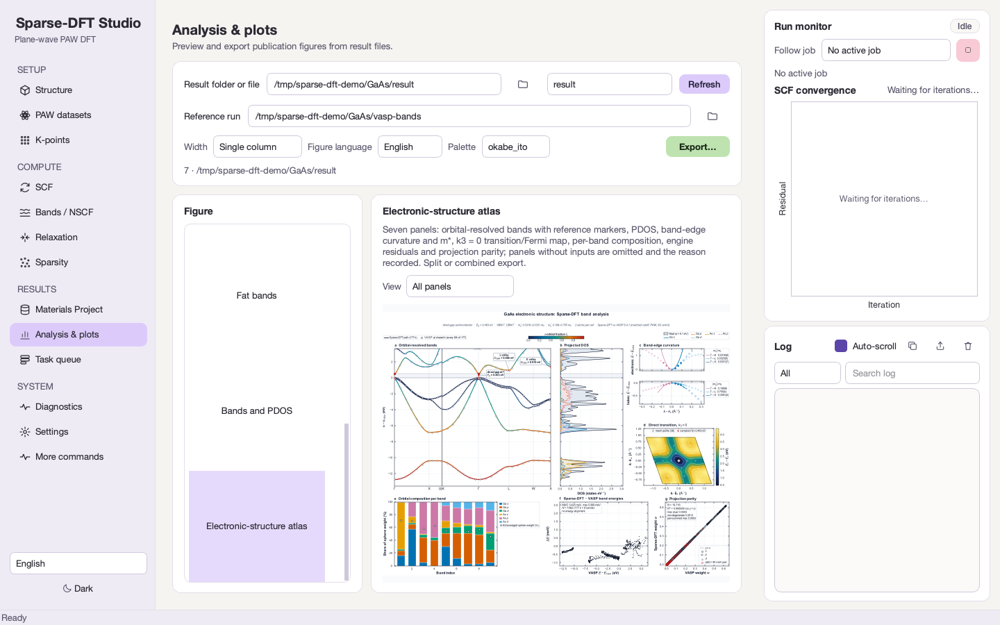

   The preview keeps the figure's aspect ratio at any window size. In the three screenshots of the atlas (1440×900, 1920×1080 and 1100×1300 px windows) the preview area and the figure both have width/height 1.316.

   | | |
   |---|---|
   | 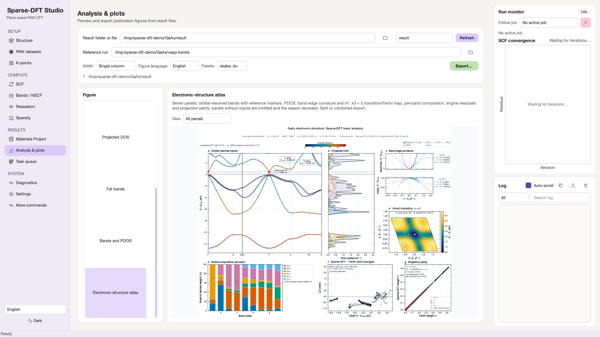 | 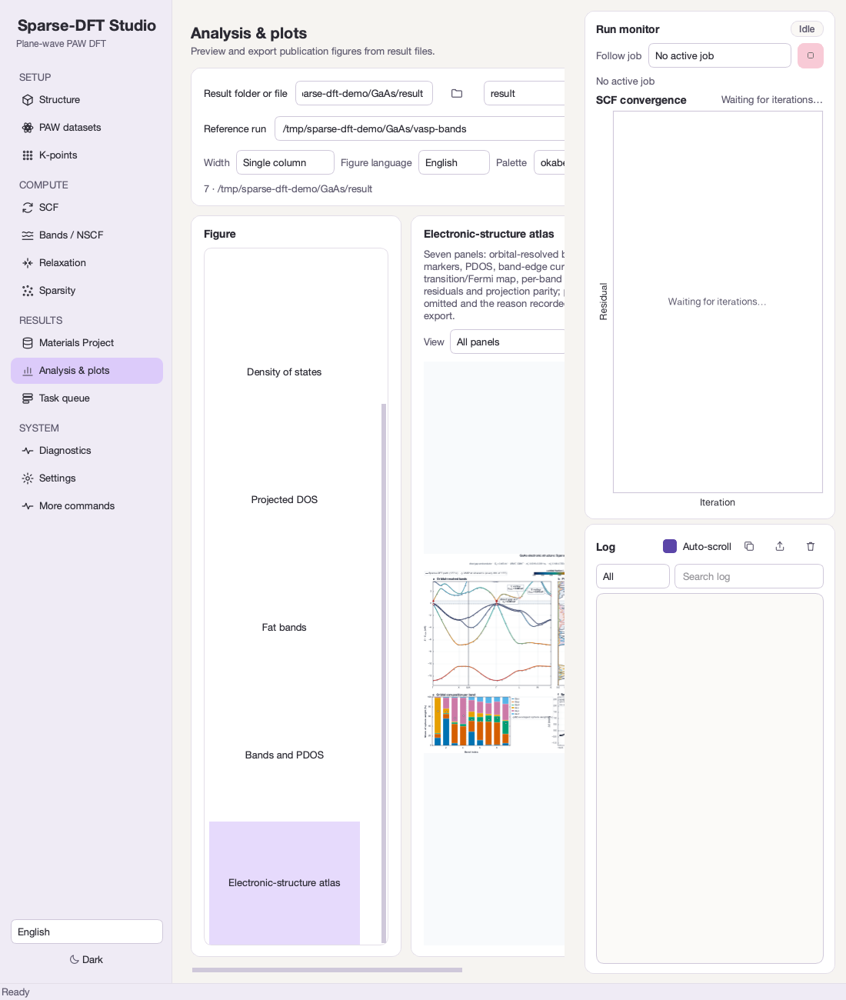 |
   | *1920×1080 window* | *1100×1300 window* |

6. **PAW.** The *paw-convert* tab converts your own licensed POTCAR set into a private archive and imports it (§3).

   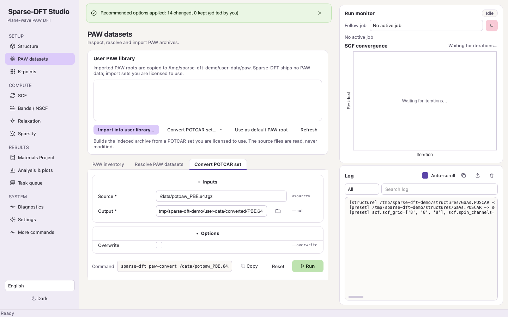

Interface languages: English, Simplified Chinese, Traditional Chinese and Japanese, in light and dark themes.

## 12. Python API

Every calculation is a Python function (`run_scf`, `run_bands`, `run_dos` in `sparse_dft.scf`; `ionic_relax`, `cell_relax` in `sparse_dft.relax`). A versioned dispatcher wraps them with uniform responses:

```python
from sparse_dft.api import dispatch

r = dispatch('job.run', {'structure': 'examples/Si.POSCAR', 'paw_root': '/path/to/archive',
                         'output': 'si_scf', 'scf_grid': [8, 8, 8]})
print(r['status'], r['data'].get('total_energy_ev'))
```

Each response has `api_version`, `request_id`, `status` (`PASS` or `FAILED`), `data`, `warnings`, `errors` and `provenance`. Methods: `structure.parse`, `structure.validate`, `paw.inventory`, `paw.resolve`, `paw.restore`, `paw.parse`, `kpoints.recommend`, `backend.info`, `bands.compare`, `bands.analyze`, `mp.fetch_structures`, `mp.fetch_bands`, `job.prepare`, `job.run`, `bands.run`, `dos.run`, `job.status`. `sparse_dft.api.main_jsonrpc()` reads one JSON request per line from standard input.

## 13. Environment variables

| variable | effect |
|---|---|
| `SDFT_SCF_EXE`, `SDFT_RELAX_STEP_EXE` | path of the native programs (otherwise bundled `bin/`, `build/` or `PATH`) |
| `SDFT_PAW_ARCHIVE` | PAW archive used by the test suite |
| `SDFT_PAW_ROOT` | extra PAW archive location listed by the GUI |
| `SDFT_USER_DATA_DIR` | per-user data directory; its `paw/` sub-directory is searched for archives |
| `SDFT_COMPUTE_BACKEND` | `cpu` (default), `mps` or `cuda` |
| `SDFT_MPI_LAUNCHER` | MPI launch template, must contain `{ranks}` |
| `SDFT_DETERMINISTIC` | `1` = same as `--deterministic` |
| `SDFT_PERSISTENT_PAW_CACHE` | `0` disables the on-disk cache of prepared PAW data |
| `SDFT_SPARSITY_PROBE_FACTORS` | comma list of probe factors in $[1, 24)$ |
| `OMP_NUM_THREADS` | OpenMP threads |

Other `SDFT_*` variables are set by sparsity profiles or are developer diagnostics; setting them by hand is not needed.

## 14. Troubleshooting

| symptom | cause and fix |
|---|---|
| `sdft_scf executable is not available` | build the native core or set `SDFT_SCF_EXE`; `sparse-dft doctor` lists the paths searched |
| `PAW archive … is missing ['manifest.json', …]` | the directory is not a converted archive; run `sparse-dft paw-convert` (§3) |
| `output directory is not empty` from `paw-convert` | choose a new directory or add `--overwrite` |
| SCF exits with code 3 | not converged: lower `--mixing`, raise `--max-iterations`, add smearing for metals, check the starting moments |
| `insufficient empty bands for smearing` with explicit `--bands` | raise `--bands`, or use 0 for automatic growth |
| `environment variable conflicts with the sparsity …` | unset the variable or drop the conflicting component flag |
| `a non-default sparsity metric needs an explicit tail budget` | add `--sparsity-tail-budget` |
| energies differ from VASP by a few meV/atom | add `--atomic-units vasp_legacy` ([ACCURACY.md §3](ACCURACY.md#3-codata-versus-vasp_legacy)) |
| MPI launcher not found | install an MPI implementation or set `SDFT_MPI_LAUNCHER` |

## References

1. H. J. Monkhorst, J. D. Pack, Special points for Brillouin-zone integrations, *Phys. Rev. B* **13**, 5188–5192 (1976). doi:[10.1103/PhysRevB.13.5188](https://doi.org/10.1103/PhysRevB.13.5188)
