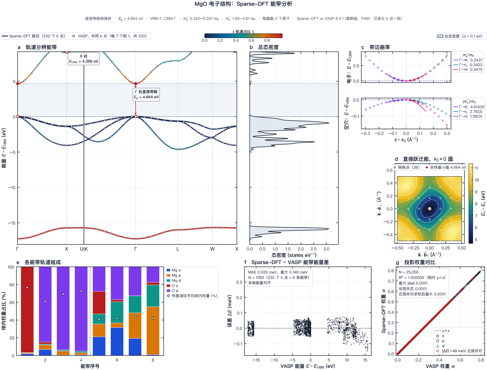
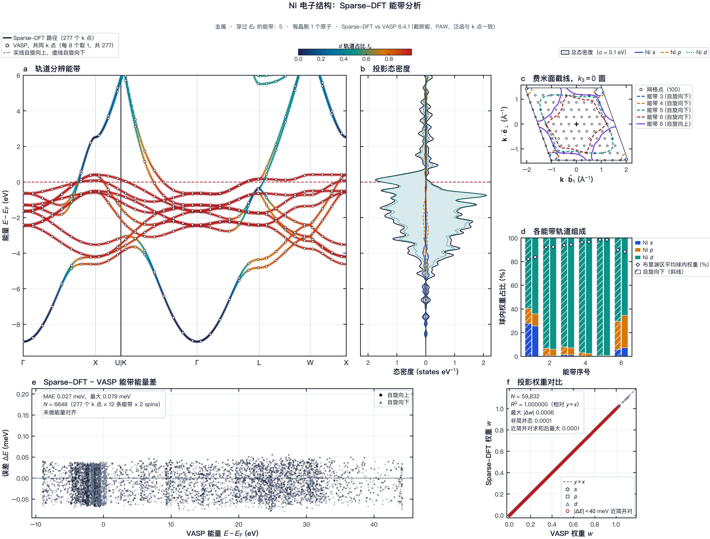
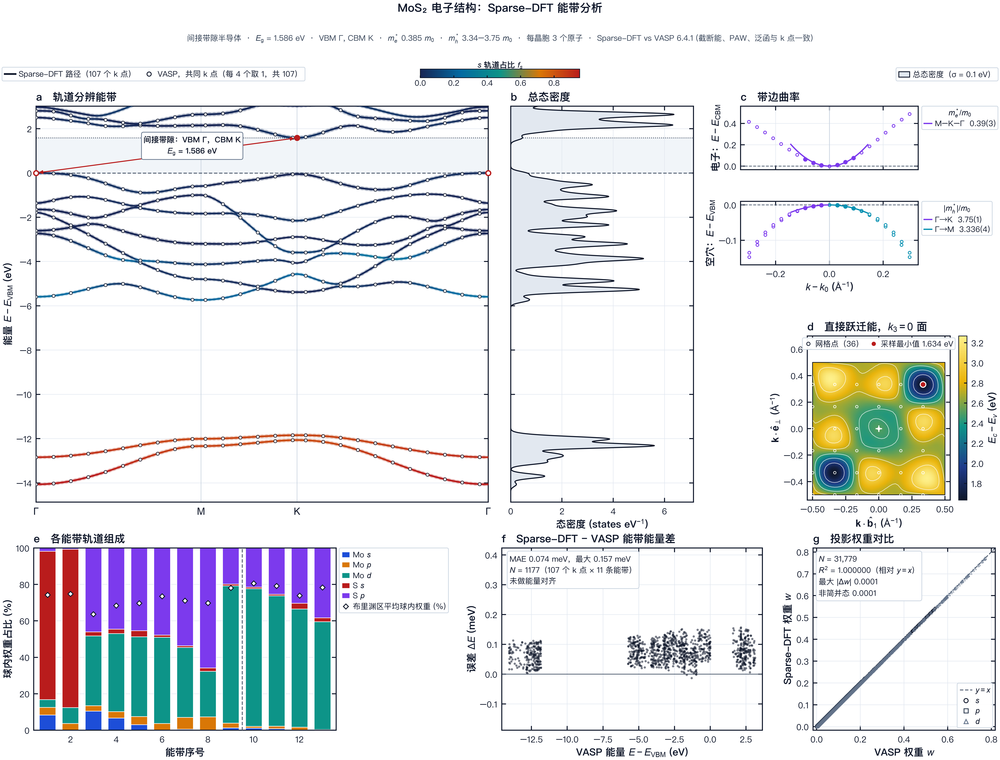

[English](USER_GUIDE.md) · **简体中文** · [README](../README.zh-CN.md) · [理论](THEORY.zh-CN.md) · [稀疏化](SPARSIFICATION.zh-CN.md) · [精度](ACCURACY.zh-CN.md) · [性能](PERFORMANCE.zh-CN.md)

# 用户指南

本指南带你从源代码检出一路做到能带、态密度（density of states，DOS）、弛豫和作图。命令以 macOS 和 Linux shell 给出；Windows 在 PowerShell 中使用相同命令，路径用 `\`。

## 1. 环境要求

- C++20 编译器、CMake 3.20 或更新版本以及 FFTW3（头文件与库）。在 macOS 上，`brew install cmake fftw` 可同时提供二者。
- Python 3.11 或更新版本，用于命令行、API 和图形界面。数值核心本身只需要标准库。
- 可选：OpenMP 运行时（macOS 上为 `libomp`）、MPI 实现（Open MPI、MPICH 或 MS-MPI）、用于 Metal 的 Xcode 命令行工具、CUDA 工具链。
- PAW 数据集：你自己有授权的 VASP POTCAR 集，或 PAW UPF v2 文件（§3）。Sparse-DFT 不附带任何数据集。

Eigen 3.4 头文件已随附在 `third_party/eigen3` 中，并以 `EIGEN_MPL2_ONLY` 编译。

## 2. 安装

### 2.1 一条命令

```bash
python3 scripts/install.py                    # 带 OpenMP 的 CPU 构建，虚拟环境在 .venv，含 plots 附加依赖
python3 scripts/install.py --backend metal    # macOS：Metal 后端
python3 scripts/install.py --backend cuda     # CUDA 后端（尚未在硬件上测试）
```

脚本在 `build-<backend>/` 中配置并构建原生程序，运行与数据无关的原生测试，安装到 `--prefix`（默认 `.install/`），创建虚拟环境（`--venv`，默认 `.venv/`），并安装带 `plots` 附加依赖的 Python 包。它会写出 `<prefix>/env.sh`；source 该文件即可把程序加入 `PATH` 并设置 `SDFT_SCF_EXE`：

```bash
source .install/env.sh
sparse-dft doctor
```

常用选项：`--jobs N`（并行编译，默认 2）、`--serial`（不用 OpenMP）、`--no-python`、`--no-plots`、`--cmake-arg=-DSDFT_ENABLE_MPI=ON`。`--index-url URL` 选择 Python 包索引（默认 `https://pypi.org/simple`）；访问 PyPI 较慢时可传入地区镜像，例如 `--index-url https://mirrors.aliyun.com/pypi/simple/`。

### 2.2 手动构建

```bash
cmake -S . -B build -DCMAKE_BUILD_TYPE=Release -DSDFT_ENABLE_OPENMP=ON
cmake --build build --parallel 8
ctest --test-dir build --output-on-failure
python3 -m venv .venv && . .venv/bin/activate
pip install ".[plots]"
```

CMake 选项：`SDFT_ENABLE_OPENMP`（默认 ON）、`SDFT_ENABLE_MPS`（Metal；默认 ON，仅在 macOS 上使用）、`SDFT_ENABLE_CUDA`（OFF）、`SDFT_ENABLE_MPI`（OFF）、`SDFT_USE_SYSTEM_EIGEN`（OFF）。从源代码树运行时，Python 包会自动找到 `build/sdft_scf`；否则请设置 `SDFT_SCF_EXE`。

### 2.3 可选的 Python 附加依赖

| 附加依赖 | 新增 | 用途 |
|---|---|---|
| `plots` | numpy、matplotlib | `sparse-dft plot`、`bands-analysis` 作图 |
| `symmetry` | spglib、seekpath | `make-band-path --auto`、`suggest` 中的对称性 |
| `bz` | spglib、seekpath、scipy | 布里渊区插图 |
| `gui` | PyQt6 及以上各项 | `sparse-dft-gui` |
| `all` | 全部 | — |

用 `pip install ".[gui]"` 等方式安装。PyQt6 以 GPL v3 或商业许可证分发；再分发图形界面打包版之前请先阅读 [NOTICE.md](../NOTICE.md)。

Python 测试（`python -m unittest discover tests`）需要一个已建索引的 PAW 归档（§3）。未设置 `SDFT_PAW_ARCHIVE` 时，读取 PAW 数据的测试会失败，并在消息中指出该变量。

## 3. PAW 数据集

Sparse-DFT 不附带任何 PAW 数据集。它从两种来源读取数据集，各来源的条款随文件保留（完整表格见 [LEGAL.zh-CN.md §5](LEGAL.zh-CN.md#5-paw-数据集与你的数据)）：

- **VASP PAW 数据集（POTCAR）。** 凭你自己的 VASP 许可证从 VASP Portal 下载，并转换一次（§3.1）。POTCAR 文件是 VASP Software GmbH 的专有数据。转换后的归档须私下保存：不要分享、上传或打包。请确认你的许可协议涵盖你的用途；Sparse-DFT 无法替你检查。本版本的全部精度结果都使用 PBE.54 集。
- **UPF v2 格式的 PAW 数据集**（`pseudo_type="PAW"`）。可自由下载或生成，例如用 pslibrary 加 Quantum ESPRESSO 原子程序 `ld1.x` 生成，或从发布 PAW UPF 文件的库下载（§3.2）。Quantum ESPRESSO 和 pslibrary 以 GNU GPL 第 2 版或（由你选择）任何更新版本分发；两个项目都没有为生成或下载的 UPF 文件另行规定许可证。各库自行规定条款和引用要求：请查看文件头和库的页面，并引用数据集作者。

### 3.1 把你的 POTCAR 集转换一次

```bash
sparse-dft paw-convert /path/to/potpaw_PBE.54   --out ~/paw/potpaw_PBE.54-json
sparse-dft paw-convert potpaw_PBE.54.tar.gz     --out ~/paw/potpaw_PBE.54-json
sparse-dft paw-convert potpaw_PBE.54.tar.xz     --out ~/paw/potpaw_PBE.54-json --overwrite
```

- **来源。** 一个 potpaw 目录，或该目录的 `.tar`、`.tar.gz`、`.tgz` 或 `.tar.xz` 归档。其中每个数据集一个子目录（`Si`、`Ga_d`、`Ni_pv`、…），内含 `POTCAR`，可选 `PSCTR`。
- **输出。** `--out` 必须是新目录或空目录；`--overwrite` 允许使用非空目录。命令写出 `manifest.json`、`index.json`、`potentials.jsonl.xz` 和 `auxiliary_files.json`。
- **内容。** POTCAR 和 PSCTR 文本连同其 SHA-256 逐字节保存。不做任何改写，每个数据集的变体（标准、`_pv`、`_sv`、`_h`、`_GW`、…）记录在索引中。
- **安全。** 归档内的不安全路径会被拒绝，链接从不被跟随。

命令输出一个 JSON 摘要，包含输出路径以及记录数和元素数。

**转换后的归档仍受 POTCAR 许可证约束。请私下保存，不要再分发。**

### 3.2 PAW UPF 文件

把单个 `.upf` 文件，或每个元素一个 PAW UPF 文件的目录，作为 `--paw-root` 传入；无需转换。Sparse-DFT 把 UPF 作为数据读取，不运行也不链接任何 Quantum ESPRESSO 代码。每个文件都经过严格解析：只接受 `pseudo_type="PAW"`、标量相对论、PBE 的 UPF 第 2 版。模守恒和超软文件会被拒绝，同一元素有两个候选文件的目录也会被拒绝。UPF 数据集尚未纳入精度对比（[ACCURACY.zh-CN.md](ACCURACY.zh-CN.md)）。

### 3.3 让 Sparse-DFT 找到数据

- **计算。** 向 `scf`、`bands`、`dos`、`relax` 和 `prepare` 传入 `--paw-root DIR`（转换后的归档、UPF 文件或 UPF 目录），`suggest` 可选传入。命令行不为此读取任何环境变量。
- **图形界面。** 在 *PAW datasets* 页面导入该目录。图形界面也会列出每用户数据目录和 `SDFT_PAW_ROOT` 中的归档。
- **测试。** 把 `SDFT_PAW_ARCHIVE=DIR` 设为转换后的 POTCAR 归档；Python 测试从该变量读取。

```bash
export SDFT_PAW_ARCHIVE=~/paw/potpaw_PBE.54-json
sparse-dft paw-inventory --root "$SDFT_PAW_ARCHIVE"
sparse-dft paw-resolve   --root "$SDFT_PAW_ARCHIVE" --elements Ga As --family standard
```

`paw-inventory` 按元素和变体列出数据集。`paw-resolve` 显示在某个选择系列下每个元素会用到哪个数据集。

## 4. 第一次计算

结构从 POSCAR、CIF 或 XYZ 文件读入；`examples/` 中有三种格式的硅。

```bash
export PAW=~/paw/potpaw_PBE.54-json
sparse-dft inspect examples/Si.POSCAR                    # 晶格、原子、警告
sparse-dft suggest examples/Si.POSCAR --paw-root $PAW    # 分类与推荐选项（JSON）
sparse-dft suggest examples/Si.POSCAR --paw-root $PAW --argv   # 以命令行形式给出同样内容
```

`suggest` 对结构分类（半导体、金属、磁性金属、表面板、分子、…），并针对 `--task scf|bands|dos|relax` 在 `--accuracy low|standard|high|production` 下给出截断能、k 网格、展宽、自旋和能带数的建议。它不运行任何计算。

运行 SCF：

```bash
OMP_NUM_THREADS=8 sparse-dft scf examples/Si.POSCAR --paw-root $PAW --out si_scf \
    --scf-grid 8 8 8 --sparsity auto
```

命令输出一个 JSON 摘要；SCF 收敛时退出码为 0，未收敛时为 3。`si_scf/` 包含：

| 文件 | 内容 |
|---|---|
| `scf_result.json` | 能量（`total_energy_ev` 及其各项）、力、应力、本征值、Fermi 能级、磁矩、来源信息、`sparsity_ledger` |
| `scf.json` | 摘要所依据的原生结果 |
| `scf.json.iterations.jsonl` | 每次 SCF 迭代一行：残差、能量、本征求解器数据 |
| `scf.json.performance.json` | 计时器与调用次数 |
| `density_probe.json` | 谱探针（使用 `--sparsity auto` 时） |

`scf`、`bands`、`dos` 和 `relax` 共用的主要选项：

| 选项 | 含义 | 默认值 |
|---|---|---|
| `--cutoff EV` | 平面波截断能 | `standard` 下为 $\max(300, 1.30\max E_{\max})$ eV |
| `--accuracy` | `low`、`standard`、`high`、`production`（截断能余量与建议） | `standard` |
| `--scf-grid NX NY NZ` | 完整均匀 k 网格，不做对称约化 | 仅 Γ 点（`--kpoint 0 0 0`） |
| `--mesh-mode` | `gamma` 或 `monkhorst-pack` [1] | `gamma` |
| `--smearing-ev KT` | Fermi–Dirac $k_BT$；0 = 零温填充 | 0 |
| `--bands N` | 求解的能带数；0 = 自动 | 0 |
| `--spin-channels 1` 或 `2`，`--initial-moments M…` | 共线自旋与初始磁矩（每原子 $\mu_B$） | 1 |
| `--hubbard EL:L:UEFF` | Dudarev DFT+U，如 `Fe:2:4`；可重复 | 无 |
| `--mixing A` | 密度混合系数 | 0.2 |
| `--density-tolerance`、`--onecenter-density-tolerance` | SCF 阈值 | $10^{-6}$、$10^{-6}$ |
| `--max-iterations` | SCF 迭代上限 | 240 |
| `--density-cutoff EV` | 绝对密度截断能 | $16E_\mathrm{cut}$ |
| `--atomic-units` | `codata` 或 `vasp_legacy`（与 VASP 比较绝对能量时用后者） | `codata` |
| `--projector-interpolation` | 倒空间投影子的 `cubic` 或 `spline` 插值 | `cubic` |
| `--scf-checkpoint FILE` | 复用已收敛的 `scf.json` | — |

绝对总能以 `total_energy_valid: false` 报告。Sparse-DFT 已在匹配条件下与 VASP 对比（[ACCURACY.zh-CN.md](ACCURACY.zh-CN.md)），但未与实验对照验证。

## 5. 能带

能带路径是一个由分数坐标 k 点组成的 JSON 文件。由结构生成标准带标签路径（需要 `symmetry` 附加依赖）：

```bash
sparse-dft make-band-path --auto examples/Si.POSCAR --out si_path.json --spacing 0.025
sparse-dft bands examples/Si.POSCAR --paw-root $PAW --path si_path.json --out si_bands \
    --scf-grid 8 8 8 --scf-checkpoint si_scf/scf.json
```

`--auto` 使用 spglib 和 SeeK-path，报告空间群和所用的对称容差（未给 `--symprec` 时依次尝试 $10^{-5}$、$10^{-3}$、$10^{-2}$ Å），并按 `--spacing` Å$^{-1}$（含 $2\pi$）对路径采样。`--periodic-axes auto` 去掉表面板、线和分子沿真空轴的路径段。若输入是超胞，`--export-primitive POSCAR` 会写出标准原胞；能带计算请用该原胞。不加 `--auto` 时，`make-band-path VERTICES.json --points-per-segment 81` 对你自己给出的顶点插值。

`--scf-checkpoint` 复用已收敛的 SCF；否则 `bands` 先在 `--kpoint`/`--scf-grid` 上收敛一次 SCF。SCF 设置（截断能、密度截断能、自旋、单位、投影子插值）必须与检查点一致。结果 `si_bands/bands.json` 含本征值、标签、SCF 的 Fermi 能级和 lm 分辨的投影（理论 §13）。SCF 未收敛时命令以 3 退出。

比较两个能带来源，例如与 VASP 的 `vasprun.xml` 或 `EIGENVAL` 比较：

```bash
sparse-dft bands-compare REFERENCE CANDIDATE --align none --max-energy-ev 10 --out compare.json
```

`--align vbm|fermi|none` 设定共同的能量零点。两个计算共享 PAW 能量零点时用 `none`，精度报告中即如此。

## 6. 态密度

```bash
sparse-dft dos examples/Si.POSCAR --paw-root $PAW --out si_dos --scf-checkpoint si_scf/scf.json \
    --scf-grid 8 8 8 --dos-grid 16 16 16 --dos-sigma 0.05 --dos-step 0.005
```

`dos` 在不做对称约化的完整 `--dos-grid` 网格上求解，并用宽度为 `--dos-sigma` eV（默认 0.05）的高斯函数展宽。`--dos-step` 不得超过 $\sigma/3$。`--dos-emin`/`--dos-emax` 以绝对 eV 设定窗口；默认从最低能带以下 1 eV 到最高求解能带起始能量加 $3\sigma$。提高 `--bands` 可把 DOS 延伸到 $E_F$ 以上更高处。`si_dos/dos.json` 含总 DOS、自旋分辨 DOS 和 lm 分辨投影 DOS、积分电子数以及 `complete_below_ev`。请同时收敛 `--dos-grid` 和 `--dos-sigma`。

## 7. 弛豫

```bash
sparse-dft relax POSCAR --paw-root $PAW --out relax_ionic --scf-grid 6 6 6 --max-steps 20
sparse-dft relax POSCAR --paw-root $PAW --out relax_cell  --scf-grid 6 6 6 --cell
```

默认在固定晶胞下弛豫原子位置，直到最大力低于 `--force-tolerance`（0.02 eV/Å）。`--cell` 在固定分数坐标下弛豫晶胞，直到每个应力分量都低于 `--stress-tolerance`（默认 0.05 GPa，以 eV/Å$^3$ 给出）。步长上限为 `--max-displacement`（0.15 Å）或 `--max-strain`（0.02）。每个被接受的步都写检查点；优化器见理论 §11。固定截断能下的应力不含基组（Pulay）项，因此晶胞弛豫之前请先收敛截断能。

## 8. 稀疏化

除非你主动要求，稀疏化是关闭的。[SPARSIFICATION.zh-CN.md](SPARSIFICATION.zh-CN.md) 解释了每个组件及规则背后的证据。

```bash
sparse-dft scf POSCAR --paw-root $PAW --sparsity auto                                   # balanced 级别
sparse-dft scf POSCAR --paw-root $PAW --sparsity auto --sparsity-level conservative     # 预算 × 0.25
sparse-dft scf POSCAR --paw-root $PAW --sparsity auto --sparsity-tail-budget 1e-7       # 显式预算
sparse-dft scf POSCAR --paw-root $PAW --sparsity auto --sparsity-min-factor 8           # 永不低于 f = 8
sparse-dft scf POSCAR --paw-root $PAW --sparsity custom --density-cutoff-factor 8 --xc-padding 2
```

| 选项 | 含义 |
|---|---|
| `--sparsity off` | 精确离散化：$f = 16$，XC 填充 2（默认） |
| `--sparsity auto` | 由探针驱动选择每个组件；显式组件参数优先 |
| `--sparsity custom` | 只使用你给出的组件 |
| `--sparsity-level` | `conservative`、`balanced`、`aggressive`（S1 预算 × 0.25、1、1.7） |
| `--sparsity-tail-budget T` | $(0, 10^{-3}]$ 内的绝对 S1 预算，取代级别 |
| `--sparsity-candidates F…` | 要尝试的 S1 因子，每个在 $[4, 24)$ 内 |
| `--sparsity-min-factor`、`--sparsity-max-factor` | 裁剪 S1 因子；最大值同时限制回退值 |
| `--sparsity-metric` | `weighted_compensation_l2`（默认）或 `shape_hartree`（需要预算） |
| `--sparsity-rules FILE` | 替代的规则文件 |
| `--density-cutoff-factor F` | S1，$F\in[4, 24]$ |
| `--xc-padding P` | S2，$P\in\{1,2,3,4\}$ |
| `--eigen-search-factor S` | S3，$S\in(0, 0.1]$ |
| `--block-ortho 0/1` | S4 |
| `--paw-compensation full/blocks/off` | S5 |
| `--projector-space`、`--projector-radius-factor` | S6 |
| `--search-precision fp64` | S7（本构建拒绝 `fp32`） |

auto 相关选项需要 `--sparsity auto`。弛豫只在初始几何上解析一次 auto。所作选择、应用的规则、尝试过的尾部和本次计算的算符计数都写入 `scf_result.json` 中的 `sparsity_ledger`。若你设置了某个组件所控制的环境变量（例如 `SDFT_FFT_OVERSAMPLING`），且其值与配置不一致，计算会报错停止，而不会忽略任何一方。

**求解器控制。** 这些选项只改变本征求解器的工作方式；FP64 证书不变：`--davidson-subspace-factor`（4–16，默认 8）、`--search-operator-floor`（默认 $10^{-6}$）、`--ritz-solver auto|qr|divide_conquer|subset`、`--incremental-ritz 0/1`、`--warm-guard-vectors N`、`--fast-density-grid 0/1`、`--scf-acceptance-margin`（0–1，默认 1）。

## 9. 并行计算

- **OpenMP。** 设置 `OMP_NUM_THREADS`。k 点按组分配，每组有内部线程预算。
- **MPI。** 用 `-DSDFT_ENABLE_MPI=ON` 构建，并以 `--mpi-ranks N` 运行。`--kgroups` 和 `--bandgroups` 把进程分配到 k 点和 Davidson 能带块上；`--threads-per-rank` 设定每个进程的 OpenMP 线程数。启动器来自 `SDFT_MPI_LAUNCHER`（默认 `mpiexec -n {ranks}`，必须包含 `{ranks}`）。不同进程布局的结果逐位相同。在单节点上 MPI 不比 OpenMP 快（[PERFORMANCE.zh-CN.md](PERFORMANCE.zh-CN.md#3-mpi)）。
- **Metal 与 CUDA。** 在含该后端的构建中用 `SDFT_COMPUTE_BACKEND=mps` 或 `cuda` 选择；`sparse-dft backend-info` 显示可用的后端。认证总是在 CPU 上以 FP64 运行。
- **可复现性。** `--deterministic` 选用固定的求和顺序和基线求解器设置；它更慢（[PERFORMANCE.zh-CN.md](PERFORMANCE.zh-CN.md#1-openmp)）。

## 10. 作图

```bash
sparse-dft plot list                                   # 所有图种及其所需输入
sparse-dft plot auto si_scf si_bands si_dos --out figures/
sparse-dft plot bands si_bands --gap-arrow --bz-inset --structure examples/Si.POSCAR
sparse-dft plot fatbands si_bands --group element+l --mode width
sparse-dft plot pdos si_dos --group element+l --stacked
sparse-dft plot band_suite si_bands --reference vasprun.xml --dos-reference vasp_scf/vasprun.xml
```

`plot auto` 绘制来源数据支持的所有图，其余跳过。每张图默认输出 PDF 和 PNG（`--formats pdf,svg,png,tiff,eps`），采用期刊版宽（`--width single|onehalf|double` 或 mm），支持 `--lang en|zh_CN|zh_TW|ja`，并使用色盲友好的调色板。每张图旁的 `.provenance.json` 记录输入文件及其 SHA-256 和绘制的每个数值。`bands-analysis BANDS [--doscar] [--procar] [--structure]` 把带来源追踪的分析报告及其图写到 `--out`（默认 `band_analysis/`）。

| | |
|---|---|
|  |  |
| *GaAs* | *MgO* |
|  |  |
| *Ni* | *MoS$_2$* |

*由 `sparse-dft plot` 根据 Sparse-DFT 能带与 DOS 结果绘制的电子结构图集，参考数据为同一锚定体系的 VASP 6.4.1 能带。`assets/electronic/atlas.provenance.json` 列出每个输入文件的 SHA-256、绘图数值和版面检查结果。*

## 11. 图形界面

```bash
sparse-dft-gui
```

图形界面（需要 `gui` 附加依赖）用与命令行相同的参数解析器生成表单，因此上述每个选项都可用。每个任务在独立的工作进程中运行，可以取消。典型用法：

1. **结构。** 载入 POSCAR、CIF 或 XYZ 文件。卡片显示晶格、原子和 `suggest` 给出的分类。

   

2. **SCF。** 应用建议设置，再调整截断能、k 网格、展宽和自旋。

   

3. **稀疏化。** 选择 `off`、`custom` 或 `auto` 以及级别。*Preview* 只运行谱探针，不做 SCF，并为每个级别列出 S1 因子、填充、尾部和估计的模式数之比 $(f/16)^{3/2}$。该页面还显示规则表和稀疏化 §5 的实测扫描表。

   

4. **Bands / NSCF。** 生成路径或 DOS 网格，并从 SCF 检查点运行。

   

5. **Analysis & plots。** 预览并导出图；分图可单独导出，也可合并导出。

   

   预览在任何窗口尺寸下都保持图的宽高比。三张图集截图的窗口分别为 1440×900、1920×1080 和 1100×1300 px，预览区与图的宽高比都是 1.316。

   | | |
   |---|---|
   |  |  |
   | *1920×1080 窗口* | *1100×1300 窗口* |

6. **PAW。** *paw-convert* 选项卡把你有授权的 POTCAR 集转换成私用归档并导入（§3）。

   

界面语言：英语、简体中文、繁体中文和日语，提供浅色和深色主题。

## 12. Python API

每种计算都是一个 Python 函数（`sparse_dft.scf` 中的 `run_scf`、`run_bands`、`run_dos`；`sparse_dft.relax` 中的 `ionic_relax`、`cell_relax`）。一个带版本的分发器以统一的响应格式封装它们：

```python
from sparse_dft.api import dispatch

r = dispatch('job.run', {'structure': 'examples/Si.POSCAR', 'paw_root': '/path/to/archive',
                         'output': 'si_scf', 'scf_grid': [8, 8, 8]})
print(r['status'], r['data'].get('total_energy_ev'))
```

每个响应含 `api_version`、`request_id`、`status`（`PASS` 或 `FAILED`）、`data`、`warnings`、`errors` 和 `provenance`。方法：`structure.parse`、`structure.validate`、`paw.inventory`、`paw.resolve`、`paw.restore`、`paw.parse`、`kpoints.recommend`、`backend.info`、`bands.compare`、`bands.analyze`、`mp.fetch_structures`、`mp.fetch_bands`、`job.prepare`、`job.run`、`bands.run`、`dos.run`、`job.status`。`sparse_dft.api.main_jsonrpc()` 从标准输入每行读取一个 JSON 请求。

## 13. 环境变量

| 变量 | 作用 |
|---|---|
| `SDFT_SCF_EXE`、`SDFT_RELAX_STEP_EXE` | 原生程序的路径（否则依次查找随附的 `bin/`、`build/` 或 `PATH`） |
| `SDFT_PAW_ARCHIVE` | 测试套件使用的 PAW 归档 |
| `SDFT_PAW_ROOT` | 图形界面额外列出的 PAW 归档位置 |
| `SDFT_USER_DATA_DIR` | 每用户数据目录；在其 `paw/` 子目录中查找归档 |
| `SDFT_COMPUTE_BACKEND` | `cpu`（默认）、`mps` 或 `cuda` |
| `SDFT_MPI_LAUNCHER` | MPI 启动模板，必须包含 `{ranks}` |
| `SDFT_DETERMINISTIC` | `1` 等同于 `--deterministic` |
| `SDFT_PERSISTENT_PAW_CACHE` | `0` 关闭已准备 PAW 数据的磁盘缓存 |
| `SDFT_SPARSITY_PROBE_FACTORS` | $[1, 24)$ 内探针因子的逗号分隔列表 |
| `OMP_NUM_THREADS` | OpenMP 线程数 |

其他 `SDFT_*` 变量由稀疏化配置设置，或为开发者诊断用；无需手动设置。

## 14. 故障排查

| 现象 | 原因与解决 |
|---|---|
| `sdft_scf executable is not available` | 构建原生核心或设置 `SDFT_SCF_EXE`；`sparse-dft doctor` 列出搜索过的路径 |
| `PAW archive … is missing ['manifest.json', …]` | 该目录不是转换后的归档；运行 `sparse-dft paw-convert`（§3） |
| `paw-convert` 报 `output directory is not empty` | 换一个新目录，或加 `--overwrite` |
| SCF 以退出码 3 结束 | 未收敛：降低 `--mixing`，提高 `--max-iterations`，对金属加展宽，检查初始磁矩 |
| 显式 `--bands` 时出现 `insufficient empty bands for smearing` | 提高 `--bands`，或用 0 让能带数自动增长 |
| `environment variable conflicts with the sparsity …` | 取消该变量，或去掉冲突的组件参数 |
| `a non-default sparsity metric needs an explicit tail budget` | 加上 `--sparsity-tail-budget` |
| 能量与 VASP 相差几 meV/atom | 加上 `--atomic-units vasp_legacy`（[ACCURACY.zh-CN.md §3](ACCURACY.zh-CN.md#3-codata-与-vasp_legacy)） |
| 找不到 MPI 启动器 | 安装 MPI 实现，或设置 `SDFT_MPI_LAUNCHER` |

## 参考文献

1. H. J. Monkhorst, J. D. Pack, Special points for Brillouin-zone integrations, *Phys. Rev. B* **13**, 5188–5192 (1976). doi:[10.1103/PhysRevB.13.5188](https://doi.org/10.1103/PhysRevB.13.5188)
